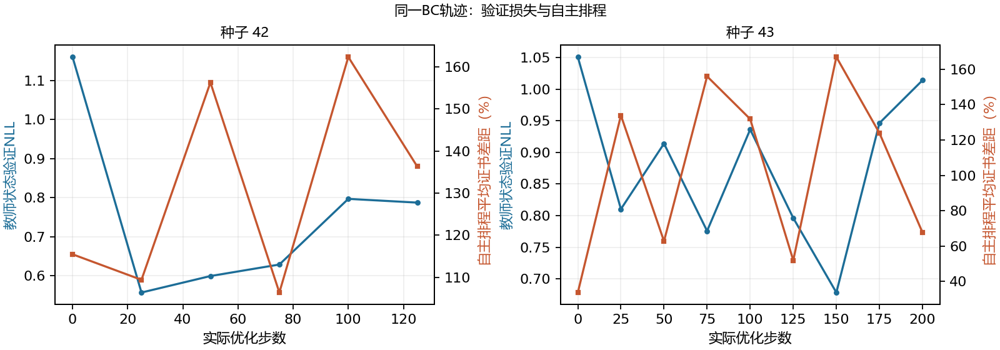

# 工作三：BC退化诊断与唯一选模候选确认

日期：2026年11月17日。**当前BC没有学会稳定的自主排程；教师NLL下降可以伴随训练实例退化。本轮没有得到跨种子一致的改进，不替换原BC默认训练或选模规则。** 已接通的QUERY、教师记录、集合概率和PPO能力继续保留，不据此宣称BC普遍无效。

## 范围、版本和身份

起点`50ccf1f20b91f80f6f0bd5d760d81a5ec79dfd44`，独立分支`work3-bc-diagnosis-20261117`。实验与诊断源码最终固定到`b8fce8cae9a22158d192eb0b5dfc3619b422150e`；报告提交在其后。未合并main、未改写上一轮报告。

使用原`D:\Conda\envs\rag_env\python.exe`，Windows、Python3.11.15、Torch2.12.0+cu132、PyG2.7.0、Lightning2.6.5、NumPy2.4.6、RTX4060 Laptop 8GB。模型推理与BC均CUDA FP32，AMP上下文保留但不启用低精度；没有升级依赖。固定seed42/43、确定性贪心解码，主进程1线程。不是重新运行PPO，也不需要借本轮声称新的双worker/GPU长训验收。

统一纯`C_exit`与`actual_cleared_v0`、两架飞机、原公开baseline/资格/容量/事件规则。只有合法完整终局且证书适用、最优值大于0时定义`gap=(C_exit-C*)/C*`；失败/截断为NA，`C_task`单列。新旧模型严格加载全部QUERY参数和输入语义，未使用旧warm start或`strict=False`。模型实验资格标记没有升级。

本轮目录：`runs/work3_bc_diagnosis/bc_diagnosis_20261117_01/`。只引用上一轮数据、权重及其SHA，没有重新生成52例或重新导出全部教师记录。原12测试母例未用于调参或复评；只读取旧数据登记中的母来源ID以排除新留出重合。

## 训练实例是否学会自主排程

阶段A覆盖原32训练母例与8验证母例，分别评估两种子的W0、原NLL最佳和末尾，共240行，其中32项旧验证结果在核对权重、公开文件、目标与预算后复用，208项新执行。全部合法完成，可行性和费用账本通过，0截断。下面为平均证书差距，越低越好；训练/验证分母分别32/8。

| seed | W0：训练 / 验证 | NLL最佳：训练 / 验证 | 末尾：训练 / 验证 |
|---|---:|---:|---:|
| 42 | 124.57% / 115.49% | 107.14% / 109.43%（25步） | 128.15% / 136.32%（125步） |
| 43 | 37.85% / 33.75% | 150.90% / 166.96%（150步） | 83.92% / 67.67%（200步） |

BC不是所有族都失败。seed42最佳相对W0，训练21例改善、11例退化，验证5例改善、3例退化；顺序/后移总体改善。结构族训练11/15退化，最差3例占正退化约59%，去掉这3例后的平均变化接近持平，因此尾部影响明显。seed43则结构训练15/15、验证4/4全部退化；去掉最差少数例后仍明显退化，不能归因于少数长实例。后移族没有退化。逐例变化、中位数、族均值和完整分母保存在`stage_a_summary.json`，主统计没有排除困难实例。

单例记忆诊断只把原训练记录缩减到`train_024`，保留seed43 W0、原set损失、需求采样、学习率、batch4、200步上限、25步验证和patience4、原8例验证。实际125步早停，25步NLL最佳：

| 模型 | 该训练例教师NLL | 自主C_exit | 证书C* |
|---|---:|---:|---:|
| W0 | 1.67980 | 168.84675 | 108 |
| 单例最佳25步 | 0.67465 | 515.67857 | 108 |
| 单例末尾125步 | 0.55964 | 414.43766 | 108 |

因此，多实例共享不是退化的唯一解释；在这套有限设置下单例也没有学好自主排程。但它仍按原验证集早停，并未训练到教师动作完全拟合，不能由此证明模型容量不足或任何更新数下都不可学。

## 同一条轨迹上的NLL与闭环结果

原工件只有W0/最佳/末尾。新增可选检查点保存后，重新运行两条原设置BC轨迹。两种子的初始NLL、各次验证NLL、125/200更新数、25/150最佳时刻、最佳及末尾全部模型参数都精确复现原结果；没有把新保存的中间点伪称旧历史。共保存6/9个点，评估发生在训练结束后的独立进程，没有训练内评估扰动优化器或随机状态。

曲线的训练侧按清单顺序事先选结构4、顺序2、后移2，验证侧使用全部8例；不是按模型表现挑面板。原NLL保持每决定均分有效监督层、按实例长度控制的定义。另列choice-only NLL与计数、各层原权重贡献；需求重采样下的训练batch损失与验证NLL不当作同分布指标。集合概率与条件贪心均在同一教师工序及合法前缀下计算，不冒充自由执行准确率。

| seed | 原验证NLL选模 | 闭环选模：合法完成数优先、再平均gap、再早时刻 | 闭环所选模型的训练32 / 验证8 gap |
|---|---|---|---:|
| 42 | 25步，NLL0.55746，验证gap109.43% | 75步，NLL0.62906，验证gap106.41% | 114.60% / 106.41% |
| 43 | 150步，NLL0.67823，验证gap166.96% | W0，NLL1.05113，验证gap33.75% | 37.85% / 33.75% |

两种子NLL最低和验证工期最低都不是同一时刻，但差异性质不同：42只是验证上的小改善，43整条已跑BC轨迹都未超过W0。没有排除W0强行制造预训练收益。



原损失确有被改善的部分。seed43 W0→NLL最佳，验证原NLL中的team_set贡献0.57511→0.17120，align0.05058→0.00011，advance0.04862→0.00225；task约0.19771→0.19696，branch却0.17912→0.30770。总NLL下降不能代表所有层和关键工序都学好。

不同人数存在取舍：seed42验证有选择的单人团队贪心命中56.52%→27.72%，双人0→65%；seed43在困难结构例上也呈现多人改善、单人退化。集合概率与逐人贪心并不总同步：seed43验证单人150→175步，平均目标集合概率0.29594→0.32077，但贪心命中29.35%→25.54%。15点中有7个这种反向的相邻分组变化，它们不是7个独立实验。均值概率没有被换算成伪造的平均NLL。固定曲线面板没有五人记录，不对五人学习曲线作结论。

## 具体在哪里脱节

从已观察过的训练/验证侧选取两个结构退化例、一个顺序退化例；后移无退化，解释性回退选一个改善例并注明。共同教师prefix使用原生见证逐步执行，同一快照交给W0/最佳/末尾评分；自主轨迹继续调用原评估器和完整Actor。记录旁路不改变动作，8条自主轨迹的终局、决策数、约束、费用等科学字段与阶段A精确一致。上游工序/分支不同时，下层命中标不可比较；同团队不同人员顺序按集合处理，“最早不同”没有直接称为错误。

- `train_024`、seed43、第一步`0_2`：BC选工人5，查询窗口[0,54)；同align合法工人11为[0,9)。完整logit为1.89597与-2.89295，查询项为1.37997与0.77169，其他评分合计差4.18063更大。后续`0_19`仍预约给工人5到[54,57)，当时工人11可在[0,0.5)执行。准确条件确实进入了logits，但没有保证联合评分偏好较有利的选择。
- 同一初始教师工序与留站条件下，`train_024`已证单人工人11的概率W0约0.99565，BC最佳约0.004801。这发生在共同教师状态，不能只用“自由轨迹偏离教师分布”解释。该例单人目标NLL2.147→2.710，而双人10.585→0.252；单人贪心命中约65.2%→26.1%，双人0→85.7%。
- `train_025`第一步三人团队工时3.3，另一个合法团队为2.35714；在实际前缀[5,19]下也存在工时2.75的合法补全。所选末人17与另一候选11的完整logit差约3.36063，查询项只差0.00743。没有用不包含已选成员的团队冒充该前缀补全。
- 顺序例`val_002`：BC先安排B占[0,7)，推迟A到[7,8)、D到[8,15)；W0先A[0,1)，可以并行执行D[1,8)。完整工期67与48。后移改善例`train_015`则从49到证书值30，不能把所有层描述成全面退化。

两次单动作条件对照重放同一完整前缀，核原动作、候选顺序、掩码、14维条件及人员prefix一致，只替换完整团队、保留工序/分支/align，再用同一策略`reset=False`续排：`train_024`为582→528，`train_025`为556.3→555.35714，均合法完成、账本通过。它们只能说明这些干预在相同后续策略下有帮助，不能证明全局最优、把其他合法动作制作成最优负标签，或解释全部差额。

直接证据支持“多人模仿收益与关键单人/顺序选择退化并存，原NLL与C_exit不一致”。需求重采样、监督分摊、动作层协同及状态偏移的相对因果作用尚未被独立识别；查询时间系数的变化也不能单独解释完整评分。因此没有猜测性修改采样或损失。

## 唯一候选与新留出

只比较同轨迹的两种模型选择规则，没有额外训练预算。A—C后冻结8个新母例的规格、种子及权重，结构/顺序/后移为4/2/2；先独立证书和完整原生见证核验，来源组与原52组不重合，再一次性打开结果，之后没有调参或换例。它们仍是受限构造母参数例，不是8个工业场景或未知拓扑泛化。

| seed | W0平均gap | 原NLL选模平均gap | 闭环选模平均gap |
|---|---:|---:|---:|
| 42 | 129.29% | 105.23% | 130.44%（75步） |
| 43 | 38.18% | 184.50% | 38.18%（W0） |

全部48行完整合法、账本通过；其中8行是同参数W0重复视图。42的候选验证小收益没有迁移到新留出，43的改善只是回退初始化。**不接受“跨种子稳定改善”的结论，不把此规则替换为生产默认，也不声称BC本身带来收益。** 原NLL最佳、原轨迹闭环最佳、W0全部保留比较，未只战胜较差检查点就宣布成功。

这8例结果现已打开，今后不能再次称为未见的调参确认集。

## 代码、检查、开销和复现

生产训练仅在`behavior_cloning.py::_Selection`增加可选的独立权重保存，默认行为不变；不改变采样、loss、网络层、state_dict键、14维输入、奖励或PPO概率定义。`bc_diagnostics.py`是实际使用的统一诊断入口，`bc_prefix_diagnostics.py`复用原Actor评分，`conf/work3/bc_diagnosis.yaml`固定本轮设置。正式BC默认仍按原NLL选模。

相关最终集中命令（rag_env）实际运行结果为**24 passed，16.95秒**，不与重叠的早期检查相加：

```powershell
& 'D:\Conda\envs\rag_env\python.exe' -m pytest tests/work3/test_bc_diagnostics.py tests/work3/test_bc_prefix_diagnostics.py tests/work3/test_bc_training.py tests/work3/test_behavior_cloning.py -q -p no:cacheprovider --tb=short
```

检查覆盖中间权重独立保存/严格加载/同快照输出、默认BC参数及Adam状态不变、模型模式和随机状态保持、W0/并列/失败与NA选模、原评估旁路精确一致、临时报表文件占用。GPU两条原设置训练及真实留出是另行运行证据，不把CPU单测数当学习结论。

四个代表的共同教师前缀共612次模型评分，采样与重放最大绝对误差为0（检查容差1e-5）；这不冒称全部自由轨迹或新PPO更新的回放检查。

曲线第一次进程因Windows短暂占用`results.csv`而退出1，保留`curve.log`；相同待替换文件随后成功替换。已对诊断报表的PermissionError最多重试3次，持续失败仍抛出并保留pending，没有改安全策略或吞错误。`curve_resume.log`记录从已存JSON继续成功；没有重训原BC。开发前段诊断编排仍在补齐，后段执行收据记录入口文件SHA与开始HEAD；Actor/环境/奖励没有在实验期间改动。新留出在干净`b8fce8c`源码运行。

合并表[bc_diagnosis_results.csv](bc_diagnosis_results.csv)保留611行：A240、曲线240、选模80、单例3、新留出48。其中418项是新自由评估、193项复用，不是611个独立场景或执行。另有8条代表自主重放、4个团队分支后缀及新8例证书见证，分开记账。新BC重跑耗时133.33/217.61秒，其中保存耗时0.687/0.922秒；两组峰值分配显存约74.26/74.38MiB。单例训练及完整阶段耗时见本轮JSON/`executions.jsonl`，不把物理工期、复用报告耗时或含启动的诊断时间说成稳定吞吐。

从计划冻结到最后新留出进程结束为46.75分钟，包含期间实现、分析及等待；冻结前准备和后续封存另计。早段未记录的外层进程时间写null，没有补造0秒或精确总训练时长。

实际分阶段命令如下，使用本轮配置与已有源run；`confirm`额外读取已冻结的`configs/confirmation_plan.json`，不能在看过留出后重选模型：

```powershell
$python = 'D:\Conda\envs\rag_env\python.exe'
$env:PYTHONDONTWRITEBYTECODE = '1'
$env:PYTHONIOENCODING = 'utf-8'
$env:OMP_NUM_THREADS = '1'
$env:MKL_NUM_THREADS = '1'
$env:CUBLAS_WORKSPACE_CONFIG = ':4096:8'
& $python -m apal.evaluation.bc_diagnostics --phase baseline --config conf/work3/bc_diagnosis.yaml
& $python 'runs/work3_bc_diagnosis/bc_diagnosis_20261117_01/artifacts/rebuild_stage_a_analysis.py'
& $python -m apal.evaluation.bc_diagnostics --phase rerun --config conf/work3/bc_diagnosis.yaml
& $python -m apal.evaluation.bc_diagnostics --phase curve --config conf/work3/bc_diagnosis.yaml
& $python -m apal.evaluation.bc_diagnostics --phase prefixes --config conf/work3/bc_diagnosis.yaml
& $python -m apal.evaluation.bc_diagnostics --phase branches --config conf/work3/bc_diagnosis.yaml
& $python -m apal.evaluation.bc_diagnostics --phase probe --config conf/work3/bc_diagnosis.yaml
& $python -m apal.evaluation.bc_diagnostics --phase selection --config conf/work3/bc_diagnosis.yaml
& $python -m apal.evaluation.bc_diagnostics --phase confirm --config conf/work3/bc_diagnosis.yaml
```

这些是本次执行记录，不应覆盖已封存run。要重新训练曲线，先用新run_id执行`prepare`，并在后续所有阶段传入同一个run_id；中间权重按清理规则删除后不支持原目录直接重算所有点。源数据/PT与权重被忽略，普通clone不自动拥有它们；具体输入和SHA由`configs/diagnostic_plan.json`、`source_identity_audit.json`及源run确定，不提供缺文件却看似可独立训练的命令。外部唯一分析脚本`artifacts/rebuild_stage_a_analysis.py`、冻结配置、曲线和少量代表轨迹构成复核依据，精简包为本轮`artifacts/reproduction.zip`。

本轮移除21份具名未选中间/重复模型，释放65.21MiB，并清理本轮绘图缓存；保留seed42的75步候选、单例最佳/末尾、原run全部工件、4例轨迹、失败日志、数据身份和必要回归。4份重复最佳/末尾模型在删除前另核BC优化器状态与原来源完全一致。逐文件大小/SHA/理由及保留清单见`cleanup_manifest.json`；原始数据、有效历史权重、全局pytest目录与外部归档未清理。清理后再次运行`rebuild_stage_a_analysis.py --final-contract`成功，缺失中间点仅使用冻结身份关联NLL，未冒充全部权重仍可现场加载。

早段一个延迟返回的旧子任务改动了原run的两份说明文件，已按原`reproduction.zip`恢复原字节；本轮结束前再次SHA核验一致，原模型和原始轨迹未改变，记录于`source_protection_record.json`。没有因此改写上一轮结论。

本轮精简复核包1,318,384字节，130项载荷逐SHA及ZIP CRC核验通过，SHA256为`fe616e5e8df0dae814b75519697abe070bdaeb33fc2795009544f31777cf79ab`。不包含模型或旧数据重复副本。

下一轮最值得做的是同W0/记录/更新预算下单独对照需求重采样，重点核关键单人选择与闭环，不同时改loss或网络。当前证据不支持直接扩大BC或继续堆PPO预算；可以保留BC初始化作为待验证方向，但应先证明最小训练例的自主改善。没有运行新的PPO对照、工业长训、真实LLM、服务器/Linux或全库回归，也没有证明收敛或一般性能优势。
