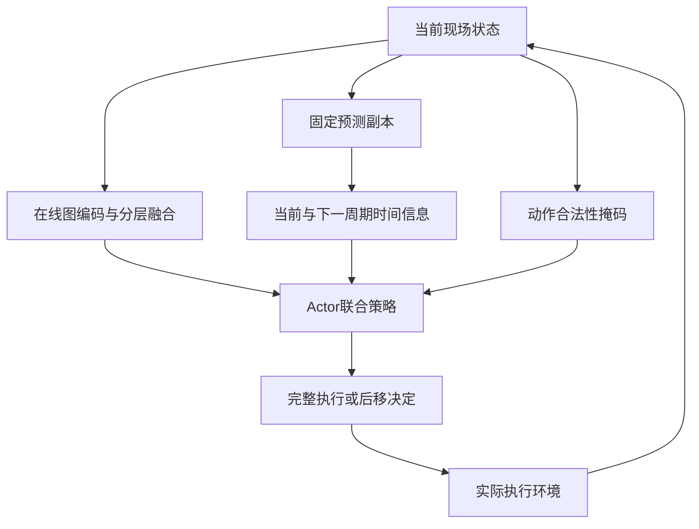

# 研究内容三：架构与语义增强通俗讲解

讲解日期：2026年10月12日。以v3及仍有效的详细技术确认稿为依据。用途是帮助用户理解后再讨论正文；本次不修改开题报告，不新增模块。下面的数字是教学示意，不是工厂数据或实验结果。当前方案已经讨论确认，完整代码与性能验证仍待完成。

## 1 工作三研究什么

工作三研究：多架飞机在脉动装配线上连续生产时，怎样利用当前现场信息估计整线转站和下一周期的时间情况，再据此安排工序、执行站位及人员团队。

你可以把调度器的工作看成三个连贯步骤：观察现场，估计后续时间影响，作出一个合法的执行决定。工厂随后实际执行，形成新的状态，再作下一个决定。

生产问题从研究二的受扰计划调整扩展到多架次实际执行。图表示沿用已有工序、站位、工人和技能编码，在其上增加分层汇总与明确的时间后果学习。一到二的衔接仍由不同关系和扰动响应需求引出，不把基准排程传递当作研究递进。

## 2 为什么要看其他飞机

选一个五站都有飞机的时刻。各站飞机不同，但共同转站。为演示这个规则，假定根据现有安排能得到以下就绪估计：

| 站位 | 当前飞机 | 扰动前估计就绪时刻 | 扰动后估计就绪时刻 |
| --- | --- | --- | --- |
| 1 | E | 8 | 8 |
| 2 | D | 9 | 14 |
| 3 | C | 10 | 10 |
| 4 | B | 7 | 7 |
| 5 | A | 9 | 9 |

第2站的工序X原本在时刻5开工，作业时长4，预计9完成。扰动发生后，其最早可开工时刻推迟到10；在人员、前序和其他安排不再变化的教学假设下，它在14完成。

原来整线最晚在10就绪，后来最晚在14就绪。所以X推迟5个时间单位，整线推迟4个。第4站虽然没有受扰，完成后仍须等待；新飞机也要等实际转站才进入一号站。

这个例子解释局部变化为什么要放到整线中看。表中的五个当前站位估计只是演示同步规则，不将它们增设为五个当前周期学习目标。已确认的当前学习目标是整线时间修正。

实际到14统一转站时，A离线，B到5站，C到4站，D到3站，E到2站；若仍有待投产飞机，F进入1站。同一架飞机始终按站位方向推进，不同时在两站加工。

## 3 三种记录要分清

| 记录 | 作用 |
| --- | --- |
| 原始参考排程 | 无扰动参照，记原站位、原团队和周期内开工位置，供比较 |
| 当前有效安排 | 记未决定任务的默认分配，以及已经正式确定的执行或后移决定 |
| 实际执行记录 | 记飞机实际位置、真实开工完工、人员占用、已揭示扰动和实际转站 |

参考排程中的一项安排，可能还只是默认参照。正式提交的实际执行决定则已经锁定。新扰动可以使既定安排按可开工条件被动顺延；已确定的站位、团队和对齐选择不能主动撤回重选。开工后的工序连续执行至完成。

因此，当前有效安排可以保留未来预约，但预约不表示工序已经开工或完成。下一周期预计任务也不等于现在已经给它们预约全部人员。

## 4 每次究竟决定什么

先从各在制飞机的合法候选中选一道工序，再选留在当前站或合法后移至紧邻下一站。

| 分支 | 本次决定 | 随后怎样执行 |
| --- | --- | --- |
| 留在当前站 | 工序、本站人员团队、时间对齐选择 | 按前序、已知开工限制和人员日历安排立即开工或合法预约 |
| 后移到下一站 | 工序及正式目标站位 | 记录后移；随飞机实际转站后，在目标站再作执行决定，不提前选未来团队 |

团队人数由工艺需求给定，策略选择满足人数和资格的具体成员。人员遵守已确定的站位安排，工人是产线资源，不给每架飞机复制一套。

时间对齐控制是否允许比参照位置更早执行。例如，实际周期起点为14，原模板中该工序在周期开始后3个单位开工，参照位置便是17。若最早可行时刻为16，可以选择16尽早执行，或保留17的位置；若最早可行时刻已经是19，仍只能从19开始。这项选择帮助兼顾计划稳定性，不由策略随意指定任意开工时刻。

有其他合法决策时，环境可以在同一物理时刻继续安排；无可行动作时，推进到下一个相关事件，例如完工、达到已知开工下界、扰动或转站。整批结束以真实完成为依据，排完全部预约或发生一次脉动都不是整批终止。

## 5 模块如何连接

| 模块 | 接受什么 | 交给谁什么内容 |
| --- | --- | --- |
| 图编码 | 可见工序、站位、人员、技能及关系 | 给分层汇总和动作选择数字表示 |
| 分层汇总与MLP融合 | 节点表示、各飞机和各站任务集合、整线事实 | 给动作网络和时间预测路径当前状态摘要 |
| 时间预测 | 当前状态及最近实际变化 | 给策略当前时间修正、下一周期各站就绪偏差及有效性信息 |
| Actor联合策略 | 当前表示、候选特征、预测数值、条件掩码 | 给环境一个完整合法决定 |
| 执行环境 | 完整决定及生产事件 | 更新真实状态，返回实际奖励，记录时间结果 |
| Critic价值网络 | 按既有实现读取状态 | 估计训练奖励对应的累计回报，辅助PPO训练 |

下面表示已选网络方案B的决策前向路径。在线预测头与事后监督在后文解释。

掩码负责限制候选，策略在合法范围内选择。时间预测提供估计信息，不改变实际开工、就绪或转站资格。

## 6 图和分层汇总分别做什么

图编码描述工艺与资源联系。例如X完成后Y才可加工；工序需要某种技能和人数；人员具有资格并存在占用。相同工序在不同飞机上是不同作业实例，其执行状态分别记录。

完整工序图保留工艺上下文；已完成节点可以继续提供关系信息，但不再计入未完工作量。组织工艺关系的节点不作为真实加工、选人或工作量计数对象，其依赖仍须保留。数据处理继续以README为准。

分层汇总回答三个不同尺度的问题：

| 层级 | 在看什么 |
| --- | --- |
| 工序／飞机 | 这架飞机做到哪里，当前、紧邻下一及更后站位还剩哪些已知任务 |
| 站位 | 本站当前飞机的有效任务与人员情况，下一次转站后到本站的飞机预计带来什么任务 |
| 整线 | 各站共同进度、实际周期位置、在制和待投产数量及瓶颈线索 |

在例子中，3站当前看飞机C，3站下一周期看现在还在2站的飞机D。1站的下一周期看待投产飞机F的已知模板，无法提前知道F将来受什么扰动。

汇总形成若干数字摘要，MLP学习怎样组合这些摘要，供预测和候选评分使用。它复用已有图骨架，不默认另加一套完整图编码器。五站是空间范围，明确的预测时域仍是当前周期和紧邻下一周期；更远影响由完整工艺上下文和长期回报间接考虑。

## 7 语义增强具体体现在哪里

图中已经有工艺和资源含义。工作三进一步让表示承载事件的时间后果：局部工序变化后，共同转站及下一周期站位进度将怎样变化。

在示意例子中，“X的可开工时刻推迟”是现场事实；“这将使D更晚就绪、其他飞机等待，并影响F进入产线的时间”是该事实的生产影响。模型以明确的时间目标学习这些联系，并把估计值用于调度。

这里的语义增强落实为三件事：明确预测量的生产含义，用实际执行时间训练相关表示，让策略读取这些时间信息。输出可以解释为提前或延后多久；当前方案不要求输出完整的因果解释报告。

### 当前周期预测

已有时间估算先给出本次转站的初步估计，学习模块预测它需要修正多少。例如某个复杂状态下，现有估算是13，模型给出修正+1，修正后的转站估计就是14。

需分清三个量：原计划10到实际14，整线推迟4；当前估算13到实际14，预测修正标签为+1；原工序开工推迟5。这些量的参照不同。

如果简单例子中的现有估算已经准确给出14，修正就应接近0。扰动发生后先更新已知开工条件，不能继续机械拿旧10作为当前估算。当前残差以采样时保存的估算为参照。

### 下一周期预测

下一周期预测各站就绪相对周期参照的提前或延后。在详细确认稿中，参照是下一周期的实际开始时刻加固定参考周期长度。

假设本次实际转站是14，参考周期长度是10，则下一周期参照为24。为示意标签，假设下一周期五站真实就绪时刻为23、24、28、22、24，则对应偏差为−1、0、+4、−2、0。训练时再按固定尺度归一化；此处用时间单位方便理解。

| 输出 | 时间含义 |
| --- | --- |
| 当前一项修正 | 实际共同转站相对该状态现有估算的差值 |
| 下一周期五站偏差 | 各站实际就绪相对下一周期实际起点加参考周期长度的差值 |

预测时尚不知道真实转站和未来就绪时间，模型只读当前信息；真实事件发生后才构造标签。无飞机或不存在的下一周期排除监督；有飞机但没有任务仍是有效目标，可以在该周期开始时就绪。占位0不等于“预测恰好准时”。

## 8 预测如何影响动作

策略同时读取候选工序的需求、飞机进度、源站当前情况、目标站下一周期情况及时间预测。训练使它学习在这些条件下怎样取舍。

例如源站预计限制当前脉动，而目标站下一周期预计已经较忙，策略需要同时考虑减少当前任务与增加后续负担的影响。对留站还需考虑选哪些本站人员及是否保留参照时间位置。最终仍是Actor选择动作。

当前采用状态后果预测：同一状态先给一组时间信息，Actor再结合不同候选评分。它不会先给每个动作分别输出一条完整未来轨迹，也不直接输出每个动作的因果收益。动作条件预测是保留的后续扩展。完整决定提交后，现场状态改变，再重新计算时间信息。

未知未来扰动不会成为当前输入。后续随机扰动和实际选择可能改变最终结果，因此预测是依据当前信息的估计，不是精确保证，也不是最优工期。

## 9 有限工序后移如何处理

后移只调整尚未提交决定工序的有效目标站位，飞机仍留在原站，直到实际脉动才向前移动。

若X必须先于Y：X在2站、Y仍须在2站时，不能单独把X后移至3站，否则会迫使Y也换站。若Y已有效安排在3站或更后站，则还需检查其他前序、既有决定、站位及人员条件，满足后可以允许X移至3站；到了3站仍须先完成X再加工Y。

正式后移时，X从2站当前任务集中移出，进入3站下一周期预计任务集；后移不算X已完成。它可能有利于当前转站，也可能增加下一周期负荷，因而需要跨周期信息。

每次后移一站，同一实际周期不能连续把同一任务推过多站；到下一实际周期可以按条件再次判断，重复后移代价更高。末站须完成剩余任务，不能再后移逃避完工。已有决定不能因新预测而撤回。

## 10 模型的正确答案从哪里来

训练按以下过程保存经验：

1. 决策时保存当时可见状态、最近变化、时间估算及周期身份，不保存尚未揭示的扰动信息。
2. 策略作决定，仿真工厂实际执行。
3. 本次实际转站出现后，将真实转站减去当时保存的估算，回填当前标签。
4. 紧邻下一周期结算后，依据其实际起点和各站首次就绪日志回填未来标签。
5. 在线预测头比较估计与真实标签，误差同时用于训练预测头和Actor共享编码／融合表示。

同周期的多个历史状态可以共享同一次实际转站答案，但各自估算不同，修正标签可能不同。当前答案先出现时可先训练当前头；下一周期答案暂未出现时保留记录等待，不能填0。采样段结束不清空尚未结算结果。测试结果只评价，不用于继续训练。

学习的是近期策略和后续实际执行产生的结果，包含随机扰动的影响；不把真实轨迹标签称为最优时间。训练期间策略可能更新，需要控制历史样本的年龄和版本差。

## 11 已选网络方案B为什么有预测副本

训练时分开在线学习模型和固定预测副本。

在线图编码、分层融合及动作头负责当前策略学习；在线预测头利用事后标签训练，并把时间监督传回共享表示。完整批次轨迹开始时，复制当时在线模型的完整预测路径，形成独立预测副本。该副本的参数及统计在这条轨迹内固定，给Actor提供预测数值，也提供当前时间塑形所需估计。

副本固定的是计算规则，输入仍是最新现场。工序完成或发生扰动后，副本会给新的预测。一次脉动不更换副本版本，后续新的完整轨迹再复制更新后的预测路径。

保存一个训练样本时，同时保存当时使用的预测数值和版本。PPO重算同一历史动作概率时，用该历史状态及其保存的外部预测值，避免旧概率和新概率对应不同信息。在线动作模型仍可以按训练批次更新。

固定副本包含编码、融合、预测头和归一化，不只是冻结最后一个小层。它增加存储和前向成本，实际效果仍需测试。完整批次里Actor可能更新，副本固定不代表行为策略始终固定。

## 12 Critic、辅助监督与奖励分别有什么用

| 学习部分 | 回答什么问题 | 训练依据 |
| --- | --- | --- |
| Actor | 当前该提交哪个合法动作 | PPO使用实际奖励和Critic提供的价值估计 |
| Critic | 从该状态继续执行，训练奖励的累计回报大致怎样 | 后续奖励及回报目标 |
| 在线时间预测头与共享表示 | 本次转站估算如何修正，下一周期各站何时就绪 | 实际时间日志形成的明确标签 |

Critic本身也评价未来。时间预测补充的是能直接解释成生产时间的量，且显式进入动作网络；其独立作用需要消融验证。

实际奖励考虑生产时间、相对参考安排的偏离及合法后移代价。预测当前时间还用于奖励塑形，为中间步骤增加与时间目标有关的训练信号；最终仍按实际生产指标评价。旧六分量账本包含与不可撤回规则关系待核对的项目，不能当作已最终统一的目标。具体权重、损失和实施参数后续确定。

## 13 三种更新频率

| 更新对象 | 更新时机 | 例子 |
| --- | --- | --- |
| 生产事实 | 开工、完工、扰动、正式决定、实际转站或时间推进 | 更新任务状态、飞机位置、人员区间和已揭示开工限制 |
| 神经表示与时间预测 | 每次完整决策前，用最新一致状态重算 | 即使某站没有新任务，也可能因整线关系或时间变化得到新表示 |
| 网络参数 | 训练批次更新；验证测试时冻结 | PPO和辅助损失更新在线模型，轨迹内固定副本不更新 |

不同层的事实可按影响范围更新，当前动态神经表示仍逐决策完整重算。后续精确增量计算或其他融合网络只是候选，不在本次讲解中自动加入。

## 14 怎样判断方法有用

需同时检查合法性、预测准确度、生产收益与计算成本。合法性包括前序、人员、不可撤回、非抢占、有限后移和同步转站。生产收益关注整批工期、周期超期、站位等待、计划偏离及后移情况。

对照与消融分别检验分层融合、时间辅助训练、显式预测输入、奖励塑形和下一周期信息。预测误差减小不自动意味着生产收益提高。图编码与副本的耗时、历史标签记录占用也要记录。当前还不能声称完整方案已验证有效。

## 15 给导师的简明解释

> 多架飞机同时装配时，各站进度共同决定整线何时转站，当前安排还会影响下一周期的任务负荷。本研究在工艺与人员图表示上汇总飞机、站位和整线信息，学习当前转站及下一周期站位就绪的时间影响，并将这些具有生产含义的时间信息用于工序、站位与团队的联合决策。

这只是用于理解的候选说明，未写入正文，也未确认替代现有段落。先理解状态、预测、动作、真实结果与训练之间的关系，再讨论正式文稿如何表述。

依据：v3第4.2.3、5.4、5.5及第6章；《研究设计与技术边界_整合说明_v3_20261012.md》；状态动作确认稿；方法设计稿§6、§7.4—7.6、§13—14。历史材料的旧题名及投稿状态继续以v3登记接替。
