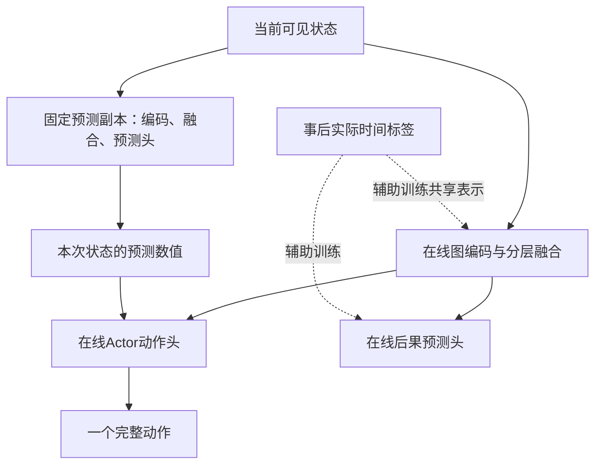

# 工作三方法设计阶段确认稿：执行流程、奖励与表征学习

> **2026年10月6日统一核查：**本轮统一术语和不可撤回决定的表述，未增加首版模块或改变实验分组。当前定义见[统一术语与当前定义](开题报告_统一术语与当前定义_20261006.md)。工作一采用最小同构编码替换，待实施与验证；工作二当前稿未投稿；工作三代码未完成、完整效果待验证。既定标题原文保留，旧标题与新内容的校准单列待确认。历史代码核对只证明当时检查范围。

> **2026年10月3日阶段收束：**工作三讨论暂告一段落，首版采用截至10月2日已确认的执行、分层后果语义、网络方案B及标签保存／回填规则。当前优先构思开题报告，不启动代码修改或正式实验。方法定义以方法稿§7.4—7.6、§13—14为准，实验分组以实验稿为准；旧六分量账本中的R_T、R_W仍属待核对历史接口，具体参数和方法效果保留待验证状态。工作一、二最终标题不变。

> **标签首版方案（2026年10月2日用户确认，仅工作三）：**每次完整决策保存可复原、不可被后续环境修改的历史输入；静态模板与拓扑共用，动态状态逐样本记录。当前／下一周期标签按实际事件分别回填，跨采样段保留待结算记录；近期已结算样本用于在线辅助学习，PPO沿原采样节奏更新。容量、年龄阈值、抽样配额与训练次数仍属实施和验证参数。完整规则见方法稿§7.6；本次设计确认不代表代码已实施。

> **网络方案B（2026年10月2日用户确认，仅工作三）：**首版采用固定版本外部预测特征＋在线Actor共享表征辅助学习。完整生产轨迹开始时，从在线模型复制包含编码、分层融合、当前／下一周期预测头和归一化统计的独立预测副本，轨迹内权重固定，每次完整决策仍读取最新现场状态重算。Actor使用副本输出的预测数值，PPO重放保存并使用当时值；在线共享编码／融合接受PPO与两项辅助损失，在线预测头接受实际时间监督。副本不参与梯度或优化器更新；副本固定不等于Actor固定。详细契约见方法稿§7.5。标签首版保存与回填方案随后已于同日确认，见方法稿§7.6；容量与采样参数待实施验证。

> **2026年10月2日同刻边界确认：**工序有效实际开工与扰动发生时刻严格相同时，先登记实际开工，再揭示扰动；该刚开工工序不受此次开工限制影响，继续非抢占执行。仅预约而尚未实际开工的工序仍受扰动影响。本次确认这两个事件的相对顺序，其他同刻事件的完整排序仍需实施核对。

> **2026年10月1日确认更新（仅工作三）：**原始工序与完整层级依赖以现有数据及《APAL_数据集规范与加载器说明_README.md》为依据；人员、日历、扰动和执行状态来自已有环境与明确配置，不虚构设备、部位空间或独立转站必完清单。Root／Sub不是物理站位，物理工作量、人数和任务统计排除虚拟节点。原始参考排程与当前有效安排分别保存。
>
> **图与分层方案：**首版保留现有完整工序图，编码后按未完物理任务与周期角色生成飞机／站位读出，动作候选另受合法性掩码控制。虚拟节点显式保留或通过等价前序投影保留其全部依赖。用于汇总的派生集合统一称“站位任务集”。首版复用已有编码骨架、采用分层MLP、每次完整决策前重算动态表示；内部解码共享现场快照，正式提交后更新环境。神经表示精确增量和其他网络仅作后续候选。
>
> **后移与验收：**首版允许不会迫使其他任务换站的单工序后移，每次正式动作只改变所选工序的有效目标站位；若完整DAG中的未完物理后继仍须留在源站或更早站，则屏蔽该次后移，不自动迁移后继。同机前序最终站位不晚于后序，同站实际加工遵守前序完成约束，已提交决定不可撤回。成组后移仅作后续候选。设计确认不代表代码已同步或验收，工作三模板入口须核对跨虚拟节点依赖转换。工作一、二标题和既有论文不由本轮修改。

> **动作掩码：**复用统一的留站／后移合法性入口，将无连带迁移条件与现有约束合并；工序候选由至少一个分支合法派生。静态拓扑与资格预计算，任务归属和状态按事件更新，读取缓存时检查现场版本；不把初始掩码永久冻结。该缓存不改变首版神经表示每次完整决策前重算的方案，见方法稿§14.3、§14.5。

> **2026年9月30日用户确认更新（仅工作三）：**一个真实事件驱动环境内，完整执行决策提交后，已选站位、团队及对齐选择不可撤回或主动更改，未开工预约也受此限制。基准模板是参照，不把尚未独立提交的基准安排误当已提交执行决策；未决任务仍可作合法留站／相邻后移决策。新扰动只能使既定安排按真实开工条件顺延，不能借此重新选站或选队。后移动作在当前实际周期内锁定；飞机实际到达目标站后，进入此前已确认的新阶段决策，不撤销前一阶段决定。已开工不抢占，已完成不重排。
>
> **就绪与语义标签：**本站第一次实际完成全部当前物理任务并满足数据与环境已有约束时记录就绪时刻，此后等待同步转站，首版不设计就绪反复变化。所有飞机共用模板；有待投产飞机时，在实际同步脉动时补入一号站。语义首版使用当前状态＋最近变化，跟随当前策略预测当前周期实际转站残差与紧邻下一周期各站就绪时间的有符号偏差；空站及不存在的下一周期用有效性掩码，未完成结果等待补标签。动作条件预测仅列后续扩展，暂不实现。首版编码复用、分层MLP融合、站位任务集与逐次决策重算已于10月1日确认；首版无连带迁移的单工序后移已确认，成组后移仅作后续候选；以上是设计确认，不代表代码已经同步或性能已验证。

初稿确认日期：2026年9月19日；本轮校准日期：2026年10月3日。状态：顶层研究方案已确认；尚未修改代码、完成训练或验证性能。本文汇总本轮讨论，替代早期关于独立虚拟层、两周期详细规划、绝对开工时间主惩罚的设定。

**核心方法：图表征学习当前周期启发式时间残差与紧邻下一周期各站有符号就绪时间偏差；当前修正时间用于动作输入与已有势函数，下一周期向量用于动作上下文；Critic继续学习综合回报。分层融合与更新按方法稿§13—14确认，首版无连带迁移的单工序后移已确认，成组后移仅作后续候选。**

本文区分“用户已确认的设计”“可直接用于实现的建议形式”与“后续参数”。公式用于明确语义，不将拟议方法写成已有实证结论。

> **2026年9月28日代码口径提示：**本文保留已确认的设计；当前工作三已实现部分环境、图输入、目标账本和时间学习接口，并有指定基线完整轨迹核查，但正式C/D训练、锁定测试和方法效果尚未完成。正文中“待实施/尚未实现”属原阶段记录，引用当前进度须以最新仓库实现与实施记录核对。

## 1. 课题定位与本阶段完成范围

| 层级 | 已确认题目 |
|---|---|
| 总体 | 基于图表示学习与强化学习的飞机脉动装配线调度方法研究 |
| 工作一 | 基于异构图与自回归决策的多资源联合调度 |
| 工作二 | 基于图网络的预测—反应式调度与人员分配优化 |
| 工作三 | 基于状态表征学习的多架次飞机装配动态协同调度 |

本阶段完成三项顶层设计：状态、动作与执行流程；目标与奖励；表征学习主路线。不扩展为完整实验方案，不追溯修改工作一、工作二论文的模型假设。

工作三协调五个站位上不同在制飞机的任务，并连续运行到指定生产批次实际完成。五站是空间范围，完整生产批次是时间范围；不要求在每个决策点生成全批次未来排程。首版空线开始、所有飞机共用模板；有待投产飞机时，在每次实际同步脉动补入一号站。批次规模与图节点保留范围作为配置；整线公共上下文包含待投产数量和当前在制数量，不读取任何未揭示扰动。

## 2. 已确认的物理规则

1. 同型号飞机共用工艺与基准模板。无扰动时，每个站位对连续飞机重复相同的作业与团队安排；不同站位之间并非执行相同任务。工人是产线资源，不能随飞机实例复制。
2. 先生成无扰动基准模板，确定工人—站位绑定；在工作三研究范围内不跨站调人。本阶段尚未提交执行决定的任务可在目标执行站位内选队，已提交团队不可重选，所需人数给定，工时仍可随团队效率变化。
3. 完整执行决策提交即锁定已选站位、团队与对齐，预约尚未开工也不重新决策。实际已开工、已完成任务不改，作业不中断且按本研究假设一定完成。未决任务仍可选择，无额外时间窗口或人为优先级。
4. 当前周期尚未提交决定的未开工工序可留在飞机当前站位，或合法后移到紧邻下一站位。飞机实际到达目标站位前，不能在那里加工该工序。同一飞机不能同时跨站作业。
5. 每次后移检查数据限定站位、完整DAG前后序、不可撤回决定、飞机位置及目标站已有人员能力；不虚构设备、部位空间或独立转站必完清单。前驱不能后移到后继最终执行站位之后；首版若后移会迫使未完后继换站，则屏蔽该后移，见§14.3。
6. 第一次改站就罚，重复改站更贵，以奖励鼓励不移动或尽量只移动一次；不设置全程最多一次的统一硬约束。同一实际周期不能连续将同一工序向多个站位推进；实际到下一站后才可再次判断后移。
7. 当前周期仍归属本站的全部物理任务实际完成，并满足数据与环境已有约束后，全线同步转站。基准转站日历不是强制放行指令。允许实际转站提前或推迟；末站不得通过后移逃避完工。
8. 初版不单独建模相对基准选用不同团队的准备时间和脉动转运耗时；这不取消作业时间和资源占用约束。若数据要求额外转运时间，须明确扩展。
9. 扰动发生前不可见；发生时揭示受影响的未开工工序与准确的新开工可用时刻R。提前获知未来扰动作为扩展保留，不与当前信息设定混用。

## 3. 一个执行环境与统一预约

### 3.1 保留事件驱动，不建设独立虚拟规划层

保留“观察现场—自回归动作—提交不可主动更改的安排—处理事件—返回下一决策状态”的流程。同一现场时刻允许多个决策；有可执行决策时不必强制推进物理时间。需要等待时，环境跳到下一相关事件，处理完成后再调用策略。

每条训练样本为 $(s_n,a_n,r_n,s_{n+1})$。事件期间不必生成虚假动作；一次step内发生的费用归入这次转移的奖励。一次动作的远期后果由后续回报传递，不要求立即全额结算，也不保证每个动作奖励非零。

取消“两周期详细规划窗口”和“当前周期构造后，在同一冻结快照里完整安排下一周期”的要求。下一周期负荷等信息可作为状态上下文，但不构成必须完整排定的窗口。

### 3.2 已预约与已开工

允许共用“已安排”队列及记录结构，不强制增加独立枚举值；但必须通过实际开工记录或正确维护的时间与事件，可靠区分预约、在制和已完成。预约时预填的开工时间不能在条件变化后仍被当作已发生事实。

未开工预约的已选站位、团队和对齐保持不变。新扰动揭示后更新开工下界，环境依据固定决定与真实约束重新计算必要的开工顺延，并传播资源日历和后继时间；这不是主动更改决策。普通完工、达到已揭示下界也可解锁未决任务。后移任务实际到站后进入新阶段决策；已开工任务保持资源占用至完工。

2026年10月2日用户确认：若有效实际开工与扰动恰好同刻，先处理实际开工，再揭示扰动，因此该刚开工工序不受此次开工限制影响。开工必须对应已提交决定并满足此前已揭示的前序、人员、站位和开工下界；失效的旧预约计时事件不能冒充实际开工。仍未实际开工的预约按新下界被动顺延，保持站位、团队及对齐决定不变。扰动揭示后才新提交的执行决定使用更新后的约束，不能借同刻优先获得豁免。本确认只确定开工相对扰动的顺序，不替代完工、资源释放、脉动、投产与策略调用的完整同刻顺序验收。

### 3.3 工人、工序开工下界、前驱与对齐统一进入开工条件

工人暂忙、已知工序开工下界尚未到达均可通过预约表达，不要求决策当下全部资源释放。选定团队后在满足物理条件的未来区间安排工序。事件揭示后的R用于更新未开工工序的下界r_new=max(r_old,R)；实际开工还受前驱、人员及站位限制。尚未揭示的R不能使用，当前数据没有工序—物料映射。

若前驱已实际完成或已有有效预约，后继时间可利用其完工约束。若前驱尚未安排，可先限制执行预约资格；决定合法后移不必要求已达到工序开工下界或前驱实际完成。后移不等于完成，不能据此解锁实际加工。

现有工人最晚释放标量支持队尾追加预约，不支持预约前空隙插入。若保留工序级对齐并希望其他任务利用空闲间隙，需要区间日历及团队—站位联合可行区间搜索；不新增虚拟层也仍需处理这一点。预约前等待不等于资源已经被占用。

## 4. 状态与条件动作

### 4.1 状态信息

| 类别 | 必要内容 |
|---|---|
| 现场 | 实际时间、当前周期起点、各机实际站位、任务执行状态、在制任务与固定工人归属 |
| 基准模板 | 原站位、周期内开工位置、原团队、基准节拍；原始绝对日历保留用于追溯 |
| 最近正式安排 | 当前预约、目标站位、已确定的团队和时间、正式决定记录与累计合法后移次数 |
| 当前资源与任务 | 有效预约区间、工艺拓扑、技能/人数、当前周期保留任务、后移待执行任务、后续已知负荷 |
| 已揭示扰动 | 已公开的新开工可用时刻R及受影响的飞机—工序 |

工序以飞机—工序唯一身份跟踪；飞机编号不直接赋予大小语义。基准团队和已提交团队保留具体成员关系，不能只用人数替代。当前周期负荷和未来负荷区分，不能用全历史累计负荷混代。预测器使用同样的信息边界。

### 4.2 自回归动作

先选飞机—工序，再从 $\{s_k,s_k+1\}\cap\mathcal S_{ki}^{\mathrm{legal}}$ 中选目标站位。这里的 $s_k$ 是飞机实际位置，不能用现有MES的“最早合法站位”代替。

| 分支 | 当前动作 | 后续处理 |
|---|---|---|
| 留在当前站位 | 工序→站位→站内团队→二元对齐 | 找到合法执行区间；立即开工或登记预约 |
| 后移 | 工序→紧邻下一合法站位，到此截断 | 记录正式后移，不选团队、不预约工人；随飞机实际转站后加入目标站位任务集 |

后移分支须满足§14.3无连带迁移条件，采用§14.5统一合法性入口及缓存边界。后移任务与本站原有任务由策略统一选取，不人工赋予优先级。两类任务均须满足真实开工条件。下一周期团队不在上一周期的虚拟第二阶段预先选定。

后移分支只累计工序与站位概率；执行分支再累计有序选人轨迹和对齐概率。PPO采样与重放使用相同分支、当时状态和掩码，不能为未激活头虚构动作或概率。一次后移、转站或采样批次结束不代表生产episode自然终止。

## 5. 节拍、周期内对齐与基准稳定性

### 5.1 节拍定义

设 $P_{q-1}$ 为上一次实际转站时刻，$F_{s,q}$ 为本周期站位s满足任务完成与放行要求的时刻，则在零转运耗时等当前假设下：

$$P_q=\max_{s=1,\ldots,5}F_{s,q},\qquad H_q=P_q-P_{q-1}.$$

当前空站不阻碍放行，事件实现不得倒退时间。占用站位第一次实际满足所有当前任务要求及放行条件时记录F，此后保持就绪等待同步转站；合法后移若在较晚时刻解除最后未完任务，F取该决定实际生效时刻，不单纯取工序最大完工时刻。首版无就绪反复变化处理。$P_q$ 是时刻，$H_q$ 是本周期持续时间。基准 $H_0$ 固定，不随上一个周期延误增大。核心效率项为：

$$J_{\mathrm{takt}}=\sum_q\frac{[H_q-H_0]_+}{H_0}.$$

以下为计账规则的说明性算例，不是工业实测或性能证据：上一转站时刻为10，五站完成时刻为18、19、22、20、21，则实际节拍12、超期2，全线计一次2而非逐站求和。连续周期12、10，相对10小时基准的超期是2、0，不是累计日历延迟2、2。

累计绝对交付延迟可以另报，但不是已确认主奖励。总完工时间项如保留须单列权重；不自动再叠加一份逐步时间消耗惩罚。当前不要求恢复至原始绝对日历。

### 5.2 周期内开工偏差与对齐

设工序i原定执行周期为 $q_i^0$，实际执行周期为 $q_i$，则：

$$b_i^0=S_i^0-P_{q_i^0-1}^0,\qquad b_i=S_i-P_{q_i-1},\qquad D_{\mathrm{time}}=\sum_i|b_i-b_i^0|/H_0.$$

提前与延迟暂用同一系数。允许周期整体平移，原模板不重写；比较其周期内位置。周期起点必须取真实全线转站时刻，不能在扰动或修订发生时任意重置。

未改站任务的对齐目标明确为 $P_{q-1}+b_i^0$。二元动作α=0不增加此下界，α=1加入此下界；若开工下界、前驱或资源已经迫使更晚开工，不额外等待。原来基准周期10、开工13；实际周期12、开工15，位置均为3，时间偏差为0。

对改站任务，建议在实际执行周期内沿用该任务原有偏移 $b_i^0$ 作为统一软参照，并独立收取改站代价；这不表示目标站曾有相同工序模板。该参照和是否给已改站任务保留二元对齐，须在工程小案例中校核，不能依靠改站重置所有成本。

## 6. 真实目标与计账规则

### 6.1 基准偏离

实际开工时，各任务只确认一次相对基准的周期内开工偏差和团队变化；站位终局偏离单报诊断，合法后移次数在后移动作提交时按增量计费。终局不再次全额重复计罚。团队人数固定为m时：

$$d(W,W^0)=1-\frac{|W\cap W^0|}{m}.$$

四人团队换一人是0.25，换三人是0.75。硬约束保证团队人数正确，不能用改变人数规避比例。工序开工时间位置接近通常有助于保持安排，但不等同于严格的作业顺序距离；当前不新增排序惩罚或硬顺序锁定。

### 6.2 不可撤回决定下的后移计账

基准团队与时间位置仍用于实际开工时的偏离评价。执行决定提交后不重选团队或对齐，后移阶段尚未选择团队不等于人员全部撤换。旧版相邻时间／团队修订费用（R_T、R_W）与新不可撤回规则的关系须在奖励阶段另行核对，不能为保留费用而重新开放决策修改。

改站次数n只统计正式合法后移；到站后依法继续后移是新阶段决定。飞机自然转站、同站换入新飞机、内部预测变化不增加次数。采用：

$$g(n)=\lambda_1n+\lambda_2[n-1]_+,\quad \lambda_1,\lambda_2>0.$$

每次只计 $g(n_{new})-g(n_{old})$，不在后续所有动作重复收费。最终相对基准站位是否变化，与过程累计改站次数是两种不同指标；可以同时保留，但不能再重复叠加同一份次数费用。

### 6.3 目标组合与实际奖励

**以下六项公式保留为2026年9月28日独立账本的历史接口，不能直接当成9月30日不可撤回规则下已重新确认的完整目标；尤其R_T、R_W须另行核对。**旧版六项为 $J_{total}=w_hJ_H+w_tD_T+w_wD_W+w_pG+w_{RT}R_T+w_{RW}R_W$，分别表示周期节拍超期、相对原模板的周期内开工位置偏差、相对原团队的替换率、累计正式改站惩罚、相邻正式安排的时间位置变化及团队变化。$G=\sum g(n)$，正式改站只计新增的$g(n_{new})-g(n_{old})$；相对基准的最终站位偏离可单报，不设独立$D_{station}$权重。当前默认$D_T,D_W,R_T,R_W$按固定工序实例数$N$归一化，$G$不除以$N$；权重具体值仍属实验参数。时间统一用固定 $H_0$ 归一化；若任务数量不同，再用事先固定的任务/周期规模做归一化，不能用随预约数量变化的分母冒充同一个总目标。

令 $A_n$ 为已发生累计加权代价，基础奖励为 $r_n^{actual}=-(A_{n+1}-A_n)$。合法后移在提交时按增量计费，实际开工记录最终基准偏差，实际脉动结算本周期超期。所有费用进入真实状态转移对应的step；跨周期回报不能被人为截断。

## 7. 已选表征路线：启发式时间估计的学习修正

### 7.1 代码事实与适配范围

此处原代码事实基于GitHub提交 `3c078972dec0d7e67942c1b3cf0c744dc00959d7`；工作三当前实现及状态以2026-09-28主分支 `9749c07166ac81713b9c972c379c8f8a913f6fb7` 为准，旧启发式公式只作来源说明。环境 `_get_estimated_cmax()` 使用：

$$\widehat C_{max}^{h}=\max\{F_{max},\overline F+W_{unassigned}/(Mb)\}.$$

该函数输入当前部分排程与剩余标准工作量。其变量名lower_bound不构成严格下界证明。工作三需只针对本周期任务与一致的绝对时间坐标构造 $\widehat P_q^h$；后移任务进入后续周期，不继续混入本站本周期工作量。正在执行和有效预约的剩余占用、当前时刻等边界必须纳入。

### 7.2 修正量预测

建议用Actor图编码器得到 $z=f_\theta(s)$，增加时间修正头 $\delta_\psi(s)$。采用归一化残差时：

$$\widehat P_q=\max\{t,\widehat P_q^h+H_0\delta_\psi(s)\},\quad \widehat R=\widehat P_q-t,\quad \widehat H_q=\widehat P_q-P_{q-1}.$$

修正量可以为正或负，不强制只能放大启发式。零修正退回经时间边界校准后的启发式。已提交预约的站位、团队与对齐不可主动修订，实际开工可以因新揭示约束被动顺延。时间一致性边界须依据已知真实约束构造，不能把预约预测直接等同最终实际结果。

本节公式描述时间数值的构造。按已确认网络方案B，决策与塑形使用§7.5冻结副本的编码和修正头；在线预测头以辅助监督训练，不替换该历史样本保存的外部数值。

监督标签来自实际轨迹：保存状态s及当时启发式值，当前周期实际转站后得到 $y=(P_q-\widehat P_q^h(s))/H_0$。用Huber或均方回归训练残差；具体损失形式为实施参数。未等到对应转站的截断样本不能凭空填造终值。

标签取决于后续策略及实际扰动，不是最优剩余时间。未来扰动可以影响最终标签，但不能提前进入该状态的输入。数据来源限训练轨迹；不利用测试结果训练修正器。

### 7.3 同一预测服务于动作、表征与塑形

采用用户已确认的显式输入方案。建议将 $[z,\widehat R/H_0,(H_0-(t-P_{q-1}))/H_0]$ 经小型融合模块提供给动作头上下文。不是将同一个数直接加到所有动作logits；那样不会改变softmax概率。

时间辅助损失反向更新Actor表征和时间头，使状态表示承载与后续脉动时间相关的信息。原Critic继续预测综合回报。接在独立Critic上的时间头只能直接监督Critic表征，不等价于此处Actor辅助学习。

2026年10月2日已确认首版网络方案B：显式预测数值来自整条生产轨迹内固定的完整预测副本，作为外部无梯度特征进入Actor。在线时间头通过实际时间标签训练并更新Actor共享表示；PPO不沿该数值支路更新副本或直接更新在线预测头。奖励数值不通过PPO反向传播到预测器。完整模块与版本契约见§7.5。

首版保存当时外部预测数值及副本版本，PPO重放对该历史状态使用保存的数值；旧策略概率所用输入不能被新预测器悄悄替换。时间头的损失权重和训练频率仍属实施参数；辅助监督进入Actor共享编码／融合已确认。

### 7.4 2026年9月30日确认：当前／下一周期状态后果语义

语义输入为当前完整图状态与最近实际事件／已提交决定的变化摘要；无人工情景类别，无递归事件记忆。所有飞机共用已知模板，整线公共上下文包含待投产数量、在制数量和下一周期占用标记。对未入线及在制飞机，扰动发生前均不知道其发生时刻、目标和程度；发生后立即揭示持续时间或准确新下界R。

首版采用状态后果预测，跟随当前策略实际执行结果学习。预测器在动作选择前输出当前时间残差及下一周期站位向量；Actor结合候选工序与站位特征评分。预测向量不是各候选动作的因果收益。动作条件预测f(s,a)保留为可能扩展，暂不实现。五站是联合空间范围，显式时间范围仅当前周期和紧邻下一周期；不将其称为一次预测五个未来周期。

对采样状态所属周期q，下一周期占用站位m的标签为：

$$y_{n,m}^{next}=(F_{m,q+1}-P_q-H_0)/H_0.$$

F是该站位第一次完成全部当前任务要求并满足放行条件的实际时刻，取真实日志；已预约不等于已完成。正值表示本站晚于下一周期基准参照就绪，负值表示早于该参照就绪，负值不保证可插入同等长度新任务。预测头允许有符号输出，不能使用仅非负输出激活。

下一周期无飞机的站位监督掩码为无效；有飞机但无待做任务仍有效，其就绪时刻可以是周期起点。整个q+1不存在则所有未来标签无效；存在但尚未结算的截断样本等待补标签，不填零。Actor同时读取占用标记，数值占位不具有零偏差含义。真实整线节拍取实际就绪时刻最大值；各站预测期望的最大值不自动等于整线超期的期望。

两项辅助损失训练Actor共享编码／融合表示和预测头；当前修正时间进入Actor与已有势函数，下一周期预测进入动作上下文，首版不另加未来预测惩罚。Critic按训练奖励继续估计综合累计回报，不能把普通Critic描述成没有未来评价能力。当前周期标签在P_q发生后取得，下一周期标签在P_{q+1}发生后取得；标签依赖后续策略，不能称最优工期。首版包含跨周期模块，后续单独消融，结果可解释是首版要求，原因解释仅作扩展。分层融合结构及各层更新按§13—14确认，首版无连带迁移的单工序后移已确认，成组后移仅作后续候选。

### 7.5 2026年10月2日确认：网络方案B的模块、梯度与版本契约

本节的“网络方案B”指固定版本预测特征，与实验稿B组“固定站位图强化学习”及曾讨论的标签抽样方案B分别命名，不混用。用户已确认首版选择本网络方案；网络A的在线选择性梯度与网络C的完全联合可微预测仅作后续候选。

**模块职责。**复用现有Actor异构图编码和分层MLP融合；在线后果预测头接在该共享表示上，以当前周期残差和下一周期各站有符号偏差两项辅助监督训练。Actor动作头在在线候选／分层表示之外，读取固定预测副本提供的显式数值。Critic沿用原有综合累计回报目标和编码组织，不由本次选择额外决定Actor／Critic共享方式。

实线表示决策前向，虚线表示辅助监督更新；事后标签仅用于训练，不进入采样时的现场输入。在线预测头的数值不在同一轨迹中悄悄替换副本特征；其训练结果供后续副本及诊断使用。

**完整预测副本。**在完整生产轨迹开始时复制该时刻的在线预测路径，保留图输入处理、编码器、分层读出／MLP、两项预测头和所依赖的归一化统计。副本具有独立参数存储，采用推理模式，停止梯度与运行统计更新，不加入训练优化器。仅冻结最后的预测MLP不满足本契约。副本可同时输出动作预测特征和当前时间势函数所需估计，避免同版本同状态重复前向；不因此增加下一周期风险费用。

每条完整生产轨迹记录自己的副本版本；轨迹中途发生PPO／辅助更新或同步脉动均不换版。后续新轨迹从届时在线模型复制新副本。训练重启须恢复仍在进行轨迹的副本及版本，不能沿用旧概率、却自动换为最新副本。验证和测试继续冻结网络参数及统计，不用测试标签更新模型。

**梯度路径。**PPO策略损失更新在线Actor动作参数及其共享编码／融合，不沿外部预测数值更新副本或直接更新在线预测头。当前／下一周期辅助损失更新在线预测头及其Actor共享编码／融合。Critic按既有回报损失训练；共享参数是否受Critic损失影响按既有实现明确。预测数值保持外部、无梯度；奖励及势函数数值也不通过PPO反向传播到副本。

副本固定不等于在线预测或Actor恒定：PPO与辅助监督都可能改变共享表示。实施时仍须检查组合更新对近期策略概率的影响、共享参数的优化器归属和数值稳定性；损失权重、优化器组织及更新步数属于实施参数，不以“预测输入固定”替代核查。

**决策与PPO重放。**每次完整决策，在线Actor表示与固定副本预测均由最新一致现场状态生成；内部选工序、留站／后移、选队和对齐共用该事实快照。记录当时的当前／下一周期预测数值及占用标记、副本版本、动作分支、条件掩码和旧对数概率。重放同一历史样本时，用其历史状态和保存的外部预测值计算新策略概率，不拿最新工厂状态、最新预测器或最新占用标记替换。在线Actor表示仍按当前训练参数重新计算，不能把旧嵌入缓存当作共享编码器更新。

对相同参数、归一化／计算配置、历史输入和条件掩码，应能复算采样概率；验证完整自回归分支概率时，后移分支不加入未激活团队头的概率。塑形继续使用该完整轨迹约定的固定预测版本，真实终止与采样截断沿用既有区别。

**开销与验收。**固定副本会增加参数占用和预测前向；在线Actor与副本参数不同后，其动态图嵌入不能无条件互用。模板、原始静态字段及动作合法性缓存可继续共享。实验须计入副本开销，并区分实际供Actor使用的副本预测误差与在线预测诊断误差。该选择不证明已加速或提高调度性能，也不保证在线预测与副本在长轨迹中始终接近。

**与标签方案的边界。**网络方案B与标签方案分别确认。用户随后于同日接受§7.6首版：逐决策保存可复原历史输入、两项标签分别回填、跨采样段保留待结算记录、PPO沿原节奏更新、近期已结算样本用于辅助学习。容量、年龄阈值与配额等具体参数仍待测量和验证。Actor可按采样段更新，预测副本固定并不会把标签变成一个始终不变行为策略的结果。本轮同步设计文稿，未修改生产代码或宣称训练链路已验收。

### 7.6 2026年10月2日确认：首版历史输入保存、标签回填与辅助采样

用户本轮接受上一轮首版建议；不以此确认标签容量、样本年龄阈值、每周期抽样数或辅助更新次数等具体数值。首版逐个完整决策保存可复原历史输入，两项真实结果分开回填，PPO按原采样节奏更新，辅助训练优先使用近期已结算样本。若后续测量发现保存开销明显，再讨论限量选取历史状态；当前不默认跳过某类决策或仅保留周期末状态。

**保存什么。**保存决策前当时可见的动态任务状态、飞机位置、当前有效安排、人员区间、已揭示限制、周期角色及最近变化，连同对应启发式值、周期起点、占用／有效性信息和完整轨迹—周期—决策身份。保留能够复原模型输入的历史快照，不能将仍会被环境原地修改的对象引用当作历史记录。静态模板、技能、拓扑与原始字段可共享；记录其配置身份，不能把未来未揭示事件放入快照，也不要求逐样本复制整份数据集或模型权重。

保留状态采集与标签结算时的训练更新／版本信息，供滞后分析。PPO沿用§7.5保存的外部预测数值、副本版本、动作分支、条件掩码、旧对数概率及必要转移记录；辅助学习还须保留可重编码的历史输入，不能仅凭旧图嵌入更新产生该嵌入的共享编码器。

**什么时候回填。**对采样于周期q的状态，在实际P_q发生后，以采样时保存的启发式值形成当前残差；在实际P_{q+1}发生后，从下一周期各站首次实际就绪日志形成下一周期有符号标签。两项标签分开维护“待结算、可用、无效”状态：当前标签先可用时，可以先训练当前头，不等待下一项；真实结果尚未出现不填零。采样段结束不清空待结算记录；无飞机站位或真实不存在的下一周期按既定掩码无效，有飞机但无任务仍依既定规则有效。

同周期不同状态可以共享同一次实际P_q、P_{q+1}及F的结果账本，但保留各自输入与启发式值；当前残差可能不同。只在结果和身份对齐后生成可用标签。当前头已经训练不构成删除仍待下一周期标签快照的理由；两个目标均已完成或判定无效后，再按辅助数据保留规则释放记录。整批真实结束补齐已经存在的结果，将不存在的未来目标置无效，不留下无法结算的悬空样本。

**怎么训练。**PPO采样记录与辅助结果记录在用途、生命周期上分开，允许共用不可变历史快照。标签补齐不会修改原奖励、终止标记、旧概率或优势，也不会把已过期PPO样本重新加入新的策略更新。辅助训练用当前在线参数重新编码历史输入，预测头输出与真实标签比较；两项损失按各自可用／有效样本训练共享编码、分层融合与在线预测头，固定副本仍不更新。辅助更新同样会改变Actor共享表示，须控制预算并核查近期策略变化，不能因它是回归损失就绕过§7.5的稳定性要求。

**近期与开销。**首版优先取近期已结算样本，用受控小批量辅助更新；既记录标签就绪先后，也记录状态采集与结算之间的训练版本差，不能仅以“已结算”认定样本与当前策略接近。未来结果包含后续实际Actor版本和随机扰动的影响；保留真实答案并不等于保证它是当前固定策略的期望结果。具体队列容量、年龄／版本差阈值、重用次数、长周期样本配额及损失权重留给实施测量和验证，不预设为最优。

逐决策保存的内存随图规模、决策数和待结算时长变化，不能声称“只跨两周期”就有固定低开销。先测量历史动态输入、待结算记录和可用样本的峰值占用；若资源不足，再讨论有明确覆盖与偏差检查的限量抽样。训练／验证／测试分离沿用已有规则，验证和测试结果仅用于评价，不回灌训练。

## 8. 势函数与密集奖励

### 8.1 推荐可实现形式

用修正后的时间建立势函数，而非再学习一个含义不明的独立势值头。一个与已有代码接近的候选是：

$$\Phi(s)=-a\widehat H_q/H_0-b[\widehat H_q-H_0]_+/H_0,\quad a,b\ge0.$$

a项提供未超期时的细分时间信号；b项强调预计超期。它们是塑形参数，不自动成为额外终局目标。势值只覆盖当前周期也可以，但不能据此宣称已显式预测所有未来周期。跨周期收益仍由Critic与完整回报学习。

$$r_n=r_n^{actual}+\beta\{\gamma\Phi(s_{n+1})-\Phi(s_n)\}.$$

保留实际代价结算，不能又全额叠加同一预测目标差分、转站超期和终局超期三份费用。若现有代码的启发式目标差分继续保留，应明确它与新塑形的等价变换或各自独立目标，不能直接叠加。

### 8.2 版本、终止与折扣

首版已确认每条完整生产轨迹使用§7.5的固定预测副本，覆盖其编码、分层融合、归一化和当前／下一周期预测头；当前时间输出同时服务既有势函数，真实终止时势置零。训练可更新在线预测器，但本条轨迹使用的塑形版本不随之变化；实际转站不是生产终止，不能任意切断势函数或回报。

轨迹起点固定时，规范的势差在折扣累计下只贡献与动作选择无关的边界项；这保持所选基础奖励的策略排序，不保证有限样本PPO更快收敛。若γ=1且正常终止，基础实际费用的累计直接对应总目标；若γ<1，优化的是折扣版本，不能声称严格等同于未折扣总费用。任意逐步奖励裁剪也会改变精确等价关系。

动态势函数允许同一状态的势随学习变化，但需按访问时的版本维护 $\gamma\Phi_{n+1}(s_{n+1})-\Phi_n(s_n)$ 等一致机制及终止条件。逐轨迹固定完整预测副本已确认为首版；完整在线动态版本保留扩展，不宣称已完成其PPO适配证明。

### 8.3 简例

只考察一个周期，H0=10，γ=β=1，a=0，b=1。预计节拍先从10变14，再变12，最后实际12。塑形先给−0.4，再给+0.2；实际结算−0.2且势回到零补+0.2。总和−0.2，与实际超期一致。此例的势回零对应所示任务的真实终止；完整批次内的中间周期不能照搬成episode结束。

## 9. 方法贡献与保留候选

可以提出的科学假设：相较仅由综合回报训练的图策略，实际脉动时间监督可能使图表征更好地区分后移、开工下界延迟与技能瓶颈的后果；修正后的时间用于动作上下文与塑形，可能改善协调决策和训练反馈。

时间预测更准确、策略结果更好、塑形训练更有效是三个不同命题，不能自动等同。不能把已有EFT特征、原始启发式或普通Critic本身包装成新增表征贡献。首版同时加入紧邻下一周期有符号就绪时间偏差预测，但当前＋下一周期仍不等于完整长期动力学。

DBC/互模拟、原型解释、动作条件预测、更远周期辅助预测、跨站调人、更长前瞻与提前扰动通知仍保留在方法库，不作为当前必需模块。本稿不展开新的实验分组，不声明首次提出或已优于文献。

## 10. 代码继承与剩余实现事项

| 已核对的已有能力 | 工作三的适配 |
|---|---|
| step允许工人队尾未来预约 | 统一已知开工下界等待；区分预约与实际开工；对齐空隙需要日历支持 |
| 无合法动作时推进到事件 | 保留事件机制，增加多机位置、真实开工及同步脉动处理 |
| 前驱/开工可用性掩码 | 分开后移资格与执行预约资格，避免尚未到达开工下界的任务无法选择后移 |
| MES相对最早合法站位限制 | 改用飞机实际站位与紧邻下一站的物理掩码 |
| 启发式makespan与目标差分 | 适配当前周期，再引入残差预测和一致的真实费用/势函数计账 |
| Actor/Critic可独立编码、序贯决策 | 保留骨架，增加时间头及上下文融合；更新条件分支PPO重放 |
| 全任务已安排作为终止条件 | 改为设定生产批次实际完成；采样截断正确bootstrap |

无需继续讨论即可记录的参数：五站中的具体工人数量、生产批次数量、归一化常数、网络宽度、损失权重、γ、塑形系数和在线辅助学习更新次数；固定预测副本仅在新完整轨迹开始时复制的规则已确认。它们尚未取最终数值，不影响本阶段顶层结论。

必须在实现前明确并验证的机制：初始在制与进出线边界；已确认同刻先开工、后扰动；完工、资源释放、脉动、投产等其余同刻事件的完整顺序；固定决定下开工顺延对后继与资源日历的传播；失败动作与不可行状态的处理；改站后对齐参照的细节；真实终止与训练截断。它们是明确的工程待办，不在本稿冒充已实现。

## 11. 与既有文件的差异

| 早期设定 | 本次确认 |
|---|---|
| 独立虚拟层生成完整修订计划 | 一个事件驱动执行环境，逐步派工与提交后不主动改动的预约 |
| 两周期详细规划 | 五站统一决策，连续执行完整指定批次；不强制详细时间窗口 |
| 后移后在本轮虚拟第二阶段选队 | 飞机实际进入目标站位后再选队 |
| 绝对基准开工偏差为主 | 固定原模板的周期内位置偏差，允许整体平移 |
| 跨周期累计转站日历延迟为效率目标 | 各周期实际长度超过固定基准节拍的部分 |
| 尚未选择表征路线 | 图表征预测启发式时间残差，显式动作输入＋势函数 |
| 多种候选都列为待必选主线 | 残差预测主线已选，DBC/原型等保留扩展 |

原始绝对日历继续保存用于追溯，变化的是评价坐标，不是偷偷重写原始计划。已选架构仍需实现验证，不以本阶段确认替代创新性或性能证据。

## 12. 证据入口与引用边界

- [本次核对的代码版本](https://github.com/1ush3n/APAL-Dynamic-2/tree/3c078972dec0d7e67942c1b3cf0c744dc00959d7)：静态检查，不代表当前之后的最新提交已审计，未运行训练。
- [启发式时间估计](https://github.com/1ush3n/APAL-Dynamic-2/blob/3c078972dec0d7e67942c1b3cf0c744dc00959d7/environment.py#L1271-L1289)、[现有目标函数](https://github.com/1ush3n/APAL-Dynamic-2/blob/3c078972dec0d7e67942c1b3cf0c744dc00959d7/utils/reschedule.py#L332-L380)：支持代码现状，不代表改造已完成。
- [Vieira等，Rescheduling Manufacturing Systems](https://isr.umd.edu/Labs/CIM/projects/jos-rescheduling.pdf)：时间/顺序稳定性、修复与事件调度依据；未证明本文相对周期指标是APAL统一标准。
- [Kampmeyer，Cyclic Scheduling Problems，第2.1节](https://d-nb.info/980566215/34)：周期与基本开工位置的分离表示；本文周期内稳定性是结合场景定义的指标。
- [Ng等，1999，Policy Invariance under Reward Transformations](https://people.eecs.berkeley.edu/~russell/papers/icml99-shaping.pdf)：势函数塑形依据，保证有相应条件，不保证PPO训练效果。
- [Devlin与Kudenko，2012，Dynamic Potential-Based Reward Shaping](https://eprints.whiterose.ac.uk/id/eprint/75121/2/p433_devlin.pdf)：动态势函数理论依据，不等于任意网络更新都自动保持性质。
- [Jaderberg等，UNREAL](https://arxiv.org/abs/1611.05397)：共享表示辅助任务的研究依据，不是本项目时间残差方法的直接实证。
- [Klissarov与Precup，2020，Reward Propagation Using Graph Convolutional Networks](https://arxiv.org/abs/2010.02474)：图网络学习势函数的研究先例；其具体学习方法与本项目残差时间监督不同。
- [Schulman等，PPO](https://arxiv.org/abs/1707.06347)：概率比与策略优化依据；本项目条件分支与预测特征版本需自行正确实现。

## 13. 分层融合、站位任务集与更新（2026年10月1日确认）

### 13.1 已确认首版与保留候选

飞机摘要覆盖全部未完物理任务，分别保留当前周期、紧邻下一周期和更后站位的摘要；更后任务是可见工艺背景，不扩大显式后果预测时域。首版采用MLP融合。编码复用、分组读出、任务集和逐次决策重算已确认；§13.3网络替换暂不实现，不声称已经有效。首版以无连带迁移条件限制单工序后移；成组后移仅作后续候选。

### 13.2 完整图编码与分组读出

首版复用已有工序／站位／工人／技能输入投影和异构图编码，编码环境可见的完整工序图，包括既有图中保留的已完成、当前未完及已知后续物理工序。完整图不被裁剪成当前站位任务集或可选动作子图；不读取未来未揭示扰动。工人是产线物理资源，不按飞机复制。

Root／Sub可以显式保留；若继承现有工作三物理工序图，须先由完整数据DAG生成保留物理前序关系的等价投影。不能过滤虚拟节点后只保留Task行显式紧前，详见§14.2。

| 口径 | 包含对象 | 边界 |
|---|---|---|
| 图消息传播 | 完整现有工序图及资源关系；保留虚拟节点或其等价依赖 | 不按未完任务集裁剪，不读隐藏未来扰动 |
| 分组读出与负荷统计 | 相应未完物理Task，按飞机、周期角色及执行状态分组 | 排除已完Task与虚拟节点，不把全机未完工作量都算作本站当前负荷 |
| 动作候选 | 允许作本阶段决定且满足相应分支条件的物理Task | 排除已有执行决定、运行中、完成及虚拟节点；后移与此刻开工资格分开 |

已完工序可以提供图上下文，但不继续增加未完负荷；虚拟节点可以表达拓扑，不计作一次加工或人员需求。暂时被前序、人员或已知开工下界阻塞的未决任务仍属于相应未完读出。

已有资源、技能、团队关系及同口径数量、工作量和日历统计复用。原全局汇总通过职责清楚的接口转为分层汇总，不默认并列两套完整图编码器。复用结构不等于永久冻结工作二权重；接口、维度和参数映射核对后才能说明检查点兼容。

| 层级 | 首版汇总内容 |
|---|---|
| 工序／飞机 | 工序表示与飞机当前、紧邻下一及更后未完任务摘要 |
| 站位 | 本站当前任务、下一周期预计任务及本站人员／已知资源状态 |
| 整线 | 各站摘要、实际周期位置、在制与待投产数量、总体负荷和瓶颈线索 |

集合统计优先沿用已有实现，补充时使用有来源的数量、标准工作量与工种分布等。标准工时之和不等于实际完工时间。MLP融合后同时提供后果预测与候选评分上下文；候选读取工序、所属飞机、源站当前、目标站下一周期及整线表示。后移不提前选未来团队，不构造两个假想执行环境，不因此增加首版动作条件预测。

### 13.3 可替换的候选结构（均暂不实现）

| 候选 | 替换或增强的位置 | 针对的问题 | 尝试条件与边界 |
|---|---|---|---|
| 多统计集合汇总 | 飞机／任务集／整线汇总 | 单一平均值可能丢失规模与突出负荷 | 借鉴PNA的多聚合思想，尝试均值、最大值、和、离散程度及数量；不直接称为完整PNA，也不重复已存在的同口径统计 |
| 周期角色条件注意力 | 站位任务集读出或候选跨层读出 | 相同任务在不同资源与周期角色下具有不同相关性 | 查询来自站位资源与当前／下一周期角色，键和值复用工序表示；任务集掩码限制可读任务，另保留数量与工作量，避免注意力归一化丢失规模 |
| 同步脉动约束下的整线读出 | 整线当前表示 | 平均负荷可能淡化限制转站的站位 | 保留平均／总负荷通道和最大值／瓶颈通道；以后可加入基于可见启发式就绪估计的注意力。该估计只是线索，不替代实际放行，也不把各站预测均值最大值当作整线完工时间期望 |
| 源站当前—目标站下一周期比较模块 | 留站／后移评分 | 减少当前任务要求与增加后续任务需共同判断 | 将工序与技能需求、源站当前、目标站下一周期、整线背景进行交互，可试共享双线性交互或两站注意力；只输出动作评分，不新增动作条件时间预测，不先构造两个假想执行环境 |
| HGT型关系编码替换 | 现有异构图传播层 | 若证据表明现有关系编码能力不足，再尝试更细的类型条件参数 | 替换已有传播模块而非额外并列一套图骨干；不默认其动态时间编码必需，也不把类型注意力本身当作执行后果语义创新 |

候选优先从局部读出替换开始。已有图传播已经表示工序与资源关系，因此没有证据时不再堆叠完整任务自注意力网络。Set Transformer可作为集合注意力的研究参考，但直接采用完整模型的额外交互和计算代价须单独验证。

参考：[Lee等，Set Transformer，ICML 2019](https://proceedings.mlr.press/v97/lee19d.html)支持用注意力建模集合元素交互；[Corso等，PNA，NeurIPS 2020](https://arxiv.org/abs/2004.05718)组合多聚合器与度缩放；[Hu等，HGT，WWW 2020](https://arxiv.org/abs/2003.01332)采用节点与边类型相关参数。上述原论文不是APAL实验，不提供本项目效果或新颖性的证明。脉动读出及源站／目标站比较是本场景下的设计候选，其与既有方法的区别仍需继续核验。

### 13.4 站位当前／下一周期任务集

任务集是初始分配与实际记录的派生集合，不新增“责任”工艺字段或强制绑定。初始参考排程保持不变，当前有效安排以参考分配为未决默认，登记正式执行／后移决定；已提交决定遵守不可撤回规则。

当前周期未完任务集仅属于当前实际位于本站的飞机，包含当前有效安排留在本站的全部未完物理Task，分未决、已预约未开工、正在执行三组。暂时不能开工不意味着移出；有效预约跨过名义周期边界也不自动进入下一周期。任务集不同于当前可选动作集合。

下一周期预计任务集仅属于下一次实际脉动进入本站的那架飞机，包含其按已知模板／有效安排预计在本站执行的未完物理Task，以及已正式后移至本站的任务。按飞机—工序身份去重。一号站有待投产飞机时使用下一架已知模板；不含未决定的可能后移、更远架次／周期、已完任务或未知扰动。已揭示限制可进入特征，不提前选未来团队，也不承诺全部任务一定在下一周期执行。

| 真实变化 | 集合处理 |
|---|---|
| 提交本站执行决定 | 保留当前成员，更新为预约／运行状态 |
| 实际完成 | 从未完读出移出，编码图可保留节点 |
| 正式由m后移至m+1 | 从源站当前移出，加入目标站下一周期预计集合；飞机实际位置暂不变 |
| 名义周期边界 | 不自动完成、后移或移交未完任务 |
| 实际同步脉动／进出线 | 按实际新位置重建当前与下一集合 |

本站当前任务实际完成，或可后移任务已合法移交后，才按数据及环境已有约束判断首次就绪。预约不能冒充完成，末站须完成全部剩余物理任务。预测不改写真实就绪或转站资格；沿用首次就绪后等待，不增加反复变化处理。

### 13.5 三类更新与完整决策快照

原始状态刷新、动态表示重算和训练参数更新分开。静态工艺／技能字段可保持不变；动态事实由生产事件、正式决定及时间推进刷新；网络参数在训练时更新。下一周期集合成员不变，不代表飞机、站位、整线表示或后果预测不变。

首版每次完整决策前，使用最新一致状态全量重算在线Actor动态表示及§7.5固定副本预测；冻结副本权重不冻结现场输入或预测结果。内部选工序／选站／选队／对齐共享该事实快照，已选部分只更新条件上下文与条件掩码；完整决定提交后更新环境。同物理时刻不同正式决定也产生新状态，纯时间推进须更新等待及剩余时间。整线不能只在脉动时刷新。

后续神经表示精确增量缓存须追踪图邻居、共享技能节点、时间与参数版本；原始属性不变不意味着动态图嵌入永久不变。精确增量与全量输出一致时，其贡献主要是效率；近似少更新另评估误差和决策效果。比较保持可见信息、动作、费用与预算一致，并区分新增信息、汇总结构和参数量作用。注意力权重不直接作为扰动原因的因果解释。

## 14. 数据边界、虚拟依赖与剩余事项（2026年10月1日确认）

### 14.1 数据与约束来源

数据说明位于“开题报告/40_实施与验证记录/APAL_数据集规范与加载器说明_README.md”。原始工序、节点类型、工种／专业、标准工时、人数、限定站位及层级依赖以现有数据和统一加载器为依据。Root／Sub不是物理站位。五工种映射注明为已有实验资源设定，不称为厂方验证的专业互换关系。

按用户说明，开头2—3个工序绑定一号站；各实例具体约束读取非空限定站位，不把数量写成所有实例常数。空值表示不限定；初始排程分配是参考结果，不自动成为强制限定，当前有效安排则独立登记正式决定。

人员能力、固定站位组织、日历、进度、已揭示开工下界与扰动由初始排程、已有环境及明确配置提供，注明来源，不要求CSV凭空新增。部位容量列未使用，不据此声称空间限制已实现；设备兼容、物料齐套、质量放行及独立转站必完清单均无原始数据依据，首版不新增。已有明确环境并行上限可作为仿真假设保留，不能冒充从保留字段推导的厂方约束。

### 14.2 虚拟节点处理契约

节点性质按加载器的node_type／层级标识判定，不能只按工时是否为零判定。虚拟节点无加工量和人员需求，不作为派工、后移、实际开工或加工完成计费对象。物理Task即使工时为零，也不能仅因零工时被当作虚拟节点删除。

完整DAG须保留加载器生成的Root→Sub、Sub→Task、组间衔接及显式前序。若工作三只编码物理Task，则对内部节点全为虚拟节点的路径添加对应物理前序边，使保留物理Task的前序可达关系与完整DAG一致。例如i→Sub→j须保留i→j；多分支汇合须保留全部物理前驱约束，不能把“且”变成“或”。删除虚拟节点后只读取Task行紧前列表不满足此契约。

统计及读出先用“物理Task且未完成”掩码，再与飞机、站位及周期角色相交。工时、人数、任务数分母、完工比例和批次真实完成检查不得误计虚拟节点；运行中、预约与未决工作量使用明确口径，避免重复。编码节点数、物理任务数和未完任务数分别记录。

### 14.3 首版单工序后移与无连带迁移条件

同机前序i→j要求最终执行站位s_i≤s_j，同站实际加工满足C_i≤S_j。首版保留单工序相邻后移，但一次正式动作仅改变所选工序的有效目标站位，不自动迁移其后继，也不撤回或修改其他任务已经提交的决定。有限成组后移保留为后续候选，暂不实现。

令D_i为由完整层级DAG得到、去除自身和虚拟节点并去重后的所有物理后继。令U_{k,s}^{eff}为飞机k有效安排中目标站位是s的未完物理任务集合，包含未决、预约未开工与运行中任务；不能仅使用动作候选集合，因为已提交任务同样构成不可绕过的限制。正式后移后按目标站位归类，不能继续按飞机尚未转站的实际物理位置归类。

对实际位于s站的飞机k，将尚未提交本阶段决定的工序i后移到s+1，要求：D_i中所有未完任务的有效目标站位均不早于s+1；若原有效安排已满足前后序站位单调性，可等价检查D_i∩U_{k,s}^{eff}=空集。不能利用这个等价简化跳过完整工艺图或已有站位逆序检查。

若交集非空，则后移会迫使其他本站任务换站，首版关闭i的后移分支。留站分支仍依据自身执行条件判断，不因后移不可行而自动移除整道工序。若后继已经位于下一站或更后站，保持其当前有效安排，仅继续遵守前驱实际完成后才加工的约束。数据限定站位、末站、目标站固定工人的技能／人数、不可撤回决定和同周期后移锁定继续共同限制动作。

这一规则不把未决参考分配误当工艺永久绑定：未决后继可以在它自己的合法决策中独立后移。例：A→B、二者同站，且B满足全部后移条件时，可先正式后移B；随后若A已不存在本站未完后继，A的后移分支可能开放。每次都是单工序决定，不是一次自动批量迁移，也不预设全图所有后继必须按同一种顺序后移。同一实际周期不能对已经后移的同一工序再次作本阶段决定；实际到站后沿用已确认的新阶段规则。

无连带迁移条件只保证不会要求别的任务新增换站，不保证没有时间传播、下一周期负荷增加或其他飞机等待。掩码保证合法性，当前／下一周期状态后果和实际回报用于学习动作的代价与收益；不为此新增动作条件预测或虚拟推演。

### 14.4 只读代码核对与验收边界

2026年10月1日核对仓库默认分支文件快照：data_loader.py（blob 0ca1c0f0208e484bc3109f7c7377286dd5c1a911）、utils/work3/multi_aircraft_baseline.py（blob 81f9bfbc293242901e3e27c8d9d7870d4a60f63a）、models/work3/graph_builder.py（blob 837a4c7bb789dc8dad695fc1e8341e96cc73665d）及models/work3/actor_critic.py（blob dec03c69eb3ba3b1257c2c93ad60ee1f1cd9a274）。这些是文件内容标识，不是整仓库提交号，不替代对其他最新审查分支的核对。

通用加载器构建包含Root／Sub的完整层级DAG。用户已认可当前空紧前处理：不因空值按CSV顺序补前序；完整DAG中确无实际前驱的起点允许初始释放，已有层级边仍保留，物理Task不能仅凭自身字段为空绕过所属Sub约束。工作三图构造器按baseline.tasks建立完整节点底座，未按未完集合删除节点；骨干接收全图，候选嵌入随后读出。但所读load_single_aircraft_template直接解析CSV显式紧前、按排程工时筛选物理Task，图构造器仅添加仍在物理映射内的前序边；在这条路径未见从完整DAG生成等价物理依赖的步骤。须补足或证明其他入口有效，不能仅凭通用加载器支持虚拟节点就宣称工作三已验收。

本轮仅修改文稿，未修改仓库或运行生产环境测试。实施验收包括：完整DAG与物理投影依赖一致；分支汇合保留所有前序；虚拟和零工时物理Task分类正确；完整图／未完汇总／动作掩码分开；正式后移源／目标集合正确；下一周期单机范围及无未来信息泄漏。通过后才描述为已实现或正确处理。

### 14.5 统一动作合法性入口与预计算／事件更新

**统一入口。**沿用一个权威的动作合法性判断，输出每个飞机—工序的“留站合法、后移合法”两列。留站列合并执行预约所需条件，后移列合并既有后移条件与§14.3无连带迁移条件；底层可以逻辑与合并多项检查，但不新增一套与既有接口独立演化的连带掩码。工序候选为任一列合法；选择留站后，站内选人和对齐仍按自回归上下文派生条件掩码。界面统一不等于把不同形状和用途的掩码强行合成一张表。约定逻辑表中True表示合法；若既有网络以True表示屏蔽，只在适配边界转换，并核对PPO重放一致性。集合汇总掩码和语义标签有效性掩码继续保留各自用途。

**可以预计算的内容。**同模板完整工艺DAG、等价物理依赖、各物理工序后继D_i及反向祖先索引、数据限定站位和传播后的最晚站位边界、末站限制。批次工人—站位绑定及技能／人数配置固定后，可以缓存每个任务在每个目标站的静态团队资格；配置改变时必须失效重建，不把资源时段可用性当静态资格。以上按模板和配置共享，不按飞机复制工艺拓扑。

**必须随现场变化的内容。**每架飞机的有效任务归属、未完状态、本阶段是否已经提交决定、实际站位、已揭示开工下界和资源预约日历。原参考排程可提供初始结果，但不能永久决定后续动作。完整决策提交或环境处理相关事件后刷新受影响事实；自回归内部共享同一现场快照，只随条件选择更新派生掩码。

**首版实现方向。**用位集合等紧凑方式缓存D_i，按飞机—目标站维护U_{k,s}^{eff}；分支判断读取缓存执行交集非空检查，不每次重新遍历DAG。位集合是建议实现，不锁定库或底层容器。若缓存最终分支结果，必须关联拓扑／绑定配置版本和现场版本，并在相关事件后标记失效或刷新；资源变化可能影响同站多道留站候选，不能只更新所选工序。

| 变化 | 无连带迁移缓存如何更新 | 其他动作条件 |
|---|---|---|
| j正式后移s→s+1 | 更新j的有效归属；若采用计数缓存，对j的物理祖先扣除源站计数并增加目标站计数 | 锁定j的本阶段后移决定；更新受影响分支 |
| j实际完成 | 从所属未完任务集合移除；计数缓存扣除其物理祖先对应计数 | 更新前序完成、资源释放和留站资格 |
| j提交留站预约或实际开工 | 尚未完成，仍留在未完集合；不提前扣除 | 关闭j的新决策资格，刷新受资源日历影响的分支 |
| 实际脉动、飞机入站或出站 | 切换当前飞机／站位上下文，沿用其正确的有效安排；拓扑缓存不重建 | 刷新位置、阶段锁定与占用条件 |
| 扰动揭示或时间推进 | 若归属和未完集合不变，拓扑交集不需更新 | 按真实开工下界、日历与前驱时序更新相关分支 |

可选计数b_{k,i,s}=|D_i∩U_{k,s}^{eff}|能进一步减少重复读取，但首版不强制维护完整计数表；缓存容器与范围由实施核对决定。比较优化结果时，以同一事实快照下从头计算的合法性为基准，要求所有分支完全一致，不能用近似更新放宽硬约束。神经表示仍按§13.5每次完整决策前重算，掩码事实缓存不等于缓存动态图嵌入。

**现有代码边界。**2026年10月1日再次只读核对默认分支envs/work3/environment.py，blob为61de151c97064bbe00d4f3537fb4662653fc8757。已有get_action_branch_mask聚合can_reserve／can_postpone，get_action_candidates由任一合法分支派生；validate_postpone包含本站未完直接后继检查。它只读取当前模板的前序映射，不替代完整层级依赖链路验收，也未证明具有本节定义的完整静态缓存和事件失效机制。本次只同步文稿，未修改生产代码或宣称性能已验证。

