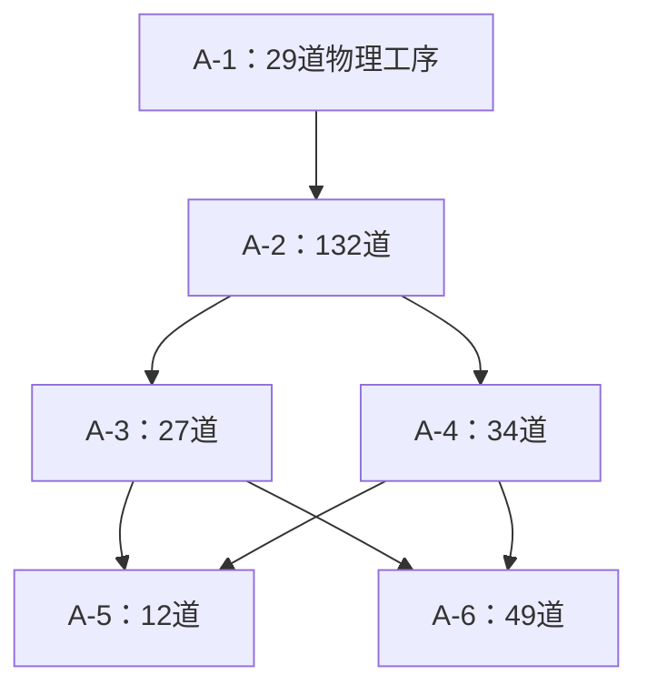

# APAL数据集拓扑解析与旧排程参考分析

日期：2026年10月1日。输入：283.csv、680.csv、2338.csv、3182.csv及用户提供的旧版排程文本。原始文件保持不变，分析通过脚本读取，仅输出统计与少量案例；没有修改生产代码、排程或研究确认稿。

## 核心发现

1. 层级依赖确实形成较大的工艺后继范围；原同站连带后移范围需要单独统计。
2. 旧排程按零基行号与283.csv对齐后，18道“未限定站位且不在末站”的初步候选中，13道没有同站后继，另外5道各有1道；这不是未来人员资格、日历与动态决定全部检查后的合法动作集合。
3. 旧排程把261／283道物理工序放在5号站（92.23%），其连带统计不能推广到其他、更均衡的排程。
4. 四份数据均有4道工序限定1号站。具体AO为AAQS00-0010、FAQJ00-3450、FDQJ00-2000、ABQJ00-0010，不能按口述数量硬编码。
5. 大规模数据包含无入边Sub；README的顺序回退说明与已读加载器快照存在需确认的差异。这比新增后移规则更优先，因为依赖解释会改变后继名单。

## 1. 节点、结构与后继范围

下表按已读加载器快照的规则构图，尚不把空Sub前序的解释认定为已核准的厂方工艺语义。

| 文件 | 物理工序 | 虚拟节点 | Root／Sub | 后继数中位数 | 最大后继数 | 无入边Sub |
| --- | ---: | ---: | ---: | ---: | ---: | ---: |
| 283.csv | 283 | 7 | 1／6 | 122 | 256 | 0 |
| 680.csv | 680 | 35 | 2／33 | 23 | 278 | 12 |
| 2338.csv | 2338 | 64 | 3／61 | 15 | 450 | 27 |
| 3182.csv | 3182 | 117 | 12／105 | 521 | 966 | 45 |

所有物理后继数均排除自身与虚拟节点，并按唯一身份去重。后继工作量为标准工时之和，不等于后移新增延迟或真实完工时间。四份输入的原始前缀逐级完全一致：283包含在680开头，680包含在2338开头，2338包含在3182开头；它们是递增扩展数据，不能当作四种独立工艺样本。

所有文件未发现重复AO、悬空前驱或环路，物理工序零工时数量均为0。物理工序工种在0—4，虚拟节点工种为-1。字段“部位容量”不用于本次分析，也不据此补充空间限制。

## 2. 283共有段的逻辑子组结构

这些是逻辑工艺子组，不是物理站位。A-3与A-4可以在依赖上并行；A-5和A-6分别等待两个前驱子组的全部任务。A-1中的每道物理工序，都通过组间关系连接后续254道物理工序；内部显式关系可能再增加同组后继，因此全图最大后继数为256。大后继范围并不代表所有这些任务都必须新增一次后移。

如果只保留Task行之间的显式紧前边，四份图分别丢失99.776%、99.598%、99.171%、99.899%的物理前后序可达关系。这里的分母是该加载器快照构图下的有序物理前序对数量，不是边数，更不是经厂方核准的工艺关系比例。这说明虚拟依赖必须显式保留或等价投影，不能仅删除虚拟行。

## 3. 旧版排程：参考映射与同站连带

排程共290行，TaskID恰为0—289，完整覆盖283.csv的290个原始行号；7个虚拟节点均在站0。文本没有AO列或生成版本指纹，因此无法独立证明生成时数据版本完全相同。以下按README定义的零基行号映射分析。

| 站位 | 物理工序数量 |
|---|---:|
| 1 | 7 |
| 2 | 5 |
| 3 | 5 |
| 4 | 5 |
| 5 | 261 |

去除4道数据限定工序及末站任务，剩余18道初步候选。13道无同站后继，5道各有1道，无候选有超过1道同站后继。对于本站任务后移一站，旧参照中已位于后站的后继不需要仅因此新增一次迁移；实际运行还要过滤已经完成、已经提交决定的任务。

代表案例：AJCP00-0150原在站3，有256道物理后继，但其中只有AJCP00-0160与它同在站3。静态下界传播将限制全部后继不得早于站4，涉及新增原同站迁移的后继只有1道。该计数不能推导实际延迟时长，也不能保证目标站人员能力满足要求。

旧模板的数字核对：物理前序站位逆序0处，完整边的End→Start数值冲突0处，限定站位冲突0处，团队人数不符0处，工人跨站使用0处，同工人区间重叠0处。未检查原始人员技能、效率与外部日历，未将模板的Start／End当作工作三多架飞机的真实绝对生产轨迹，因此不作当前版本的完整可行性认证。

## 4. 无紧前Sub：需要核准的解释

按已读快照，283中无无入边Sub；680中有12个、2338中27个、3182中45个。例如B-4、B-7、B-9、B-11。这些节点没有显式前序，也没有该快照生成的隐式入边。Root→First Sub仅连接每个Root的首个子组；若其他子组没有路径从首组进入，则图本身没有把它们绑定到所属Root的开始条件。

在当前构图下，680和2338分别出现13和16个弱连通分量；3182虽弱连通，仍有无入边Sub。弱连通不是有向前序覆盖的保证。四份图中不具有“所属Root→该物理任务”可达路径的任务数分别为0、375、1861、2189。这个检查用于定位需解释的层级组织，不自动将其判为数据错误。

归档README§6 Rule C之后的注释提及无显式Sub紧前时的顺序回退，但所读快照的构图段没有该回退分支。不能据此擅自添加顺序边：有些空前序可能表示同Root内的并行起点，有些可能确实需要省略的衔接，可能也存在其他未提供的工艺说明。

下一步应确认这些Sub的真实含义和实际使用的加载器版本。若它们是同Root内并行起点，需要核对Root开始约束是否应覆盖全部起点；若需要顺序衔接，须依据工艺说明确定前序。解释确认后再重算后继范围和联动规则。

## 5. 方法与复核范围

- 物理节点按“类型==2”识别，不按工时筛选。
- 保留原CSV行顺序，通过AO格式与当前Root／Sub状态解析层级。
- 原始边按Rule A/B/C/D/E分开记录；不新增无法溯源的边。
- 分析脚本的边集与原加载器的解析辅助函数、构图AST段逐边一致。加载器文件blob：0ca1c0f0208e484bc3109f7c7377286dd5c1a911；它是此前读取的默认分支文件快照，不代表其他审查分支。
- 显式保留虚拟节点的可达关系与物理投影逐任务全量比对一致。
- 另用独立DFS核对52个抽样物理节点的后继集合；用A子组的全部完成门槛核对关键分支关系。
- 没有运行依赖torch的完整生产加载器，没有模拟扰动或执行未来生产过程。
- 工种编码的合法值被核对；没有将五工种聚合映射认定为厂方专业互换认证。

复核包包括脚本、逐工序指标CSV、旧排程同站指标CSV、子组表、摘要JSON和可执行笔记本。笔记本以四行总表和少量案例展示结果，暂不把未核准的空Sub语义制作成工艺结论图。输入文件SHA256保存在摘要与来源清单；原始输入仍由用户上传文件提供。

## 6. 对工作三讨论的含义

先核准数据依赖，再选择后继联动机制。硬约束可以沿全部后继传播；任务集迁移和迁移费用应关注当前实际未完的同站任务，不能把全部工艺后继计成新增迁移。当前旧参考不足以支持“经常大批连带后移”或“始终只需移动少量任务”的一般结论。需要拓扑解释确认后，再叠加更有代表性的参考排程或真实决策快照。

本报告是本次数据解析记录，未替换研究确认稿中的未决设计。
