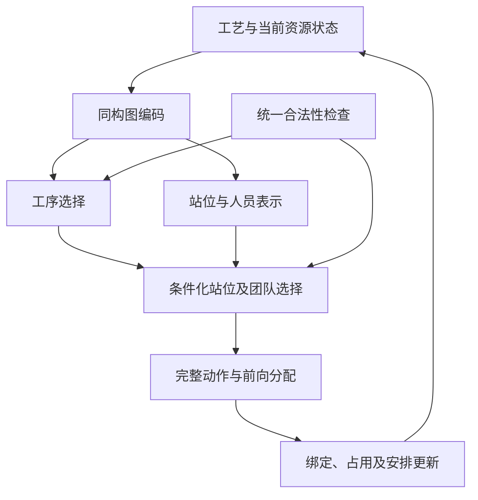

# 工作一：同构图联合决策机制与贡献细化（详细资料）

> **2026年10月6日统一核查：**本文专业术语与方案解释按[统一术语与当前定义](开题报告_统一术语与当前定义_20261006.md)使用。工作一为保留原机制的最小同构编码替换，GraphSAGE旧变体仅作参考；工作二同时介绍异构联合调度与计划稳定性重调度。原论文事实及实验结果保持原归属。

> **2026年10月6日方案来源与数据事实更新：**用户拟以工作一原论文模型为基础，仅将异构图编码改为同构图编码，保留其他机制。原稿的工序、站位、工人对象及相关属性和连接作为这一最小替换方向的基础；共享注意力实现为助手建议，尚未实施。工作二GraphSAGE变体保留为参考，不再默认是本工作拟用版本。用户确认工艺参数与四规模数据为真实工厂数据，人员总量、资格和效率为自构配置。效果仍以对应设置验证，详见《总体技术路线_详细讨论稿_20261006.md》。

> **2026年10月4日研究递进纠正（当前口径）：**按用户本轮转述的老师要求，由工作一的研究不足引出工作二：统一同构表示对不同实体／关系的区分与信息利用仍需加强，且工作一未覆盖扰动后的计划调整；对应工作二的异构图联合调度与考虑计划稳定性的动态重调度。“工作一提供基准排程”不作为两项工作的研究衔接或独立创新依据。已有生产计划、冻结／绑定继承及基准特征只在工作二模型与技术细节中按论文事实保留。详见[研究不足与递进论证校准稿](工作一二_研究不足与递进论证_校准稿_20261004.md)。本条记录形成时依据为用户转述；同日用户随后提供完整导师评价并认可递进论证，见总控中的原始记录。较早过渡段保留讨论语境，不把同构表示的局限写成已证明无法表达全部耦合或满足硬约束。

日期：2026年10月4日。用途：先保留详细论证，后续压缩为开题正文与汇报。工作一采用同构图和工序—站位—团队联合决策已确认；一、二内容分工已被用户暂时采纳，保留后续修订空间。**本文的机制解释、贡献候选与验证建议属于本轮进一步讨论，不代表新代码、实验或文献优先性已确认。**此前确定的标题、原论文和代码不改。

> **10月4日后续核对：**用户同意前轮其余机制说明，但质疑“人员占用与绑定最值得突出”的主次判断。综述及飞机装配研究支持排序、站位与人员的耦合优化，不能为本数据集排出因素贡献大小。以下保留既有机制，问题重心改为联合优化；[文献核对与表述校准](../30_文献与论证素材/工作一重点问题_权威文献核对与开题表述校准_20261004.md)记录证据与访问范围。工作二已进入[异构图与基准条件化修复细化](工作二_异构图与基准条件化修复_细化讨论稿_20261004.md)，新增草案仍待讨论。

## 1. 本轮写作层级

10月4日后续用户认可问题定位，并要求逐项核验术语、区分问题句与完整工作概括。详见[术语核验与表述对照讨论稿](工作一二_术语核验与问题方法表述对照_讨论稿_20261004.md)。本轮用户已采纳核验后的术语，并确认保存下面的详细概括；贡献候选与新实验建议继续保留待验证状态。本文件已定机制及标题不因此改变。

**工作一详细概括（用户确认保存）：**面向飞机脉动装配线的工序前序约束与多资源约束，采用同构图表示调度状态，通过自回归策略联合进行工序排序、站位分配和人员分配，构造可行的基准排程。

先保留这份完整表述，开题正文及口头汇报版本随后精简。中文术语的选择不声称唯一标准译名，人员分配具体指给定人数下的团队成员选择。

用户检查同组开题材料后认为，开题技术方案可能不必写到特别细，但详细资料对后续研究仍有用。暂按以下层级组织：

| 载体 | 保留内容 | 详细程度 |
|---|---|---|
| 详细资料 | 输入与状态、动作条件、人员绑定、掩码与时间分配、概率分解、训练反馈、证据边界、实验设计 | 用于后续论文、实现和审查，本文件保留 |
| 开题正文 | 具体问题、同构图状态、联合决策核心机制、输出、贡献与验证路径 | 让评审能够理解创新与判断可行性；层数、维数、优化器等细节按需省略 |
| 组会PPT | 一个资源耦合例子、一张方法图、核心贡献与研究基础 | 按既有汇报时间压缩，不指定新的硬页数要求 |

同组报告用于判断展示习惯，不把其详细程度当作学校正式要求。详细资料与报告正文共享方法口径，不要求直接复制全部技术细节。

## 2. 联合决策要解决的耦合

这些影响路径解释“为什么需要联合决策”，不构成哪项因素最重要的实证排序。工艺前序由数据给定；可优化的是合法候选的构造优先次序及其站位、团队选择，最终加工时序由约束检查与时间分配共同确定。

| 耦合 | 当前选择改变什么 | 对后续的影响 |
|---|---|---|
| 工序—工序 | 安排哪道工序及其完成位置与时刻 | 后继的可行站位与时间下界变化；没有显式前序的物理工序按已有正确规则进入初始候选 |
| 工序—站位 | 任务目标站位与负荷分布 | 影响本站负荷、前后序单向站位约束，以及该站可用人员 |
| 工序—团队 | 选择给定人数的具体成员 | 工时依赖被选成员效率；占用特定人员而不是抽象人数 |
| 团队—站位 | 未绑定工人的首次使用 | 确定其后续站位归属，改变未来资源配置的选择空间 |
| 团队—其他任务 | 占用人员及释放时间 | 影响需要相同资格人员的任务能否及何时安排 |

共同数据来源分开：工艺前序、标准工时、需求人数等取四规模真实工厂数据；人员总量、资格和效率由用户构造，站位及日历按已有环境和明确配置；已安排状态、绑定、占用和负荷由构造过程生成。没有新增未给定设备、空间、未来扰动或到料预测字段。虚拟节点保留依赖作用，排除物理动作、人数和工作量统计。

工作一“静态”表示不受外部扰动，构造状态仍随每个完整动作更新。模板跨度与实际整批工期分开定义，不沿用旧CAC稿“五倍节拍”文字作新方案统一口径。

## 3. 两个解释性例子

### 3.1 多技能人员与当前任务速度

假设A、B没有前序关系，所在配置允许它们使用不同工人并行加工。工人甲能做A和B，工人乙只能做A；甲做A可能更快。

- A选甲：B可能等待甲释放；
- A选乙、B选甲：可以利用不同资源并行。

这说明仅根据A的局部加工时间，不能判断整份排程优劣。哪种组合更好取决于实际工时、资格、日历和容量，不能据此断言总应保留多技能或最快工人。本例是假设条件下的机制演示，不是数据集结果、当前代码输出或性能证明。

### 3.2 首次使用绑定与站位选择

假设甲能承担A及后续另一类任务，乙只能承担A，二者最初均未绑定。若A安排到一号站：

- A选甲，则甲绑定一号站，后续不能为二号站的任务选甲；
- A选乙，则甲暂未绑定，未来仍可在一号或二号站首次使用。

这里没有假设后续工序必须在二号站加工，二号站只是未来的一个候选。方案一仍可能把后续任务安排到一号站；方案二保留了更多分配选择，但不自动保证工期更好。例子说明绑定决策影响后续选择空间，工序、站位和团队因此需要共同考虑。

## 4. “联合”与“自回归”各自表示什么

联合决策指把工序、站位和团队放在同一调度状态与整体评价下协同决定。其输出为完整动作\(a_t=(i_t,m_t,W_t)\)。自回归是生成该动作的一种方式：后一步以此前选择为条件。

自回归本身也是按顺序选择，不能仅以“分阶段”区分联合方法与传统方法。对照应明确：前面的决定是否预先固定、人员信息是否参与前面选择、是否允许迭代反馈、是否按同一整体目标优化。具有联合搜索或迭代反馈的分阶段方法也可能充分考虑资源耦合，不应笼统贬低。

对给定人数\(q_i\)，保存的有序生成轨迹为\(\widetilde a=(i,m,w_1,\ldots,w_{q_i})\)，条件分解可写为：

\[
\pi_\theta(\widetilde a\mid s)
=\pi_O(i\mid s)\,
\pi_M(m\mid s,i)\,
\prod_{r=1}^{q_i}\pi_W(w_r\mid s,i,m,w_{<r}).
\]

实际执行团队是无序集合\(W=\{w_1,\ldots,w_{q_i}\}\)。训练保存有序生成过程的对数概率，不能不加说明地把上述单条生成轨迹概率当成该无序集合所有生成顺序的总概率。

| 阶段 | 必须知道什么 | 输出 |
|---|---|---|
| 工序选择 | 工艺与资源状态、已有安排、合法候选 | 所选工序\(i\) |
| 站位选择 | 共享表示、工序\(i\)、站位合法性及资源信息 | 所选站位\(m\) |
| 第r次人员选择 | 工序\(i\)、站位\(m\)、已选成员、剩余人数和人员候选 | 下一位成员\(w_r\) |
| 动作提交 | 完整且合法的团队、日历与工序约束 | 时间安排、绑定与占用更新 |

内部选择更新的是部分团队和候选；完整动作形成后统一更新构造环境。选择顺序固定不意味着前一步永远无法利用后续资源信息：工序选择可以读取站位和人员的共享表示，整体调度反馈通过训练影响各选择头。是否真正学到这种取舍须由对照和轨迹验证，不能仅由概率分解推出。

自回归避免直接为每种团队组合建立独立输出项，使不同工序的给定人数对应不同生成长度；仍需逐次评估人员候选，编码与推理耗时需实际测量。它不自动证明全局最优、训练稳定或更快。

## 5. 同构图、选择头与约束检查及时间分配的分工

同构图统一组织工艺与资源信息，产生供选择头读取的节点／全局表示。按10月6日用户提出的最小替换方向，从工作一原稿的工序、站位、工人及原有属性／连接出发，仅替换图编码及其必要接口，不增删生产变量、解码或约束机制。助手优先建议共享参数的同构图注意力以保留原注意力家族；特征统一、索引和传播细节留待实现核对。GraphSAGE已有变体保留参考，不默认等同于此新设置，网络名称本身不构成创新。

- 编码器回答“当前哪些工艺和资源信息与选择有关”；
- 自回归策略在合法候选中作选择；
- 掩码守住资格、人数、绑定、重复成员及已有其他约束；
- 前向分配依据前驱、日历和容量确定合法时间；
- Critic估计累计回报，PPO利用采样轨迹反馈更新策略。

工人每次选择后，已选成员从候选中排除，人数与部分团队按已有机制更新。资格按模型定义检查，不自动改成新的多技能组合覆盖模型。具体忙闲与等待规则以实际环境为准。

局部动作合法与整份排程能够完成是不同命题。掩码／分配可以保证其覆盖的即时约束；未来是否仍有足够合格且合站的团队、能否完成所有任务，需要完整轨迹核查。若要主张普遍可完成性，需更强条件或论证，不能把所测实例可行率改写成任意状态保证。

按本轮最小替换方向，工作一保留其原CAC稿所述估计makespan差分奖励及对应训练机制；具体代码配置在后续核对。工作二基准阶段另含的负荷均衡信号不因此混入工作一。最终生产指标与训练中的估计／塑形信号分别解释；旧稿“五倍周期”等解释仍按已有校准边界使用。

## 6. 贡献怎样表达

建议形成一个中心贡献与两个支持机制：

- **中心贡献候选：**面向APAL工艺与资源耦合，将同构图状态编码与工序—站位—团队联合自回归决策结合，在前序、技能、人员绑定及资源占用约束下构造可行基准。人员绑定不单列为已证明的首要瓶颈。
- **支持机制一：**用条件化选择逐步构造给定人数的具体团队，处理成员选择、部分团队与后续资源占用之间的联系。
- **支持机制二：**把绑定、资格、前序及日历规则连接到动作候选和前向分配，使联合选择产生可核查的安排。

这些构成研究贡献候选；不分别宣称GraphSAGE、PPO、自回归或通用掩码为新发明，也不将一个整体结果拆成多个已独立证明的增益。两篇论文的机制是已有研究基础，学位同构方案的性能必须来自其对应设置。

## 7. 验证与当前证据

| 要回答的问题 | 对照／核查方式 | 应报告什么 | 当前限制 |
|---|---|---|---|
| 同构图联合方法是否有效 | 与同任务适配基线、规则方法比较，统一约束和时间分配 | 可行率、模板跨度、耗时与重复运行信息 | 新同构设置未验证；工作二Table VII变体仅为参考，不能直接代作本方向结果 |
| 工序构造优先策略有何作用 | 固定图表示、站位／团队规则及分配逻辑，比较学习策略与适配的工序优先规则 | 可行率、跨度及前序／资源竞争情境 | 尚无相同设置下的排序、团队和绑定因素排名；不删除工艺前序约束 |
| 学习具体团队是否有作用 | 固定同构编码及其他决策，比较人员指针与固定选择规则 | 效率、可行性和死锁；失败方案独立计数 | 现有Op–Station变体可作线索，不能自动作为新同构方案的机制证据 |
| 内生绑定是否有作用 | 比较预绑定与联合形成绑定，明确共同资格和配置 | 工期、负荷、人员分布及可行性 | 两者改变决策空间，解释为绑定配置策略比较，不假称只换网络 |
| 图传播是否有作用 | 保持信息、解码和约束，比较有／无图传播的状态编码 | 总体表现与有解释力的资源竞争情境 | CAC去GAT结果来自异构模型，不直接证明重组后的同构增益 |
| 约束守护是否正确 | 小例和完整轨迹核查前序、绑定、人数、占用及虚拟节点处理 | 违规、失败及未完成情况 | 不建议靠删除硬掩码制造不公平性能对照 |

用户已明确，全部现有对比和消融均在所提供论文中；论文未报告的实验视为未开展。上表超出论文记载的对照属于大论文阶段可考虑的验证规划，本次开题不新增实验，也不将它们写成已有研究结果。当前先登记已有证据、缺口与贡献对应关系，完整实验按既有安排推进，不作为10月8日前开题写作的前置条件。

## 8. 从工作一的研究不足引出工作二

工作一面向无扰动条件下的飞机脉动装配线，采用同构图统一表示工艺与资源状态，通过自回归策略联合安排工序、站位和人员，构造可行基准排程。在此基础上，对工艺前序、技能匹配及动态资源安排等不同关系的区分与信息利用仍需进一步加强；同时，工作一尚未覆盖扰动导致工序释放条件变化后的计划调整。为此，工作二研究按实体与关系类型组织信息的异构图联合调度，并进一步研究工序释放延迟下兼顾完工时间与计划稳定性的重调度方法。

表示侧的不足是统一编码对不同关系类型的区分与信息利用仍需加强；运行侧的不足是未覆盖外部扰动后的计划调整。不是因为工作一输出了基准才需要工作二，也不把同构图说成无法处理已有约束。基准排程仍是工作一已确认的输出，其在重调度中的具体使用属于模型背景和技术说明。

上述为过渡段草案，独立表示增益仍按对应对照限定。详见[递进论证校准](工作一二_研究不足与递进论证_校准稿_20261004.md)。

## 9. 开题压缩提纲

开题正文只需依次交代：

1. 工艺与资源耦合问题：工序排序、站位分配和具体团队共同改变后续安排，不预判因素主次；
2. 方法：同构图表示，条件化选择工序、站位及团队；
3. 可行构造：掩码与前向分配守住约束；
4. 输出与验证：基准模板、对应指标及机制对照；
5. 承接：由关系差异的进一步刻画与无扰动条件的边界，引出异构图联合调度和受扰重调度。

网络维数、层数、完整概率公式、团队记录、实现参数等保留在详细资料；正式正文是否需要某个细节，由它是否帮助理解创新与可行性决定。当前保存已确认的详细概括；正式开题段落和口头版本随后统一压缩。

## 10. 来源与状态

- [一、二内容分工](工作一二_研究内容分配与同构异构递进_讨论稿_20261004.md)：2026年10月4日用户暂时采纳。
- [两篇论文审阅与贡献重组](工作一二_论文审阅与开题贡献重组_20261003.md)：原论文事实与同构重组区分。
- [论文版本与证据来源索引](../20_论文与已有结果/论文版本与证据来源索引_20261003.md)：当前版本与成果状态。
- CAC稿§II—III、Algorithm 1：团队条件化、完整动作、绑定、掩码及估计makespan差分；原图为异构图。
- 工作二稿§III—IV、Tables VII—VIII：联合模型、基准／修复框架及同构变体线索。

两篇项目地址与运行日志仍未提供，本轮未核对项目实现。10月4日后续讨论按用户要求新增外部文献检索，访问范围及证据见[专项核对](../30_文献与论证素材/工作一重点问题_权威文献核对与开题表述校准_20261004.md)。这些来源支持研究动机，不证明本数据集的主导瓶颈，也不代表新颖性查全。
