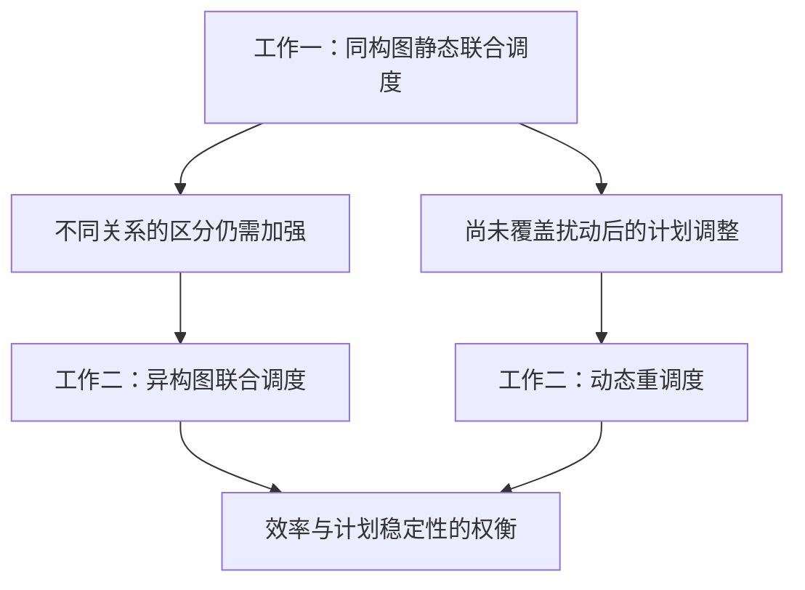

# 工作一、二：研究不足与递进论证（校准稿）

> **2026年10月4日20:40用户确认：**用户已认可依据导师评价重写的三项工作衔接及综述支撑方向。当前主线为“无扰动静态调度→工序延迟开工下动态调度→多架次协同动态调度”，方法对应“同构图→异构图→语义增强图网络”；一到二由关系区分与扰动响应需求引出，二到三由同步脉动下在制多架次的相互影响引出事件与后果语义。完整依据见[用户提供的导师评价记录](../00_总控与交付/导师评价_用户提供记录与研究递进讨论稿_20261004.md)。16:49已取得该评价记录，此前“未取得完整评价”的说明仅反映当时检索状态。确认的是研究组织和衔接表述，不代表新增实现或性能结论；已定标题、物理规则、原论文与代码沿用。下一步[文献综述细化](文献综述_章节论证与装配线平衡调度边界_讨论稿_20261004.md)为讨论稿，尚未全面替换正式正文。

日期：2026年10月4日。用途：纠正此前把排程输入／输出接口当作研究递进主线的组织方式。**本轮用户明确：应从工作一的不足引出工作二，沿同构图到异构图、理想无扰动到受扰动态调度展开。**下列新过渡段和不足措辞为本轮打磨草案，待后续讨论，不等同于新的实验结论。工作一、二已定标题、原论文、代码和已确认物理规则沿用；本次开题不新增实验。

## 1. 老师意见核对到什么程度

现有[老师要求台账](../00_总控与交付/04_老师审阅要求与开题落实台账_20261003.md)记录了用户此前转述：“就是要按照老师说的同构图到异构图的递进，工作一不一定要完全对照论文。”这是用户原话转述，不能标成老师逐字原评语。

本轮用户进一步明确，一项工作到下一项的逻辑要寻找前一项不足，而非以工作一提供基准排程说明工作二的必要性。历史对话回溯与当前资料检索没有取得老师逐字评语或完整截图；仅能确认上述转述及当前补充，不编造老师原话，也不把此前助手提出的“输出成为下一项参照”归到老师名下。

后续来源更新：16:49用户已提供完整导师讨论与评价记录，20:40确认三项衔接与综述支撑方向，见[原始记录与确认段落](../00_总控与交付/导师评价_用户提供记录与研究递进讨论稿_20261004.md)。前两段说明较早检索情况，不再据此称完整评价仍未提供；记录不推定为导师全篇逐字发言。

## 2. 两条不足分别怎样引出工作二

| 维度 | 工作一已经解决什么 | 仍需进一步研究什么 | 工作二怎样回应 |
|---|---|---|---|
| 状态表示 | 用同构图统一组织工艺与资源信息，支持工序、站位和人员联合决策 | 统一类型及传播方式未显式按不同关系类型处理工艺前序、技能匹配和动态安排；对关系差异及耦合作用的信息利用仍需增强 | 研究工序、站位、人员、技能及不同关系类型构成的异构图表示与联合调度 |
| 运行条件 | 在无外部扰动、给定工艺与资源条件下构造排程 | 未覆盖扰动导致的工序释放条件变化，以及由此产生的执行依赖和资源安排调整 | 研究释放延迟下的动态重调度，保留冻结和人员绑定约束，兼顾完工时间与计划稳定性 |

这两条分别回答“表示为什么继续发展”和“任务场景为什么继续扩展”。异构图联合调度可先在无扰动任务中研究，再用于受扰重调度；不把同构与静态、异构与动态写成技术上的唯一对应。

图中箭头表示研究不足及其回应；不表示前一项排程必须作为后一项算法输入，也不要求迁移前一项已训练权重。共同工艺、资源约束和联合动作作为方法基础继承。

## 3. “同构图不足”怎样表述才准确

推荐写法：**工作一采用统一同构表示，针对工艺前序、技能匹配和资源安排等不同关系的区别及耦合作用，仍有进一步加强表示与信息利用的空间。**随后明确工作二按类型组织哪些关系、怎样进行消息传播。

不写成“同构图根本不能表达复杂耦合”或“同构图无法满足这些约束”。实体属性和索引仍可进入同构表示；硬约束由模型、候选掩码和时间分配检查。异构编码增强关系区分，不替代这些合法性规则。

图神经网络原始研究[Heterogeneous Graph Transformer](https://arxiv.org/abs/2003.01332)使用节点和边类型相关参数刻画不同关系，可支持按类型处理关系的建模动机。本轮核对作者摘要，不引入HGT网络、不把其其他任务的性能结果转用到APAL，也不据此证明当前同构实现必然失效。

现有工作二Tables VII–VIII有同构GraphSAGE对照，但同时改变关系处理与聚合算子。因此，不足可以作为研究动机，独立关系增益仍须谨慎表述。论文未报告的对照即未开展，必要补充留到大论文阶段考虑。

## 4. 过渡段打磨草案

工作一面向无扰动条件下的飞机脉动装配线，采用同构图统一表示工艺与资源状态，通过自回归策略联合安排工序、站位和人员，构造可行基准排程。在此基础上，对工艺前序、技能匹配及动态资源安排等不同关系的区分与信息利用仍需进一步加强；同时，工作一尚未覆盖扰动导致工序释放条件变化后的计划调整。为此，工作二研究按实体与关系类型组织信息的异构图联合调度，并进一步研究工序释放延迟下兼顾完工时间与计划稳定性的重调度方法。

该段保留工作一已确认的联合调度价值，再指出表示与运行条件的边界，最后引出工作二两部分。不因需要递进而把工作一写成不能处理已有前序、技能或人员约束的方法。

后续压缩的逻辑骨架：**统一同构表示与理想无扰动条件 → 关系差异的进一步刻画与扰动响应需求 → 异构图联合调度及动态重调度。**正式简版另按汇报篇幅形成；本段暂作详细讨论资料。

## 5. 工作二的研究问题与贡献应围绕什么

两项相连的问题草案：

1. 如何利用不同类型的工艺与资源关系，增强工序排序、站位分配和人员分配的联合决策？
2. 工序释放条件受到扰动后，如何调整允许修改的计划，兼顾完工时间与计划稳定性？

对应两项贡献候选：**面向工艺与资源耦合的异构关系表示及联合调度；扰动下考虑计划稳定性的联合重调度。**自回归团队选择、首次绑定、通用掩码和PPO是共同基础，不重复计为工作二首次提出。

工作二仍按已选方案A同时展示异构图联合调度与考虑计划稳定性的重调度。阶段尚未结束时响应释放延迟，已绑定人员不跨站重新配置；冻结集及未使用人员首次绑定按当前论文定义。变化的是论证组织和贡献重心，没有删改已有模型输入或新增动作。

## 6. 已有生产计划放在哪里

在本研究的重调度场景中，扰动发生前已有生产计划是问题背景；它限定保留的安排，也为计划偏离提供参照。当前论文还把部分基准信息作为工序特征。这些按模型事实保留在技术说明中。

不把“存在基准排程”“读入基准排程”本身写成独立创新，不以“工作一产生排程给工作二使用”代替不足论证，也不规定已有计划只能由工作一产生。原实验计划来源只按论文明示登记，不另作推定。

此前[工作二详细对照](工作二_研究问题方法贡献与证据对照_详细资料_20261004.md)§4.1–4.3关于基准特征、冻结继承及偏离评价的说明保留为技术解释，降低其开题论证权重，不作为一到二的主要衔接。无需为了改写研究动机删除论文已记载的输入通道。

## 7. 本轮一致性修改

- [一二分工稿](工作一二_研究内容分配与同构异构递进_讨论稿_20261004.md)：承接图改为不足及回应，删除基准输入链作为研究主线。
- [工作一详细稿](工作一_同构图联合决策机制与贡献细化_详细资料_20261004.md)：保留已确认概括，重写引出工作二的段落。
- [工作二细化稿](工作二_异构图与基准条件化修复_细化讨论稿_20261004.md)及[贡献证据对照](工作二_研究问题方法贡献与证据对照_详细资料_20261004.md)：两部分沿研究不足组织；基准使用降为技术说明。
- [研究框架](开题第一步_研究框架与三项工作定位_v2.md)、[总控](../00_总控与交付/00_开题报告总控文稿_论证大纲与复用索引_20260928.md)、[任务表](../00_总控与交付/03_开题报告_工作二三整理任务表_按老师递进_20261003.md)及[老师要求台账](../00_总控与交付/04_老师审阅要求与开题落实台账_20261003.md)：纠正当前递进表述与来源归属。

早期历史记录依本轮最新口径理解；本轮不改工作三首版架构、不重写既有论文、不运行新实验。

## 8. 三项递进已确认后的综述推进

本课题围绕飞机脉动装配线的工序排序、站位分配与人员分配，按照“无扰动静态调度—扰动下动态调度—多架次协同动态调度”逐步展开，并相应研究同构图、异构图及语义增强图网络的状态表示方法。

工作一首先面向无扰动条件下的静态调度问题，采用同构图统一组织工艺与资源信息，通过自回归策略联合进行工序排序、站位分配和人员分配，构造可行排程。在此基础上，对工艺前序、技能匹配和资源安排等不同关系的针对性处理仍需加强，且无扰动条件下的研究尚未覆盖工序延迟开工后的计划调整。因此，工作二引入异构图，分别组织不同实体及关系的信息，并研究工序延迟开工扰动下兼顾完工时间与计划稳定性的动态调度。

工作二重点研究受扰周期计划的修复，尚需进一步考虑不同在制飞机在实际执行中的相互影响。在多架次连续生产中，各站位承载不同飞机，其任务进度共同决定全线同步脉动的时刻；局部延迟还可能影响其他飞机的转站与后续周期安排。因此，工作三在异构图表示基础上引入事件与后果语义，在工序／飞机、站位和整线层面预测当前及紧邻下一周期的时间后果，将现场状态进一步转化为对全线运行影响的理解，为多架次协同动态调度提供依据。

用户已确认以上研究组织。下一步按导师三节方向细化文献综述，见[章节论证与平衡／调度边界讨论稿](文献综述_章节论证与装配线平衡调度边界_讨论稿_20261004.md)；具体综述段落和缺口结论继续讨论。
