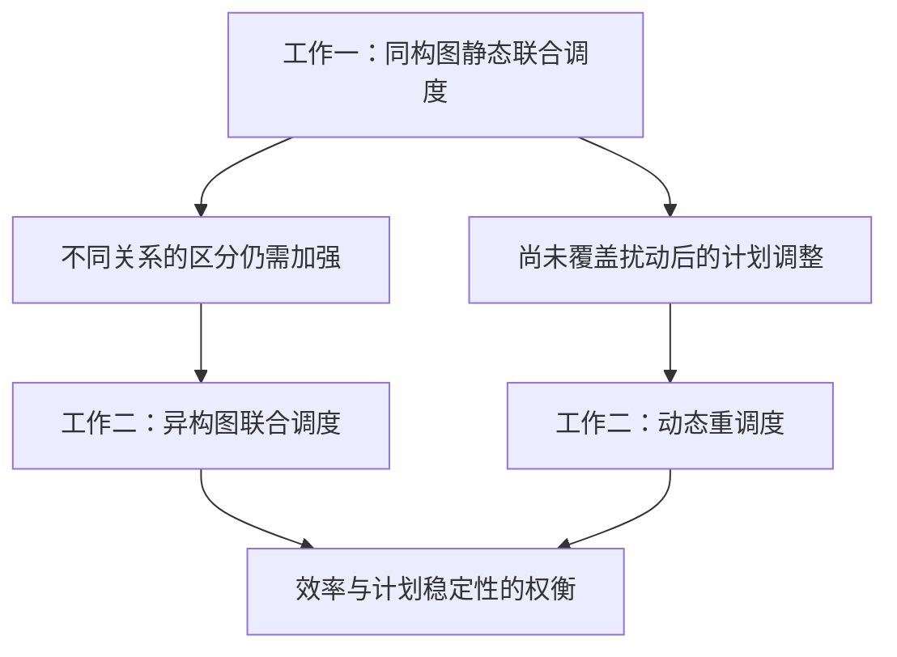

# 工作一、二研究内容分配与同构图—异构图递进（讨论稿）

> **2026年10月6日统一核查：**本文保留当轮讨论与来源。已经确认的当前术语、研究方向及证据状态以[统一术语与当前定义](开题报告_统一术语与当前定义_20261006.md)和后续对应详细稿为准；早期候选不自动成为首版设计。原论文事实与用户／导师原话保持原归属。

> **2026年10月4日研究递进纠正（当前口径）：**按用户本轮转述的老师要求，由工作一的研究不足引出工作二：统一同构表示对不同实体／关系的区分与信息利用仍需加强，且工作一未覆盖扰动后的计划调整；对应工作二的异构图联合调度与考虑计划稳定性的动态重调度。“工作一提供基准排程”不作为两项工作的研究衔接或独立创新依据。已有生产计划、冻结／绑定继承及基准特征只在工作二模型与技术细节中按论文事实保留。详见[研究不足与递进论证校准稿](工作一二_研究不足与递进论证_校准稿_20261004.md)。本条记录形成时依据为用户转述；同日用户随后提供完整导师评价并认可递进论证，见总控中的原始记录。较早过渡段保留讨论语境，不把同构表示的局限写成已证明无法表达全部耦合或满足硬约束。

> **2026年10月4日阶段内边界与工作二继续细化：**用户补充：工作二在当前阶段尚未结束时响应扰动，已绑定人员保留原站位；文献中的阶段末人员调整不直接作为本研究阶段内方案的替代选择。冻结集、全部基准人员绑定继承及未使用人员首次绑定规则继续按当前论文定义。用户已赞同并理解“异构图联合调度＋考虑计划稳定性的重调度”两部分，本轮继续解释基准排程作为网络背景、约束继承依据及偏离评价固定参照的三种用途，见[工作二详细对照](工作二_研究问题方法贡献与证据对照_详细资料_20261004.md)§4.1–4.3。新机制解释保持讨论状态；本轮不修改标题、原论文或代码，不新增实验。

**2026年10月4日最新确认：**推荐术语及工作一详细概括已确认保存；工作二本轮方案A为“异构图联合调度＋考虑计划稳定性的重调度”，两部分保留在同一项工作中。全部现有实验以论文记载为准，未报告的实验即未开展，补充实验留到大论文阶段考虑。新增[问题、方法、贡献与证据对照](工作二_研究问题方法贡献与证据对照_详细资料_20261004.md)；冻结与绑定保留详细定义，简版随后精简。下文机制及分工继续有效，具体贡献效果仍依其证据边界理解。

日期：2026年10月4日。服务开题内容组织，不修改代码、原论文或此前已定标题。**方案A及工作一使用“同构图”称呼已由用户确认；下述内容分配于10月4日由用户暂时采纳，作为当前安排；具体实现与贡献细节继续讨论。**

> **10月4日后续讨论：**用户同意前轮其余机制解释，但要求用文献或以后实验核对工作一的重点，不能预先把人员占用／绑定排为最突出因素。现有综述和飞机装配研究支持排序、站位与人员的耦合问题；本数据集因素主次仍待对应实验。详见[专项核对](../30_文献与论证素材/工作一重点问题_权威文献核对与开题表述校准_20261004.md)。随后开始[工作二细化](工作二_异构图与基准条件化修复_细化讨论稿_20261004.md)，其新增解释及贡献草案仍属讨论状态。

## 1. 本轮已确认与仍待核对

用户确认优先采用方案A：“多实体信息统一同构编码＋工序—站位—团队联合决策”，要求解释为“同构图”，由工作一引出工作二的异构图，并一起讨论两项工作的内容取舍。

执行用语：工作一采用**同构图**，工作二采用**异构图**。工作一统一图输入与消息传递规则；工序、站位和人员仍可由属性和索引区分，以支持联合动作。不同物理对象进入统一图，不等于运行约束被合并。具体节点集合、特征格式、边方向、池化和共享参数仍需核对实际实现；没有确认三类／四类实体、特定编码层数或当前代码已完成。

本轮分配的原则：工作一建立完整的静态联合调度方法，重点展示联合决策与可行构造；工作二继承共同基础，重点展示异构关系及受扰计划修复。工作一采用同构图以后，资源信息、具体团队、人员绑定和硬约束仍保留；取舍的是表示方式及各节展开重点。

## 2. 暂采纳的分工表

| 内容 | 工作一的主要任务／展示 | 工作二的继承与新增 | 贡献归属边界 |
|---|---|---|---|
| APAL共同模型 | 讲清工艺、同步脉动、站位单向流动、技能、规定人数、资源占用、人员绑定及模板跨度 | 简述继承的模型，新增扰动揭示、更新释放及模板冻结边界 | 共用基础不重复列两次创新；实际约束来源须明确 |
| 图状态编码 | 同构图；统一组织任务、站位及人员等信息，服务完整联合决策 | 异构图；明确实体及关系，结合基准、延迟、冻结和资源状态 | 表示增量是关系处理与动态条件，不按节点数量直接证明优越性 |
| 联合动作分解 | 完整展开工序→站位→具体团队，说明后一步受前一步选择影响 | 沿用联合动作骨架，在受扰与承诺条件下选择允许修改的任务及团队 | 自回归首次完整介绍放一；二介绍在新条件下的使用与扩展 |
| 团队选择 | 给定人数下选择具体成员，部分团队与余下人数影响后续候选；选择效率影响工时与占用 | 在绑定与冻结边界内调整可变任务的团队，权衡恢复效率和团队偏离 | 两篇均有部分团队条件化描述，不能直接归为二的新机制 |
| 人员站位绑定 | 首次使用时内生确定绑定；说明绑定与后续分配耦合 | 继承已有绑定，保留可调整任务与人员之间的合法匹配 | 二不把工人跨站重新流动作默认恢复手段 |
| 掩码与前向分配 | 解释前序、技能、人数、重复成员、绑定、占用和容量怎样守住可行性；确定最早可行时刻 | 增加／适配更新释放、冻结任务与修复下界，继续使用共用可行分配 | 图网络不单独保证可行；冻结规则按工作二计划模型，不冒充工作三实际提交规则 |
| 优化目标 | 模板跨度；同构方案训练信号待对应设置核对，不直接沿用工作二负荷均衡项；最终评价注明单位与口径 | 效率、相对基准超限、开工偏离、改站和团队变化的权衡 | 五项加权不是单独足够的算法创新；分量不能宣称全部更优 |
| PPO与Critic | 说明训练框架与价值估计，作为基础方法 | 继承PPO；解释异构模型在基准阶段与修复阶段怎样训练 | PPO／Critic本身不重复列为新贡献，权重迁移须有对应结构依据 |
| 技能、EFT及稀缺特征 | 资格与效率作为共同资源信息；具体特征以实现为准 | 可解释动态竞争与当前团队评估的增强，是否新增需版本对照 | 若技能节点两项均保留，不能列“新增技能节点”；附录公式更详细不等于机制首次出现 |
| 输出与证据 | 可行基准模板；同构方法的整体性能与联合决策作用 | 修复模板；异构表示、基准条件与稳定修复的作用 | 原论文基础、重组方法和拟验证效果分开；不转用完整异构模型数字作为一的同构效果 |

## 3. 工作一需要展示的完整研究内容

研究问题：无外部扰动时，工序、站位和具体人员团队共同决定工时、资源占用与后续选择空间，如何联合构造可行基准？静态表示不含外部扰动，排程构造状态仍随每次动作更新。

建议重点展开三部分：

1. **同构图与联合资源状态。** 说明任务需求与资源状态进入统一图的方式，输出哪些向量给工序、站位、人员选择头。既有虚拟节点保留依赖作用，排除物理动作及工作量统计；不增设数据没有的设备、空间或预测字段。
2. **自回归工序—站位—团队决策。** 团队人数为各工序给定，优化具体成员。选定工序后限制站位，选定站位后限制团队；每增加成员，部分团队与候选更新。首用绑定改变后续可选团队，因此要与工序和站位一起考虑。
3. **逐步可行构造。** 掩码限制离散选择，前向分配确定最早可行时刻，安排结果回到下一步状态。明确合法性来自哪条约束和哪段执行逻辑，不能把GNN称为自动保证可行的模型。

贡献候选：面向APAL工艺与资源耦合，将同构图状态编码与有约束的工序—站位—团队自回归决策相连接，在前序、技能、人员绑定及资源占用约束下构造可行基准。该组合的文献新颖性和各机制独立作用仍须相应证据，不将GraphSAGE、PPO或通用掩码本身称为原创算法，也不预排排序、团队与绑定因素的重要性。

## 4. 工作二需要展示的新增研究内容

研究问题（详细版保留）：工序释放时间延迟后，如何在冻结工序和人员站位绑定约束下，对已有基准排程进行重调度，兼顾完工时间与计划稳定性？

工作二完整范围按已选方案A展开异构图联合调度与考虑计划稳定性的重调度；表示增量和任务增量都保留。

建议重点展开三部分：

1. **由同构图到异构图。** 工艺前序、任务安排、技能需求、资格和归属具有不同含义。异构关系分开组织这些信息，再结合当前基准、延迟与冻结条件进行决策。不同关系的作用应给出实际例子，不能只增加彩色节点或网络名字。
2. **基准条件化的受扰修复。** 明确触发时已知的释放信息、冻结／可调整任务、继承绑定与修复下界。扰动发生前不可预知，已知条件限于触发后当前揭示内容，不增加未来到料预测能力。
3. **受约束的任务与团队调整。** 沿用一的联合动作，在允许改变的部分选择顺序、站位与具体团队；指标区分效率、开工偏离、站位与团队变化。未开工不自动等于可任意更改，具体冻结集遵从论文计划层定义。

贡献候选：利用基准与扰动条件化异构图，区分不同实体和资源关系，在承诺继承下联合修复任务与团队，检验效率和计划偏离的权衡。异构静态基准生成也应保留为表示对照／训练基础，不因二重点受扰修复而删除。

## 5. 两项工作怎样承接

研究衔接以工作一的不足为依据：统一同构编码尚需进一步区分工艺与资源关系，且工作一尚未覆盖扰动后的计划调整。分别引出工作二的异构图联合调度与考虑计划稳定性的动态重调度。

已有生产计划是工作二场景中的背景与偏离参照，其来源不限定为工作一。原论文实际基准来源以稿件明示为准；不把计划传递关系当作研究必要性或创新依据。

工作二内部的无扰动异构模型训练及受扰继续训练属于技术安排；同构权重向异构权重的转换不能作默认前提。同构与异构作用应在相同任务、信息与约束下比较，不能直接以静态工作一与受扰工作二的结果差值证明关系类型收益。

过渡段草案与证据边界见[研究不足与递进论证](工作一二_研究不足与递进论证_校准稿_20261004.md)。

## 6. 实验与证据怎样分配

| 要验证的命题 | 建议对照 | 归属 | 当前证据与限制 |
|---|---|---|---|
| 同构图联合构造能输出高质量可行基准 | 同任务规则／适配基线，统一约束与时间分配 | 一的整体方法 | 当前Table VII有同构变体可行性与初始结果线索，配置与代码待核；CAC整体结果来自异构模型 |
| 联合团队选择与绑定决策有作用 | 固定编码器，比较团队指针与固定规则／预绑定 | 一的机制 | 当前变体改变的项需核对；不可行方案单报，不能用失败结果代替低工期 |
| 异构表示改善同任务信息利用 | 静态：同构／异构；受扰：同构／异构 | 二的表示增量 | 当前Tables VII–VIII提供对照；GraphSAGE与GATv2包含算子变化，不能将差值只归因关系类型 |
| 基准与扰动条件有作用 | 受扰任务中保留／去除基准条件，其他条件一致 | 二的动态信息 | Table VIII去基准条件变体是整体线索，不能分别证明每个特征 |
| 修复兼顾效率与偏离 | 同一基准、事件、冻结与绑定条件下比较恢复方法 | 二的恢复方法 | Tables VIII–X分开报告综合指标、分量与统计；平均较好不等于各分量全胜或校正检验显著 |

若未来要单独验证关系类型，应尽量使用相同聚合算子的同构／异构版本并控制信息、约束和预算。用户已明确，全部现有对比和消融均已写入论文，未报告者视为未开展。补充对照可在大论文阶段考虑，本次开题不新增实验，先登记已有证据的准确作用。

## 7. 暂不拆成两项独立创新的内容

- PPO、Critic、通用MLP、GraphSAGE／GAT名称：基础工具。
- 自回归、首用绑定、通用人员技能掩码：工作一完整介绍，工作二继承，不重复包装。
- 部分团队条件化：CAC已描述，工作二可进一步发展，但新增范围需版本证据。
- 技能节点、预计完工与稀缺特征：逐项核对是否确属新机制，不凭篇幅增加判定首次出现。
- 模板跨度与真实周期：按统一层级定义，不混成单架总装全程时间；不把二的冻结机制套成三的实际提交规则。

## 8. 当前采纳状态与下一步

已确认：方案A、工作一同构图、工序—站位—团队联合决策，以及由一到二的同构图—异构图递进。10月4日用户进一步暂时采纳本稿分工表与叙述重心，作为当前推进安排，后续可修订。

继续讨论／核对：具体节点集合、新增特征归属、联合决策的贡献与证据。设计确认、代码核对和方法效果验证分别记录。用户要求先保留详细资料，再压缩开题技术方案；详见[工作一联合决策详细资料](工作一_同构图联合决策机制与贡献细化_详细资料_20261004.md)。

工作一影响路径已展开，后续核对将问题重点校准为联合优化，并把因素主次留待对应实验。当前进入工作二，优先解释异构关系如何区分工艺、技能与动态安排，以及它们怎样与基准／释放／冻结条件配合；详见[工作二细化讨论稿](工作二_异构图与基准条件化修复_细化讨论稿_20261004.md)。

## 9. 依据

- [两篇论文审阅与贡献重组](工作一二_论文审阅与开题贡献重组_20261003.md)
- [老师要求与落实台账](../00_总控与交付/04_老师审阅要求与开题落实台账_20261003.md)
- [论文版本与证据来源索引](../20_论文与已有结果/论文版本与证据来源索引_20261003.md)
- 当前CAC稿§II—III：联合动作、部分团队、绑定及掩码的既有基础。
- 当前工作二稿§III—IV、Tables VII—XI及附录：异构表示、受扰修复与证据范围。
