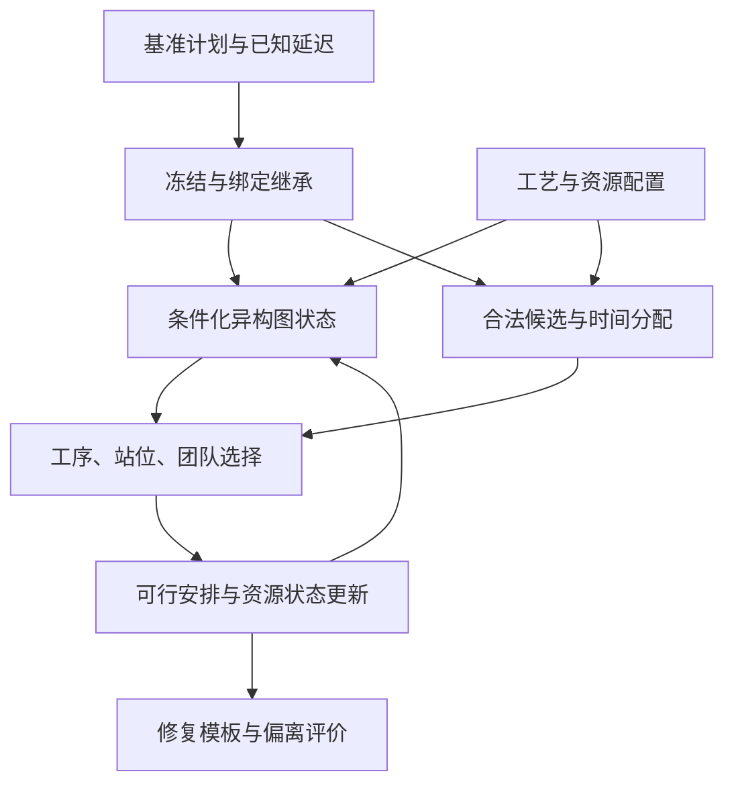

# 工作二：异构图与基准条件化修复（细化讨论稿）

> **2026年10月6日统一核查：**本文保留当轮讨论与来源。已经确认的当前术语、研究方向及证据状态以[统一术语与当前定义](开题报告_统一术语与当前定义_20261006.md)和后续对应详细稿为准；早期候选不自动成为首版设计。原论文事实与用户／导师原话保持原归属。

> **2026年10月4日研究递进纠正（当前口径）：**按用户本轮转述的老师要求，由工作一的研究不足引出工作二：统一同构表示对不同实体／关系的区分与信息利用仍需加强，且工作一未覆盖扰动后的计划调整；对应工作二的异构图联合调度与考虑计划稳定性的动态重调度。“工作一提供基准排程”不作为两项工作的研究衔接或独立创新依据。已有生产计划、冻结／绑定继承及基准特征只在工作二模型与技术细节中按论文事实保留。详见[研究不足与递进论证校准稿](工作一二_研究不足与递进论证_校准稿_20261004.md)。本条记录形成时依据为用户转述；同日用户随后提供完整导师评价并认可递进论证，见总控中的原始记录。较早过渡段保留讨论语境，不把同构表示的局限写成已证明无法表达全部耦合或满足硬约束。

日期：2026年10月4日。用途：承接工作一重点问题核对，开始细化工作二，为开题保留详细资料。已采纳的一、二分工继续有效；用户已选择“异构图联合调度＋考虑计划稳定性的重调度”的方案A，并要求详细版先保留；新的解释及贡献措辞仍供讨论，不将其全部标为新确认机制。此前工作一、二标题原文不改；工作二论文仍为未投稿稿，目标期刊IEEE Transactions on Systems, Man, and Cybernetics: Systems。

## 1. 从工作一引出什么问题

10月4日后续讨论明确：前轮问题句用于说明困难与递进，不单独承担完整工作介绍。完整概括须同时说明异构表示、联合调度与考虑计划稳定性的重调度；术语用法及建议句见[表述对照讨论稿](工作一二_术语核验与问题方法表述对照_讨论稿_20261004.md)，推荐术语与工作一详细概括已获用户确认，工作二采用方案A；不修改此前已定标题或现有模型。

**工作二详细概括（按用户选定结构保存）：**采用工序、站位、人员和技能构成的异构图表示调度状态，研究工序排序、站位分配与人员分配的联合调度方法；进一步结合基准排程及扰动后更新的工序释放时间，在冻结工序和人员站位绑定约束下进行重调度，兼顾完工时间与计划稳定性。

本轮已经建立[问题、方法、贡献与证据对照](工作二_研究问题方法贡献与证据对照_详细资料_20261004.md)，说明两部分如何连接，并核对冻结及人员绑定在文献中的表述层级。

工作一在无外部扰动下，用同构图组织调度状态，联合决定安排哪道工序、放在哪个站位、选择哪些具体成员，形成可行基准。

工作二继承这些联合决策和约束，继续回答：**工序释放时间延迟后，如何在冻结工序和人员站位绑定约束下，对已有基准排程进行重调度，兼顾完工时间与计划稳定性？**

该问题句先保留详细约束。异构图联合调度是工作二完整范围的一部分，另在方法概括中明确展开；后续简版可把具体冻结和绑定规则集中放在模型说明，不将其声称为所有工厂的通用规定。

两条研究递进均由工作一边界引出：统一同构表示对工艺与资源关系的区分仍需加强，且理想无扰动条件尚未覆盖释放条件变化后的计划调整。工作二分别研究异构图联合调度与受扰动态重调度；已有基准属于问题背景，不以工作一输出基准作为衔接论据。它们不能混成“静态只能同构、动态必须异构”；异构图也有无扰动基准训练与对照。工作二的异构表示作用，应在同一静态或同一受扰任务中比较。

| 内容 | 工作一 | 工作二的细化重心 |
|---|---|---|
| 问题 | 联合构造基准 | 参照既有计划进行受扰修复 |
| 状态表示 | 统一同构编码 | 按实体与关系类型编码，并加入基准／释放／冻结条件 |
| 动作 | 工序→站位→给定人数的具体团队 | 沿用动作骨架，面向允许修改的工序 |
| 可行性 | 前序、站位单向性、技能、人数、绑定及占用 | 继承共同约束，另满足冻结与修复时间下界 |
| 输出 | 基准模板 | 修复模板及相对基准的变化 |

人员绑定仍是共同模型约束；没有将其评为比工序排序更重要的因素。依据见[工作一文献核对](../30_文献与论证素材/工作一重点问题_权威文献核对与开题表述校准_20261004.md)。

## 2. 异构图具体区分什么

不同关系都能影响一个工序，但影响方式不同。前驱关系约束执行先后，技能关系约束候选资格，人员和站位安排关系描述资源使用。异构图按节点类型组织输入、按关系类型传递信息，给策略提供联合表示。

当前工作二稿明确使用工序、站位、人员、技能四类节点。工作一同构方案的具体节点集合仍需核对，不能简单地把工作二的创新写成“多增加一个节点类型”。同构图仍可通过属性区分实体；二的表示增量在于显式按类型处理不同关系。

下表取自当前工作二稿Tables II–III及§IV-B，不新增未核对关系：

| 信息 | 当前论文中的表达 | 稳定／变化情况 | 对决策的作用 |
|---|---|---|---|
| 工艺前序 | 工序→工序，precedes | 拓扑固定 | 提供前序链及任务合法性背景 |
| 工序需要的技能 | 工序↔技能，requires／required-by | 需求固定 | 联系具有相同需求的任务及技能资源 |
| 人员具备的技能 | 人员↔技能，has-skill／provided-by | 资格固定 | 联系技能需求与合格人员，表达潜在竞争 |
| 工序的当前站位安排 | 工序↔站位，assigned-to／has-task | 随安排变化 | 联系任务分布和站位负荷 |
| 工序的当前团队 | 工序→人员，done-by | 随安排变化 | 表达具体成员归属及资源使用 |
| 人员站位绑定 | 人员节点的绑定属性，并由合法性规则检查 | 按模型建立及继承 | 限制人员可服务的站位；当前稿没有单列“人员—站位绑定边” |

节点还保存工时／需求、站位负荷与等待、人员效率／日历、技能容量等已有状态。没有增加数据未提供的设备、空间测量或未来扰动信息。

### 一个说明性例子

假设A是B的前驱，C与A没有前序关系，但C需要某些相同人员。A的释放时间延迟后：

- B的最早可行开工可能通过工艺依赖受到影响；
- C不受这条前序链直接限制，但其资源安排可能改变，方向取决于具体日历与负荷；
- 可调整任务还必须遵守既有绑定与冻结边界。

图中分别保留这些关系，策略可以结合不同路径的信息作选择。例子说明不同关系类型的用途，不证明注意力权重具有因果解释性，也不证明异构图一定获得更优排程。

## 3. 修复模块接受哪些输入

| 输入 | 来源 | 使用位置 |
|---|---|---|
| 原始工艺、需求与人员配置 | 现有数据及明确环境配置 | 图状态、候选生成、可行分配 |
| 基准计划π⁰ | 已有可行模板；原实验来源以论文明示为准，未明示时不补作推定 | 保留基准站位、团队及起止时刻，用于冻结与偏离评价 |
| 已揭示的更新释放时间rᵢ | 修复触发时已知的扰动信息 | 特征、最早开工约束与时间分配 |
| 计划冻结边界τʳ | 当前工作二计划修复模型 | 划分冻结和可调整任务 |
| 基准形成的人员绑定 | 基准安排及资源账本 | 人员特征、团队候选与可行检查 |
| 当前修复进度 | 每次完整安排后更新的构造状态 | 动态边、负荷、占用和下一步决策 |

完整基准团队身份应在参考排程中保留，以计算团队变化。不能因为工序特征含“基准人数”，就声称所有成员身份均被编码进工序特征。当前稿明确列出了基准开工、站位、人数及冻结／延迟标志等条件；具体特征排列和代码接口仍需核对。

扰动发生前不预知未来信息。当前论文是在修复触发时假设更新释放时间已知，其实证场景为物料就绪延迟；不据此声称验证了人员缺席、设备故障、工时变化或工艺路线变化。

## 4. 冻结与可调整边界

**2026年10月4日用户补充确认：**工作二响应的是当前阶段尚未结束时发生的扰动，某些工序因释放条件变化而延迟开工；阶段内重调度保留人员站位绑定，不允许已绑定人员跨站重新分配。文献在阶段结束后允许人员调整，与本研究的阶段内规则处于不同调整时点。阶段结束后的人员重新配置不纳入工作二当前方案，也不据此推定当前方案到阶段末会自动解除绑定。当前论文在计划层继承基准中的全部人员绑定，冻结集继续按原定义划分；没有改成仅绑定此刻正在工作的人员。此前未使用人员的首次绑定规则仍保留。

当前论文按**基准开工时刻**定义计划层冻结集：

\[
\mathcal O_{frz}=\{i:B_i^0\le\tau^r\},\qquad
\mathcal O_{mov}=\{i:B_i^0>\tau^r\}.
\]

冻结项继承原站位、团队及起止时刻；可调整项满足\(B_i^r\ge\max(\tau^r,r_i)\)，并继续满足前序及资源约束。所有已在基准中使用的人员继承站位绑定，只有此前未使用的人员保持未绑定。

这与工作三依据真实执行和正式提交维护不可撤回承诺的机制不同。不能用“当前实际未开工”替换工作二的上述集合，也不能为了降低工期允许已有绑定人员跨站。

释放延迟与冻结承诺需相容：若某冻结项被赋予晚于其冻结开工的释放时间，同时又要求保留原时刻，两个条件会冲突。正式实验应核对场景选择及可行性；本轮未读取生成代码，不声称所有边界情形已经验证，也不擅自改变冻结定义。

## 5. 算法流程及模块职责

下面的基准使用是论文技术细节，不作为一到二的研究递进或独立创新依据。本轮此前细化基准排程的三个用途：作为工序输入的原计划背景、用于冻结和绑定继承、作为效率与计划偏离的固定参照。详见[贡献与证据对照](工作二_研究问题方法贡献与证据对照_详细资料_20261004.md)§4.1–4.3的模块表、站内例子与流程图。基准始终保留，动态修复状态随安排更新；Table II未列出的完整原团队成员身份不能自动写成工序输入特征。

1. **继承承诺。** 读取基准，划分冻结／可调整任务，保留冻结条目与人员站位绑定。
2. **构建状态。** 工艺／资格关系与当前安排／资源状态共同形成异构图，加入基准、已知释放和冻结条件。
3. **联合选择。** 沿用工序→站位→团队的自回归骨架，每层在合法候选中选择；工序人数给定，优化具体成员。
4. **形成可行时间。** 前向分配依据更新释放、冻结下界、前驱、人员日历和容量确定时间；完整动作后更新构造状态。
5. **评价与训练。** 最终与基准比较，PPO使用相应训练反馈更新策略，Critic估计累计回报。

图编码负责表示，策略负责取舍，掩码与时间分配负责其覆盖的硬约束，评价负责效率和偏离。异构图本身不替代合法性检查，也不自动保证任意状态都能完成排程。

## 6. 输出与“稳定性”的含义

主要输出是修复模板πʳ，包括每道物理工序的站位、具体团队、起止时刻，保留冻结项，并报告约束核查结果。虚拟节点参与结构表达但不成为物理任务、团队人数或工作量统计项。

当前论文综合评价五类量：修复模板跨度、相对基准参考跨度的超限、平均开工偏离、改站率和团队变化率。稳定性指对既有计划的偏离程度，不是泛指训练曲线稳定；综合分数较好也不等于每一项偏离都更小。权重是当前稿的配置，不作为普遍工业标准。

工作二输出计划模板，不输出扰动切换时多架在制飞机的完整真实转站轨迹。固定模板的稳态展开与受扰模板切换的实际过渡要分开，这为工作三的多架次实际执行研究留下具体问题。

## 7. 研究贡献如何组织

建议把工作二组织为一个中心问题、两项相互连接的增量：

- **表示增量：**按实体与关系类型组织工艺依赖、技能匹配和动态安排，在共同信息下检验异构表示的作用。
- **任务增量：**从无扰动条件扩展到释放延迟下的动态重调度，研究在阶段内绑定及冻结范围内调整任务和团队，并兼顾完工时间与计划稳定性；已有计划作为背景和偏离参照。

贡献草案：面向既有模板受开工可用性延迟影响的恢复问题，将基准与扰动条件融入异构图联合决策，在冻结及人员绑定约束下修复可调整计划，并检验效率与计划偏离的权衡。

PPO、通用掩码、自回归骨架、给定人数团队选择及首用绑定是继承的共同基础。不能将它们再次逐项列为工作二独有创新；也不将四类节点、GATv2名称或五项加权目标本身当作充分创新依据。

## 8. 现有证据和以后验证

**用户本轮确认：全部现有对比和消融已经写入所提供论文；未报告的实验即未开展。**不再假设另有未提供的对照结果。以下超出稿件的建议留到大论文阶段考虑，本次开题不新增实验。详细证据登记见[贡献与证据对照](工作二_研究问题方法贡献与证据对照_详细资料_20261004.md)§6–7。

| 命题 | 当前工作二稿可用证据 | 表述边界／进一步核对 |
|---|---|---|
| 表示形式与整体表现有关 | Tables VII–VIII有同构GraphSAGE与完整异构方法对照 | 同时改变关系处理及聚合算子，不能把全部差值归因于关系类型 |
| 基准条件有帮助 | Table VIII的去基准条件变体 | 是整体条件的线索，不能分别证明每个输入字段 |
| 受扰修复兼顾效率与偏离 | Tables VIII–IX的综合指标及分量 | 平均综合分数更低不代表所有分量、规模与场景全胜 |
| 对最接近方法的统计优势 | Table X配对检验 | 校正后的检验未显著，不写成已证明全面显著优于所有方法 |
| 可以在大规模实例上给出方案 | Table XI耗时及约束验证 | 最大实例123.60秒，表述为约两分钟；不写严格小于两分钟 |

若后续单独检验关系类型，优先考虑同聚合算子、相同可见信息、相同动作与约束、相同训练和推理预算下的同构／异构对照。不要拿工作一静态结果与工作二受扰结果直接相减证明图的优势。

两项工作的研究衔接依据是表示与运行条件的不足及对应回应。已有生产计划的来源不限定为工作一；当前原实验来源以论文明示登记，未明示时保留待核，不能默认来自新同构方案。异构网络内部的基准阶段训练再继续修复训练，也不等于同构权重无缝转换为异构权重。

## 9. 开题压缩与下一轮讨论

用户选定两部分共同展示：先说明异构图怎样支持联合调度，再说明加入基准与已揭示释放延迟后怎样兼顾完工时间和计划稳定性进行重调度。详细概括先保存；开题正文与口头版本随后精简。节点维数、网络层数及完整公式留在详细资料。

用户已赞同并理解两部分细化；本轮进一步说明**异构关系如何结合基准／释放特征支持选择，以及约束与偏离评价各自负责什么**。后续把已理解的机制压缩为开题表述，并逐项核对贡献与证据。冻结边界和目标定义已有论文依据，先理解后核对，不额外设计新规则。工作三架构继续沿既有确认稿，不在本轮扩展。

## 10. 依据

- 当前工作二用户提供稿§III-D、§IV、Tables II–III、VII–XI及结论；[论文版本索引](../20_论文与已有结果/论文版本与证据来源索引_20261003.md)。
- [一、二内容分配](工作一二_研究内容分配与同构异构递进_讨论稿_20261004.md)：用户暂采纳安排。
- [工作一详细资料](工作一_同构图联合决策机制与贡献细化_详细资料_20261004.md)：共同联合机制。
- [工作一文献核对](../30_文献与论证素材/工作一重点问题_权威文献核对与开题表述校准_20261004.md)：不预排因素主次。

本轮为论文与文稿核对，没有新增代码核查、训练或实验结果。机制动机、文稿记载、实现状态及效果证据分别登记。
