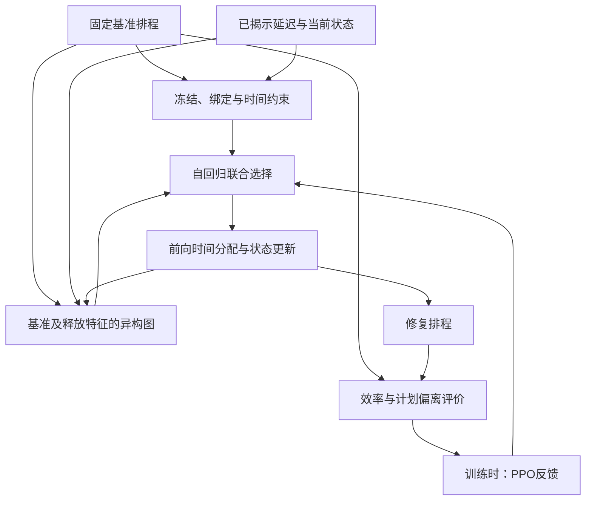

# 工作二：研究问题、方法、贡献与证据对照（详细资料）

> **2026年10月6日统一核查：**本文专业术语与方案解释按[统一术语与当前定义](开题报告_统一术语与当前定义_20261006.md)使用。工作一为保留原机制的最小同构编码替换，GraphSAGE旧变体仅作参考；工作二同时介绍异构联合调度与计划稳定性重调度。原论文事实及实验结果保持原归属。

> **2026年10月6日来源与对照边界更新：**用户确认四规模工艺数据和核心工艺参数来自真实工厂，人员总量、资格及效率自行构造；准确区分工业工艺数据与实验资源配置。工作一拟从其原论文模型仅替换同构编码，工作二Table VII的GraphSAGE因此保留既有对照身份，不默认是新工作一的实现或结果。工作二论文仍为本轮已有结果主要依据，不修改其模型或实验。

> **2026年10月4日研究递进纠正（当前口径）：**按用户本轮转述的老师要求，由工作一的研究不足引出工作二：统一同构表示对不同实体／关系的区分与信息利用仍需加强，且工作一未覆盖扰动后的计划调整；对应工作二的异构图联合调度与考虑计划稳定性的动态重调度。“工作一提供基准排程”不作为两项工作的研究衔接或独立创新依据。已有生产计划、冻结／绑定继承及基准特征只在工作二模型与技术细节中按论文事实保留。详见[研究不足与递进论证校准稿](工作一二_研究不足与递进论证_校准稿_20261004.md)。本条记录形成时依据为用户转述；同日用户随后提供完整导师评价并认可递进论证，见总控中的原始记录。较早过渡段保留讨论语境，不把同构表示的局限写成已证明无法表达全部耦合或满足硬约束。

日期：2026年10月4日。用途：按用户选定的方案A继续细化工作二，服务开题报告与后续大论文。**用户本轮赞同并理解工作二的两部分细化，补充确认阶段内扰动与人员绑定边界；术语采用及实验事实边界继续有效。新整理的贡献措辞和机制解释仍供讨论，不等同于已完成新颖性审查。**工作一、二已定标题原文保留，原论文和代码不修改。工作二为未投稿稿，目标期刊IEEE Transactions on Systems, Man, and Cybernetics: Systems。

## 1. 先确定一项工作的两个部分

首先由工作一的两条边界引出本工作：统一同构表示对不同关系的区分与利用仍需加强，且无扰动条件未覆盖释放变化后的计划调整。分别对应异构图联合调度与动态重调度；不以工作一提供基准排程作为研究衔接。

工作二按“异构图联合调度＋考虑计划稳定性的重调度”展开，两部分共享异构编码、联合动作和可行时间分配。前一部分在共同联合调度基础上细化不同实体与关系的表示，后一部分加入已有计划及已揭示延迟，处理允许调整的计划。

**当前详细研究问题：**工序释放时间延迟后，如何在冻结工序和人员站位绑定约束下，对已有基准排程进行重调度，兼顾完工时间与计划稳定性？

**当前详细概括：**采用工序、站位、人员和技能构成的异构图表示调度状态，研究工序排序、站位分配与人员分配的联合调度方法；进一步结合基准排程及扰动后更新的工序释放时间，在冻结工序和人员站位绑定约束下进行重调度，兼顾完工时间与计划稳定性。

这两句先作为详细资料保存；研究问题提出困难与目标，概括句说明完整工作范围。开题正文和口头版本随后精简。冻结和绑定的具体定义放在模型段，不要求在每一处提及工作二时重复全部约束。

| 部分 | 要回答的问题 | 本部分的作用 | 输出 |
|---|---|---|---|
| A：异构图联合调度 | 在工艺依赖、技能匹配、资源占用和站位安排相互关联时，如何为联合决策提供按关系类型组织的状态表示？ | 工序、站位、人员、技能四类节点及不同关系参与信息传播；沿用工序→站位→团队动作骨架 | 可行基准模板，以及供工序、站位、人员选择头读取的表示 |
| B：考虑计划稳定性的重调度 | 工序释放延迟后，怎样调整可修改计划，兼顾完工时间与对基准的偏离？ | 增加基准／释放／冻结条件，继承冻结条目和人员绑定，在允许范围内联合调整 | 修复模板，以及相对基准的开工、站位、团队和跨度变化 |

“部分A／B”是本文件的展开编号；用户本轮选择的**方案A**指同时展示上面两个部分，避免与此前工作一的方案A混淆。两部分并非两项新的学位工作；没有删除工作二的无扰动联合调度研究。

## 2. 冻结和人员站位绑定要写到什么程度

**判断：模型说明应准确列出；高层研究问题可以随后精简。**这些约束改变可调整范围和人员候选，评审需要知道实际解决的问题；它们不必承担工作二每一处概括的全部篇幅，也不因具有生产管理动机就自动构成独立创新。

**2026年10月4日用户补充确认：**工作二响应的是当前阶段尚未结束时发生的扰动，某些工序因释放条件变化而延迟开工；阶段内重调度保留人员站位绑定，不允许已绑定人员跨站重新分配。文献在阶段结束后允许人员调整，与本研究的阶段内规则处于不同调整时点。阶段结束后的人员重新配置不纳入工作二当前方案，也不据此推定当前方案到阶段末会自动解除绑定。当前论文在计划层继承基准中的全部人员绑定，冻结集继续按原定义划分；没有改成仅绑定此刻正在工作的人员。此前未使用人员的首次绑定规则仍保留。

### 2.1 文献的具体写法

| 原始文献 | 核对到的写法 | 对本研究写作的启示 |
|---|---|---|
| Zheng等，RCIM，2025 [L1] | 题名直接写“under a resource dedication policy”，摘要明确在该策略下联合优化人员分配与多模式任务调度 | 若某种资源策略是区分研究对象的关键条件，可以在概括中强调；并不能据此要求每篇论文列出所有约束 |
| Fang等，IEEE TII，2021 [L2] | 摘要概括定期调整；§III-B明确在阶段结束后允许部分人员跨站，随后展开阶段、人员与任务模型 | 明确调整时点：阶段末跨站调整与本研究阶段内继承绑定可以同时成立，不能把该文献直接视为本研究阶段内规则的替代方案 |
| Vieira等，Journal of Scheduling，2003 [L3] | 用环境、策略、触发政策和方法组织重调度，§4分别讨论效率、稳定性和成本 | 概括中先突出重调度目标，再在问题描述／模型中交代可修改边界，是可采用的写作组织 |

上述例子支持“关键策略可以强调、具体边界须定义”的组织建议，不是关于全领域摘要写法的统计结论。资源专用策略与我们的个体首次使用绑定具有联系，但时间范围、绑定建立方式和修复继承规则不能直接视为相同。

### 2.2 我们的两条规则实际保留什么

| 规则 | 当前工作二的准确含义 | 必须避免的混淆 |
|---|---|---|
| 冻结工序 | 按基准开工时刻划分：Bᵢ⁰≤τʳ的条目继承原站位、团队与起止时刻；其余为可调整集 | 这是计划层冻结政策；不能用“实际是否已经开工”替换集合定义，也不能直接套用工作三真实提交规则 |
| 人员站位绑定 | 所有在基准中使用过的人员继承站位绑定；此前未使用的人员保持未绑定 | 更换某任务的团队，仍须满足成员绑定与资格；不能为了改善目标把已绑定人员移到另一站 |

可调整工序还需满足更新释放时间与修复下界，以及共同前序、技能、人数、占用和容量约束。冻结工序必须与扰动输入相容，详细边界见[工作二细化稿](工作二_异构图与基准条件化修复_细化讨论稿_20261004.md)§4；本轮不新增规则或声称已验证所有边界场景。

## 3. 问题—信息—方法—输出—贡献—证据

| 研究问题／困难 | 接受的信息 | 方法怎样回应 | 输出给谁 | 可讨论的贡献 | 当前证据及限制 |
|---|---|---|---|---|---|
| 工艺依赖与技能／资源关系影响联合选择 | 给定前序图、工序需求、人员资格和效率、站位及当前安排 | 显式区分节点和关系类型，形成节点／全局表示 | 工序、站位、人员选择头 | 在APAL联合调度中结合不同关系组织状态，是工作二的表示增量候选 | Tables VII–VIII有同构GraphSAGE对照，但同时改变聚合算子，未隔离关系类型的独立增益 |
| 工序、站位和团队选择相互影响 | 共享表示、已选工序和站位、部分团队、合法候选 | 沿用自回归联合选择，给定人数下选择具体成员；约束检查与前向时间分配确定安排 | 构造环境及下一步状态 | 是完整方法的重要基础；工作一已展开，不重复列为工作二首次提出 | Table VII的动作变体提供整体线索，部分变体存在不可行／死锁，不能只比成功样本工期 |
| 延迟发生后，原安排不能直接照用 | 基准计划π⁰、已揭示释放时间rᵢ、冻结边界、人员绑定及当前修复状态 | 把基准和扰动条件输入异构状态；保留冻结条目，调整允许修改的条目 | 修复策略、可行性检查及时间分配 | 把已有计划及已揭示延迟用于异构图重调度，是任务与条件信息增量候选 | Table VIII的去基准条件对照支持整体条件作用；没有逐字段独立消融 |
| 恢复效率和减少计划变更需要权衡 | 修复模板及完整基准条目 | 分别计算跨度、参考超限、开工偏离、改站率和团队变化率，以当前综合目标评价 | 训练反馈、结果报告及研究对照 | 研究基准条件下的效率／稳定性权衡；五项加权和本身不等于新算法 | Tables VIII–X报告综合、分量与统计，不能写成全部分量或所有方法上均显著占优 |
| 规模较大时，需要在可用时间内给出方案 | 当前实例规模、策略输出和耗时记录 | 复用学习策略构造修复模板并核查约束 | 调度结果和耗时报告 | 是方法实用性证据，是否达到具体工厂时限还需该工厂要求 | Table XI最大实例123.60秒，表述为约两分钟；不外推任何工厂实时要求 |

对照表先让每一条贡献有可追溯的输入、模块、输出与证据。不能只列四类节点、GATv2或PPO名称作为创新点；也不能由整体结果证明每一条关系、特征或约束的独立贡献。

## 4. 简单理解：异构关系怎样进入三个选择

| 选择 | 希望网络结合哪些信息 | 硬约束由谁检查 |
|---|---|---|
| 先选工序 | 前序任务安排、所需技能对应的人员资源、当前站位负荷，以及重调度时的基准和释放条件 | 工序候选与冻结／前序等合法性规则 |
| 再选站位 | 已选工序、本站任务与负荷、人员绑定及可用性、前后序站位限制 | 站位候选及单向站位约束 |
| 再选团队 | 工序技能需求、已选站位、候选人员资格与效率、占用和已选成员 | 人员资格、绑定、人数、重复成员及资源规则 |

表中信息路径是机制解释，不声称当前每个选择头都直接读取所有原始字段；字段也可先经图编码／池化进入共享表示。论文Tables II–III确定具体节点与边，模型定义确定掩码与时间约束，不能凭解释增设关系。

例如A是B的前驱，C与A无前序关系但竞争部分合格人员。A延迟后，B受到前序时间影响，C可能因资源安排调整而改变；C是否更早或更晚取决于日历和实际选择。异构图分别组织前序与技能／安排关系，策略据此取舍；合法性规则仍负责排除不允许的动作。这个例子解释网络为什么需要联合信息，不证明注意力因果解释或每种关系的独立性能增益。

当前稿只有precedes、assigned-to、has-task、done-by、has-skill、provided-by、requires、required-by八种有向关系。人员站位绑定体现在节点属性与合法性规则，不能新增为论文已实现的人员—站位边。工序图保留虚拟结构节点，但物理动作、人员需求和工作量统计排除虚拟节点。

### 4.1 技术说明：已有计划的使用（不作为研究衔接依据）

本节只保留当前论文的模型输入、约束继承与评价事实，依据§III-D、§IV和Table II。已有计划是重调度场景背景，使用已有计划本身不作为独立创新，也不证明一到二的研究递进；不因论证重心调整删除已有特征。基准排程π⁰作为固定参照保存，当前修复状态随每次完整安排更新。比较计划偏离时始终与π⁰比较，不把每一步的修复结果滚动替换为新的基准。

| 作用 | 使用什么基准信息 | 进入哪些模块 | 解决什么问题 |
|---|---|---|---|
| 给策略提供原计划背景 | 基准开工、基准站位、基准团队人数，以及冻结／延迟标志；更新释放时间与当前状态一同进入 | 工序节点特征→异构编码→联合选择 | 帮助策略区分原计划安排和扰动后可用条件，并结合前序、技能与资源关系取舍 |
| 定义允许修改的范围 | 冻结条目的原站位、团队、起止时刻；基准中已形成的人员绑定 | 初始化／继承逻辑、合法候选、前向时间分配 | 冻结条目保留原安排；已绑定人员保留站位；可调整项满足更新释放与修复时间下界 |
| 评价新计划偏离了多少 | 完整基准起止时刻、站位、具体团队及参考模板跨度 | 效率／偏离指标、综合评价及训练奖励 | 同时衡量恢复效率与开工、站位、团队变化，供比较和学习反馈使用 |

三种用途配合使用：仅知道原计划不保证少改动；仅惩罚偏离也不等于策略已得到所有基准信息。当前稿有整体去基准条件对照，没有报告以上三类用途逐一分离的消融，不将本解释写成已验证的独立机制增益。

**输入和参照账本须区分。**Table II列出的工序基准特征包括原开工、原站位和团队人数，没有列出完整原团队成员身份向量。完整基准团队保留在参照排程中，用于冻结继承和团队变化计算；不能据此声称全部成员身份已直接编码进工序特征。其是否还通过动态边或其他输入通路可见，以论文明确说明与后续实现核对为准，本轮不增加新字段。

### 4.2 用一个站内例子理解信息怎样帮助选择

假设二号站位中A、B、C均属于可调整工序，A是B的前驱，C与A、B无前序关系；C已满足释放条件，其所需合格人员留在二号站且当前可用，其他前序、人数和容量约束均满足。原计划先安排A，再安排B、C。此时A发生释放延迟。

| 候选安排 | 人员站位与合法性 | 可能的效率影响 | 对原计划的影响 |
|---|---|---|---|
| 等待A，继续保留原顺序 | 人员仍在二号站；A达到更新释放时间后开工，B仍需等待A完成 | 等待可能延长模板跨度，程度取决于其他站与后续安排 | 顺序较接近基准，但开工时刻仍会变化，不能自动称为偏离最小 |
| 先安排独立工序C，再安排A、B | 使用二号站的合格可用人员；必须通过候选与日历检查 | 在条件满足时可利用等待时段，可能减少后续积压 | C提前会产生开工偏离，不能只因利用了空闲就断定综合目标更好 |
| 借用已绑定三号站的人员执行二号站任务 | 违反已有绑定，候选被屏蔽 | 不进入可行方案比较 | 不能以降低工期为理由解除阶段内绑定 |

这是假设条件下的机制例子，不是数据集结果。网络结合前序关系识别B对A的依赖，结合技能与人员状态评估C的资源条件，结合基准时刻和已揭示释放条件了解调整背景；合法性规则排除不允许的选择，效率与偏离评价再比较可行方案。没有预先规定总应等待或总应把C提前。

### 4.3 在算法流程中的位置

输入为给定工艺与资源配置、基准排程、当前已揭示的释放变化和冻结边界；输出为修复后的站位、具体团队与起止时刻，以及相对固定基准的可核查指标。网络输出选择，前向时间分配依据约束确定时间，不能写成网络直接回归最终开工时刻。PPO反馈箭头表示训练阶段，部署推理不要求每次调整都重新训练。

工作二的两部分复用异构编码与自回归联合动作：当前稿先训练无扰动的异构调度模型，再扩展工序输入的基准／扰动特征，继承兼容参数并在重调度环境继续训练。它是工作二内部的训练安排，不等于将工作一同构权重无缝改为异构权重，也不是临时叠加一个独立网络。本轮不改变已列的输入字段、层数或训练目标。

## 5. 两条贡献候选与共同基础

**候选一：面向联合调度的异构关系表示。**结合工艺前序、技能需求、人员资格与动态安排关系，为工序排序、站位分配和人员分配提供共享状态表示。相对于工作一的同构编码，增量是按类型处理关系，而非增加节点数量。现有证据支持方法组合比较，关系类型本身的独立作用仍需更严格对照。

**候选二：扰动下考虑计划稳定性的联合重调度。**在工序释放延迟已揭示后，利用基准排程、冻结边界及人员绑定调整允许修改的任务，研究完工时间与计划偏离的权衡。候选贡献在于具体问题、信息与联合策略的结合；不声称首次提出重调度、计划稳定性、计划冻结或资源专用。

共同基础包括：自回归工序—站位—团队动作、给定人数团队成员选择、首次使用绑定、通用硬掩码、前向时间分配、PPO与Critic。工作一完整介绍，工作二说明继承与适配。贡献的新颖性仍需与直接相关方法逐项对照，术语有文献依据不等于组合已被证明原创。

## 6. 论文中已经有哪些证据

用户已明确：**全部现有对比和消融均在所提供论文中，未报告的实验即未开展。**下面只登记当前稿件可追溯的结果，不假定另有隐藏对照、日志或未写入实验。

| 证据 | 当前稿记载 | 可以支持的表述 | 暂不支持的表述 |
|---|---|---|---|
| Table VII：初始调度结构变体 | 完整异构方法平均跨度902.40 h，同构GraphSAGE为1037.64 h；两者4/4初始实例可行，所测重调度场景可行率均100% | 当前完整方法相对该同构实现的整体比较；该变体保留参考，不默认等于10月6日提出的新工作一设置 | 不把完整异构结果当作工作一同构成果；不把全部差值归因于关系类型 |
| Table VIII：重调度及去基准条件变体 | 完整方法平均综合分数0.8511，去基准条件0.9429，同构GraphSAGE为1.1148 | 当前测试中，完整方法平均综合分数较低；基准条件整体比较可追溯 | 不分别证明基准开工、站位、人数等每个特征；不外推所有扰动类型 |
| Table IX：目标分量 | 完整方法改站率2.12%、团队变化率95.60%；StabilityAwareRepair分别为1.73%、94.76% | 报告恢复效率与偏离的具体权衡 | 不称完整方法在所有稳定性分量上更好 |
| Table X：配对统计 | 对L2D-PPO-APAL和StabilityAwareRepair的综合分数Holm校正p值分别0.7237、0.5498 | 区分均值比较与该检验的统计结论 | 不写综合分数显著优于所有方法；不将该结论扩大到每个分量的其他检验 |
| Table XI：耗时 | 最大3182工序实例的修复耗时123.60秒 | 所测最大实例约两分钟 | 不称严格小于两分钟，不据此保证所有实例／工业条件实时可用 |

当前评估为物料就绪导致的工序释放延迟，修复时更新释放时间已知；不声称已经验证人员缺席、设备故障、工时变化或路线变更。完工时间在本工作对应计划模板跨度，不能改写为整批飞机真实工期。

## 7. 开题现在做什么，大论文以后可做什么

| 时段 | 工作 | 用途／状态 |
|---|---|---|
| 当前开题 | 保存术语与详细概括；整理本对照；讲清异构关系、基准条件和两项工作分工；引用已有论文结果 | 本轮已推进文稿，不新增实验，不修改代码 |
| 大论文阶段可考虑 | 相同聚合算子、信息、动作、约束和预算下的同构／异构对照 | 更接近隔离关系类型作用；当前稿没有报告，视为未开展 |
| 大论文阶段可考虑 | 对前序、技能或动态安排关系进行有针对性的消融；硬约束和可见数据保持不变，明确信息是否仍从其他通路进入 | 检验特定信息传播路径；不能删边后又宣称其所有信息已消失，也不能通过删除约束创造不公平对照 |
| 大论文阶段可考虑 | 分开检查基准条件信息与偏离评价的作用，保留共同冻结／绑定约束 | 区分知道原计划与评价计划变更的效果；当前去基准条件结果不等于这些单独实验 |

这些是后续可讨论的候选验证，不是本次开题的前置任务，也不记录为用户已经承诺开展全部实验。本轮已继续细化基准信息进入网络、冻结与绑定限制选择、固定基准评价计划偏离的分工，见§4.1–4.3。后续在用户理解并认可后，整理对应的开题简版与贡献措辞；本轮解释不等于新增机制效果已验证。

## 8. 以研究不足承接工作一和工作三

一到二：工作一的统一同构表示对不同关系的区分仍需加强，且其无扰动运行条件未覆盖释放延迟后的调整；工作二对应研究异构图联合调度与动态重调度。已有计划只作为重调度背景和偏离参照，不是工作一提供给工作二的研究必要性依据。详见[递进论证校准稿](工作一二_研究不足与递进论证_校准稿_20261004.md)。

原论文实验基准来源以稿件明示为准，不规定全部由重组后的同构工作一生成；工作二内部的异构模型继续训练也不等于同构权重直接转换。

二到三：工作二的模板层修复未覆盖受扰切换中多架在制飞机的实际位置、进度与同步转站过程，工作三沿已确认的实际执行及当前／下一周期后果语义继续研究。这是本研究模型边界的延伸，不宣称整个领域没有相关研究，不扩展工作三首版。

## 9. 文献与访问范围

- **[L1]** Zheng等. *Joint optimization of production scheduling and worker allocation under a resource dedication policy in aircraft assembly lines*. Robotics and Computer-Integrated Manufacturing, 96, 103047, 2025. DOI：[10.1016/j.rcim.2025.103047](https://doi.org/10.1016/j.rcim.2025.103047)；[出版页](https://www.sciencedirect.com/science/article/pii/S0736584525001012)。本轮核对出版页索引题名与摘要，直接打开返回403；用于说明资源策略可进入题名及研究对象，不宣称全文所有规则与本模型相同。
- **[L2]** Fang, P.; Yang, J.; Liao, Q.; Zhong, R. Y.; Jiang, Y. *Flexible Worker Allocation in Aircraft Final Assembly Line Using Multiobjective Evolutionary Algorithms*. IEEE Transactions on Industrial Informatics, 17(11), 7468–7478, 2021. DOI：[10.1109/TII.2021.3051896](https://doi.org/10.1109/TII.2021.3051896)；[高校提供原文](https://virtualsim.nuaa.edu.cn/file/up_document/2024/01/SeFxOf1X-wt_nxTz.pdf)。核对摘要、§I与§III-B的阶段性跨站调整及问题描述；不转用其工厂字段或实验结论。
- **[L3]** Vieira, G. E.; Herrmann, J. W.; Lin, E. *Rescheduling Manufacturing Systems: A Framework of Strategies, Policies, and Methods*. Journal of Scheduling, 6, 39–62, 2003. [作者单位预印本](https://isr.umd.edu/Labs/CIM/projects/jos-rescheduling.pdf)。核对框架、§3.4、§4及§6.2；效率、稳定性和具体计划更新方式分别表述，不将本模型自动归为仅修改受影响任务的局部重调度。
- 用户提供的[工作二未投稿稿](../20_论文与已有结果/工作二_拟投IEEE_TSMC_Systems_联合调度与人员分配_未投稿稿_20261003.pdf)：§III-D、§IV、Tables II–III及VII–XI。当前稿用于模型与结果事实，外部文献用于术语和问题组织，两者用途分开。
- [术语核验与确认记录](工作一二_术语核验与问题方法表述对照_讨论稿_20261004.md)、[工作一详细资料](工作一_同构图联合决策机制与贡献细化_详细资料_20261004.md)、[一二分工](工作一二_研究内容分配与同构异构递进_讨论稿_20261004.md)、[工作二机制细化](工作二_异构图与基准条件化修复_细化讨论稿_20261004.md)。

本文件为详细讨论资料；未生成口头简版，未新增代码、训练或实验，没有更改此前工作一、二标题。
