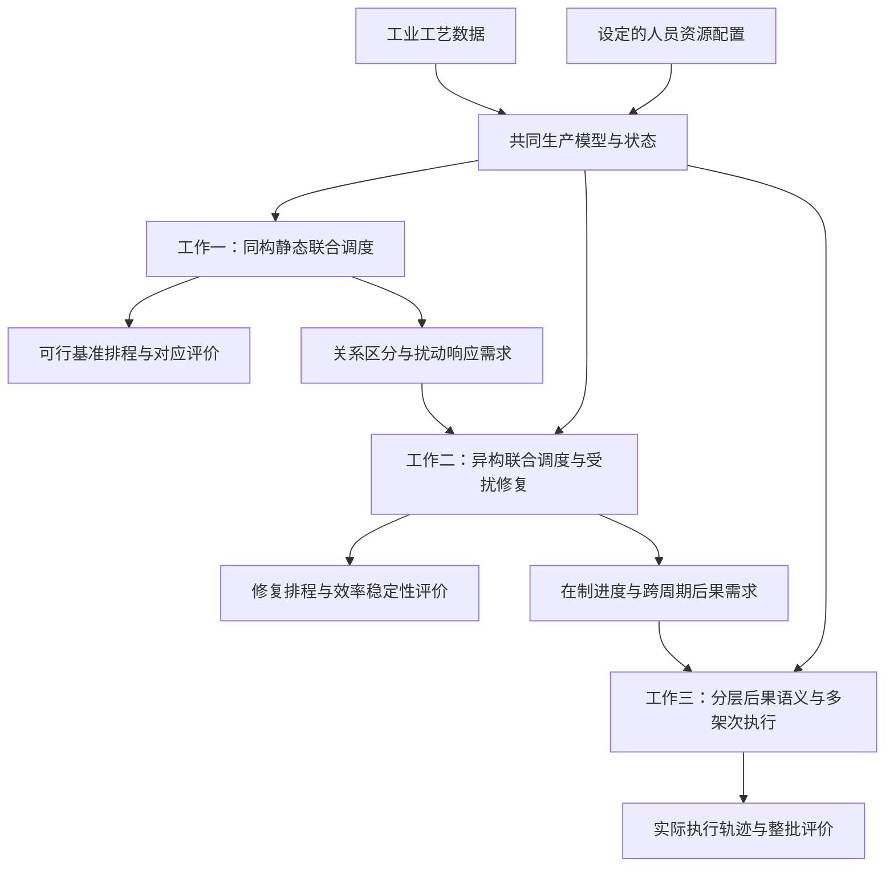
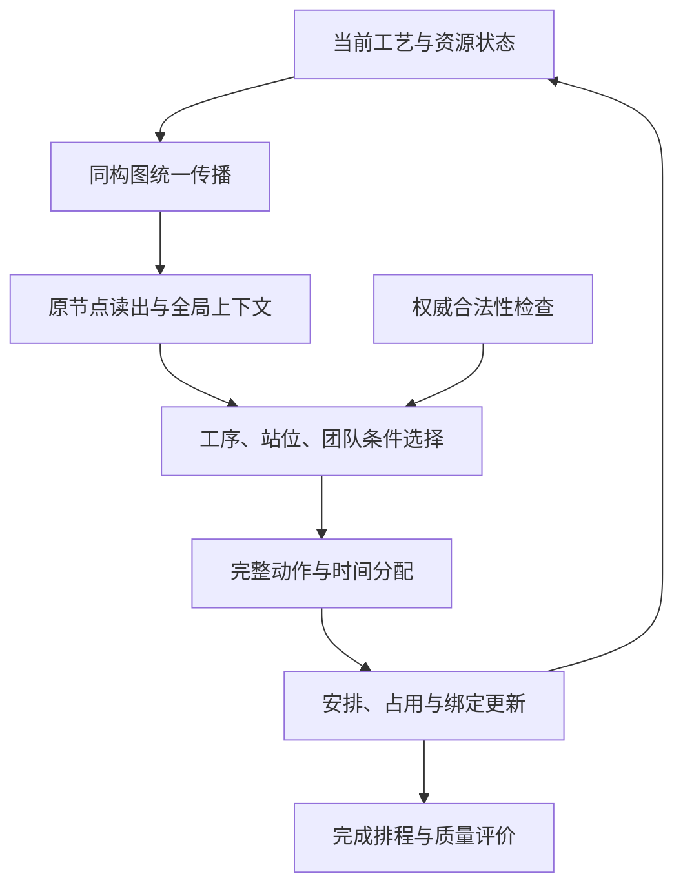
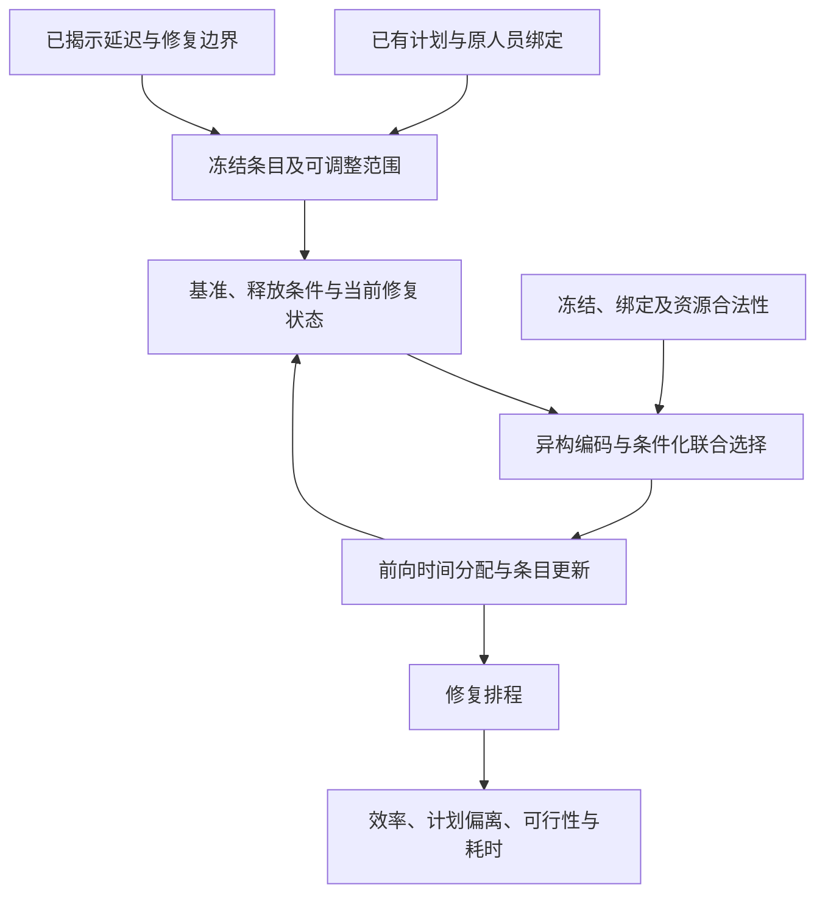
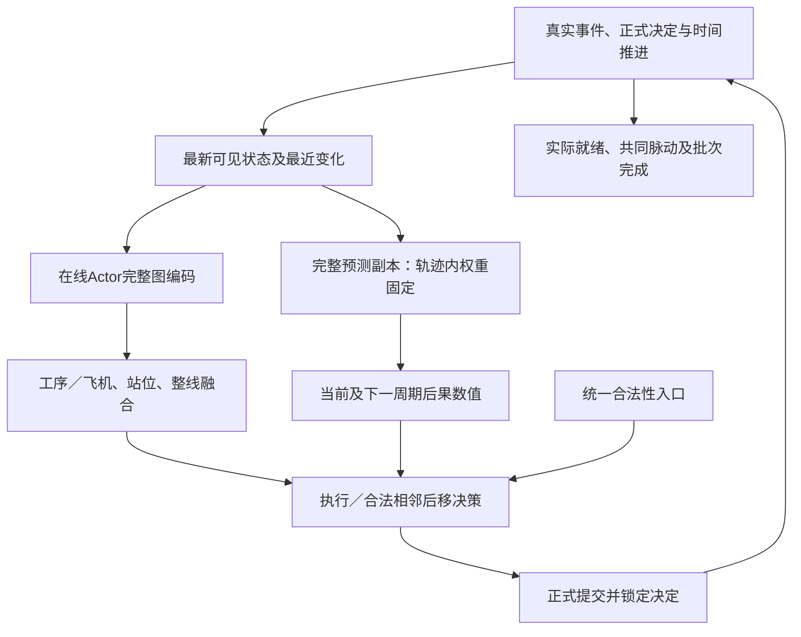

# 总体技术路线（详细讨论稿）

> **2026年10月6日统一核查：**已按专业术语、跨文件定义与写作问题清单核查。本稿主体研究方向保留，相关措辞在记录中逐项说明；统一定义见[术语表](开题报告_统一术语与当前定义_20261006.md)，正式论述见[全文整合稿](../00_总控与交付/开题报告_全文整合稿_20261006.md)。凝练介绍不是新增副标题，工作一、二已登记标题不变。

日期：2026年10月6日。内部版本：V2（本轮仅同步确认状态）。用途：在已暂时确认的研究目标与三项内容基础上，组织开题报告技术路线。用户已同意上一轮方案方向，工作一按原模型最小同构替换组织，具体共享注意力实现仍为建议；工作三按设计确认、代码未完成及效果待验证处理。既定工作一、二标题保持原文，不修改论文、代码或开展新实验。

## 1. 路线怎样回应递进问题

共同生产基础是工艺前序、给定有序站位和人员资源条件。三项方法分别处理无扰动联合安排、受扰计划调整和在制多架次实际执行。在表示上从统一同构编码发展到按类型处理关系，再加入由实际执行结果监督的时间后果。图编码提供信息，联合策略选择动作，合法性与时间分配落实可行安排；三者职责分开。

图中W1→L1→W2及W2→L2→W3表示研究需求递进。基准排程仍可以用作动态调度的已有计划，但其产物传递不是研究衔接理由。三种输出的时间尺度不同，不直接合并比较模板跨度、实际周期及整批工期。

## 2. 输入来源与共同模块

| 模块／输入 | 接受什么 | 输出及使用者 | 来源和边界 |
|---|---|---|---|
| 工艺数据处理 | 四规模CSV、节点类型、前序、标准工时、需求人数等 | 完整DAG与物理任务属性，供环境、图与统计使用 | 用户确认核心工艺参数来自真实工厂；虚拟依赖保留，物理统计排除虚拟节点 |
| 人员资源配置 | 人数、资格、效率和明确日历／站位规则 | 资格、占用、团队时长及绑定条件 | 人数、资格和效率由用户构造；日历及运行规则为已有环境与配置，不称厂方实测 |
| 状态更新 | 当前安排、资源占用、时间及已揭示事件 | 一致的可见状态，供编码与合法性使用 | 未发生扰动不可预知；正式事实与预测值区分 |
| 图表示 | 工艺与资源状态、连接和对应属性 | 节点／全局上下文，供联合选择与价值估计 | 共享传播或按关系类型传播按工作定义，不靠图代替硬约束 |
| 联合选择 | 节点与全局上下文、条件掩码 | 工序、站位和给定人数的具体团队 | 自回归及PPO为共同基础，不在每项重复认定为独立创新 |
| 可行时间分配 | 完整动作、前驱完成与人员日历等 | 合法起止、占用及绑定更新 | 沿对应环境定义；工作二计划层与工作三实际执行层不可调整范围不同 |
| 评价 | 排程或真实生产轨迹 | 各工作对应效率、稳定性、可行性和耗时 | 训练塑形、真实成本和评价指标分别说明 |

推荐数据说明句：**采用四个规模的真实工业工艺数据，并结合设定的人员资源配置开展仿真验证。**可以在背景中简述“采用真实工业工艺数据”，在实验段明确人员来源。工种聚合及未使用的部位容量按README原口径处理。

## 3. 工作一：原模型的最小同构替换

### 3.1 保留什么，替换什么

以工作一用户提供的CAC原稿为方法基础。其原图含工序、站位、工人三类实体。保留这些对象、原有属性及关联的事实范围；仅将图编码由按类型分别传播改为单一图上的统一传播，并完成必要的输入与索引适配。实体真实身份、技能资格、前序和站位绑定仍供选择与约束使用。

| 项目 | 本轮方向 |
|---|---|
| 工艺、人员配置与运行规则 | 保留原工作一对应设置 |
| 原始工序／站位／工人信息及关联 | 保留，不删除资源对象或工艺前序 |
| 图消息传播 | 取消按关系类型的专门传播参数／通道，采用共享机制 |
| 特征接口 | 原特征维度不同，需统一字段／维度；只做编码接口必要适配，不额外引入生产变量 |
| 分对象读出及联合选择头 | 保持原功能与输出；按索引读回工序、站位、工人表示 |
| 自回归解码、部分团队、掩码、时间分配、绑定 | 保留原工作一机制 |
| Actor／Critic组织及PPO、奖励 | 保留原工作一对应定义，不将工作二的新信号混入 |

这里“其余不变”指编码模块之外的机制和实验设定保持一致。编码方式变化可能带来参数量、输入投影、邻域归一化和实际输出差异，不能承诺所有权重、张量形状或结果原样不变。

### 3.2 优先实现建议

原工作一使用异构图注意力，优先考虑共享参数的同构图注意力，尽量保留注意力家族、层数、宽度、头数、残差与读出设置。不要为简化图类型同时默认切换成GraphSAGE；后者改变聚合算子，且已有Table VII变体不一定对应本方案。具体采用GAT还是原实现兼容的注意力版本在后续代码工作时核对，不在本轮写成已实现。

统一传播示意为：

\[
h_i^{(\ell+1)}=\operatorname{Update}_{\theta_\ell}\left(h_i^{(\ell)},\operatorname{Agg}_{j\in\mathcal N(i)}\operatorname{Message}_{\theta_\ell}(h_i^{(\ell)},h_j^{(\ell)})\right).
\]

所有边使用共享消息机制，节点差异由保留的属性体现。公式仅说明拟用接口，不是最终实现或新公式贡献。分工序、站位、工人读出和不同动作头不改变传播图采用同构编码的定义。若保留按类型的输入适配，需在方法中明示其位置，不能把它称为全模型不含任何类型处理。

仅重命名节点、将不同关系权重数值绑在一起却继续使用独立关系通道，不能自动认定为这里的单一图统一传播。原边方向、重复边规则和必要反向边应在转换时核对；约束仍读取权威工艺与资源状态。

### 3.3 构造闭环

训练反馈仍依原工作一奖励与PPO。同构新设置需单独训练及核查后获得结果；原异构模型性能、权重和已有GraphSAGE变体不直接认定为该设置的成果。

## 4. 工作二：异构联合构造与受扰修复

### 4.1 异构联合构造

输入工艺与当前资源状态，按论文的工序、站位、工人及技能四类节点和关系构图；异构传播与读出形成选择上下文；联合自回归动作及可行时间分配输出初始排程。相对于工作一说明类型关系和信息组织，共同选择机制按原论文继承与适配。

### 4.2 延迟后的修复

冻结集合按当前论文的基准开工时刻与边界定义，不改成任意另一套实际状态冻结规则。基准已使用人员继承站位绑定，阶段内不跨站重新配置；未使用人员按首次使用规则处理。已有计划同时提供约束继承、可见基准条件和偏离参照，其作为网络输入的字段按论文保留。

动态训练在论文所定义环境中适配异构策略。初始异构到修复异构的参数适配，是工作二内部流程；不承诺工作一新同构检查点可直接加载到异构模型。当前结果限于论文报告的物料导致开工延迟场景。

## 5. 工作三：实际执行、分层融合与后果学习

### 5.1 执行与信息闭环

工艺／资源完整图与未完成任务汇总范围分别处理：图可保留已完成节点的上下文；未完物理任务用于飞机和当前／下一周期站位读出；动作候选另由合法性检查产生。工人是产线资源，不按飞机复制。源站当前与目标站下一周期任务集按正式事实变化，不包括潜在但未决定的后移或未知扰动。

首版每次完整决策前基于一致现场状态重算动态表示与副本预测。内部选择共享快照，正式提交后更新；事件刷新、神经重算和训练参数更新是不同节奏。MLP为首版，精确神经增量与其他融合网络仍为后续选项。

### 5.2 语义模块接口

| 模块 | 输入 | 输出 | 给谁使用 |
|---|---|---|---|
| 分层读出与融合 | 完整图表示、按身份和周期角色组织的未完任务、最近变化与资源状态 | 工序／飞机、站位及整线上下文 | 动作选择和后果预测 |
| 当前周期预测 | 当前可见上下文、启发式脉动估计 | 实际共同脉动的残差修正及对应时间估计 | 显式决策信息、已确认当前周期势差塑形和误差评价 |
| 下一周期预测 | 当前可见状态、各站紧邻下一周期任务与资源上下文 | 各有效站位下一周期就绪的有符号偏差 | 决策信息、辅助学习及跨周期机制评价 |
| 实际标签结算 | 历史决策输入、实际就绪／脉动事件和周期身份 | 已结算的当前／下一周期监督目标及有效性掩码 | 在线共享编码／融合和预测头训练 |
| Critic | 按确认架构取得的状态与价值上下文 | 累计回报估计 | PPO优势与价值损失；不替代上述物理时间标签 |

扰动发生前不可预知，发生后已揭示恢复时刻可用。没有飞机或没有下一周期的目标无效；尚未实际结束的目标等待结算，不能填零。预测是跟随当前策略实际后果，不是最优时间承诺，也不模拟两个假想动作分支。

### 5.3 网络方案B与训练

一条完整生产轨迹开始时，从在线模型复制包含图编码、分层融合、两项预测头及归一化统计的完整独立预测副本。副本在该轨迹内不更新参数，但每次完整决策读取最新输入。Actor使用副本预测的外部数值，PPO重放使用采样时保存的数值和条件掩码。在线Actor共享编码／融合接受PPO及已结算标签的辅助更新，在线预测头接受实际时间监督；副本不接受梯度。Critic继续承担价值学习。

实际完整轨迹与PPO采样段区分；中间脉动不是轨迹终止。历史动态输入不可被后续环境原地修改，当前／下一标签分项回填，跨采样段保留待结算项。当前周期势差塑形沿已确认公式，真实代价另记账；本稿不扩展为未经确认的下一周期塑形。

完整副本是已确认方案的预测版本控制组成，其额外资源开销应计入测试。结构复用不代表零开销或任意检查点兼容。

### 5.4 实际约束与输出

正式执行决定不可撤回，运行中任务非抢占；有效开工与扰动严格同刻时先开工。单工序后移仅到相邻站且不迫使其他未完任务新增换站，按完整前序和目标能力检查，末站不能后移。后移改变任务有效归属，不立即转站、不视作完工、不提前选择未来团队。

各有效站位实际就绪后共同脉动，存在待投产飞机时按实际脉动补入一号站。末站须实际完成剩余物理任务。输出完整批次执行轨迹、共同脉动及分项真实指标，并报告预测误差、完成可行性和计算开销。

## 6. 各阶段验证及当前可行性

| 阶段 | 当前依据 | 接下来需要验证 |
|---|---|---|
| 共同生产基础 | 四规模工业工艺数据、README及人员配置机制 | 数据处理、虚拟依赖、资格及时间占用的实现一致性 |
| 工作一 | 原CAC论文的方法与实验基础，本轮同构替换方向 | 新同构实现、完整轨迹、对应质量与耗时；不移用异构数字 |
| 工作二 | 当前未投稿稿中初始、修复与消融实验 | 按对应协议解释；更严格表示对照可留后续 |
| 工作三 | 已确认首版方案、部分代码及历史原型记录 | 物理正确、计账与标签正确、预测可学习、训练闭环及受控比较 |

可行性来自已有工艺数据、联合策略与仿真基础，以及明确的模块接口和分阶段核查安排；这些支撑研究可开展，不保证拟创新点一定提升性能。所有缺少实证的收益保留为待检验命题。

## 7. 文献依据与来源

工作一原CAC稿§III-B–D报告三类实体、不同维度特征、关系参数注意力及分组读出；本稿据此提出最小替换建议。工作二及工作三接口分别以当前论文和确认稿为准。

- Veličković等，*Graph Attention Networks*，ICLR 2018：https://arxiv.org/abs/1710.10903 。提供邻域注意力机制依据，不证明本课题替换后的性能。
- Hu等，*Heterogeneous Graph Transformer*，WWW 2020：https://arxiv.org/abs/2003.01332 。提供节点／边类型相关参数的表示依据；本课题不因此默认采用HGT。
- 文献近邻及生产依据沿当前综述R1–R25与全文核验记录；拟创新点和证据边界见配套《拟创新点与证据对应_详细讨论稿_20261006.md》。

上一轮已完成总体路线、三项方法流程、输入输出和训练／执行分工的讨论稿，用户随后同意方案并要求继续。已确认的是方案方向；当前配套《拟创新点与证据对应_详细讨论稿_20261006.md》V2进一步打磨问题、机制和递进。下一步据此完善技术路线的汇报表达；具体编码接口、实现和验证仍需后续核对。未开展：代码修改、同构新训练、工作三完整实施与性能验证。
