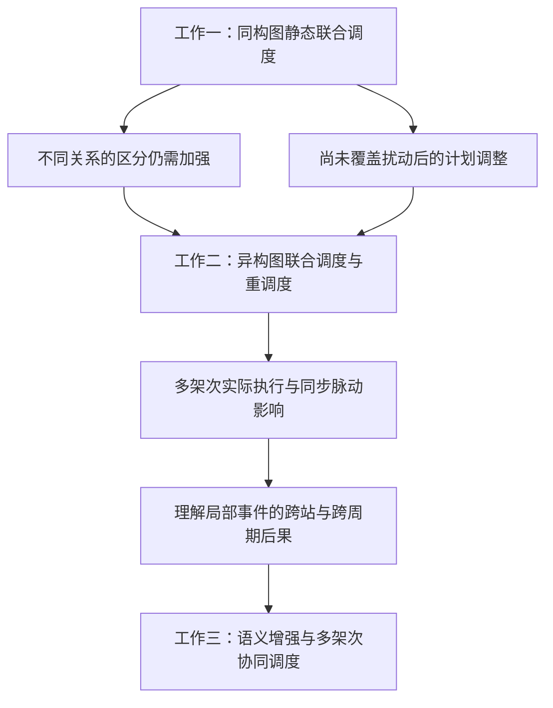

# 开题报告：工作二、三整理任务表

> **2026年10月6日统一核查：**任务3、4详细正文已获用户暂时认可；术语与跨文件核查、全文整合稿及脚本文字同步本轮完成。详见[检查记录](全文整合前_术语一致性与写作检查记录_20261006.md)。正式排版、PPT制作与试讲仍待开展，新同构和工作三实现、实验未因此完成。

> **2026年10月6日当前写作进度：**任务3[研究方案与验证详细稿](../10_研究设计确认稿/研究方案与验证_详细稿_20261006.md)、任务4[可行性与研究计划详细稿](../10_研究设计确认稿/可行性与研究计划_详细稿_20261006.md)已完成初稿，待用户审阅，记录于[提纲与答复](../10_研究设计确认稿/研究方案与验证_可行性与研究计划_写作提纲与待答问题_20261006.md)。用户补充尽快推进、本周加快、预计10月下旬开题；拟租用AutoDL的4090服务器；预期1—2篇论文及1篇会议论文，信息已足够。三段拟创新点及使用安排已暂时确认，工作一、二标题沿用。新同构验证和工作三完整效果仍为拟开展，工作二实验按论文归属。当前1—4是写作阶段，原T编号为专题清单，以下早期记录保留历史语境，最新入口优先。下一步整合全文、引文和展示表达，不修改代码、不执行新训练。

| 当前阶段 | 交付物 | 状态 |
|---|---|---|
| 1：研究目标与研究内容 | 详细稿及三项递进 | 已获用户暂时确认 |
| 2：拟创新点与总体技术路线 | 三段凝练文字、使用位置及路线详细稿 | 拟创新点及使用安排已暂时确认；路线详细稿已具备，展示表达后续完善 |
| 3：研究方案与验证 | 数据／场景、分项方案、主比较、指标、消融、统计和阶段核查 | 详细正文已获暂时认可，完成统一核查并纳入全文整合稿 |
| 4：可行性与研究计划 | 已有基础、可行性、剩余任务、阶段安排、计算条件和预期成果 | 用户补充已记录，详细正文已获暂时认可并纳入全文整合稿 |

> **2026年10月4日文献综述本轮更新：**用户要求今天优先完成综述，第一步必须讲清飞机脉动装配线生产问题；允许在既有文献基础上按具体用途补充权威来源。已形成[生产背景](../10_研究设计确认稿/生产问题与背景_飞机脉动装配线_20261004.md)、[三节综述V1](../10_研究设计确认稿/文献综述_正文初稿_20261004.md)及[任务状态](文献综述_任务表与状态记录_20261004.md)。关键来源核对与本轮写作完成，新正文待用户审阅；没有把全部候选文献称作已通读，也没有把研究定位写成已证明的首创性。此前“本轮不新增检索”由本轮明确要求更新。已定标题、原论文、代码及工作三设计沿用。

> **2026年10月4日20:40用户确认：**用户已认可依据导师评价重写的三项工作衔接及综述支撑方向。当前主线为“无扰动静态调度→工序延迟开工下动态调度→多架次协同动态调度”，方法对应“同构图→异构图→语义增强图网络”；一到二由关系区分与扰动响应需求引出，二到三由同步脉动下在制多架次的相互影响引出事件与后果语义。完整依据见[用户提供的导师评价记录](导师评价_用户提供记录与研究递进讨论稿_20261004.md)。16:49已取得该评价记录，此前“未取得完整评价”的说明仅反映当时检索状态。确认的是研究组织和衔接表述，不代表新增实现或性能结论；已定标题、物理规则、原论文与代码沿用。下一步[文献综述细化](../10_研究设计确认稿/文献综述_章节论证与装配线平衡调度边界_讨论稿_20261004.md)为讨论稿，尚未全面替换正式正文。

> **2026年10月4日研究递进纠正（当前口径）：**按用户本轮转述的老师要求，由工作一的研究不足引出工作二：统一同构表示对不同实体／关系的区分与信息利用仍需加强，且工作一未覆盖扰动后的计划调整；对应工作二的异构图联合调度与考虑计划稳定性的动态重调度。“工作一提供基准排程”不作为两项工作的研究衔接或独立创新依据。已有生产计划、冻结／绑定继承及基准特征只在工作二模型与技术细节中按论文事实保留。详见[研究不足与递进论证校准稿](../10_研究设计确认稿/工作一二_研究不足与递进论证_校准稿_20261004.md)。较早此处依据为用户转述；16:49用户已提供完整评价记录，20:40认可重写后的衔接。以下保留当时讨论记录，不把同构表示的局限写成已证明无法表达全部耦合或满足硬约束。

> **2026年10月4日阶段内边界与工作二继续细化：**用户补充：工作二在当前阶段尚未结束时响应扰动，已绑定人员保留原站位；文献中的阶段末人员调整不直接作为本研究阶段内方案的替代选择。冻结集、全部基准人员绑定继承及未使用人员首次绑定规则继续按当前论文定义。用户已赞同并理解“异构图联合调度＋考虑计划稳定性的重调度”两部分，本轮继续解释基准排程作为网络背景、约束继承依据及偏离评价固定参照的三种用途，见[工作二详细对照](../10_研究设计确认稿/工作二_研究问题方法贡献与证据对照_详细资料_20261004.md)§4.1–4.3。新机制解释保持讨论状态；本轮不修改标题、原论文或代码，不新增实验。

> **2026年10月4日术语与工作二方案A最新确认：**用户采纳核验后的术语，确认保存工作一的“工序前序约束与多资源约束—同构图—自回归联合决策—可行基准排程”详细概括。工作二明确展开**异构图联合调度＋考虑计划稳定性的重调度**两部分；冻结工序与人员站位绑定在详细模型中准确保留，后续简版再安排篇幅。全部现有对比与消融以论文记载为准，未报告者视为未开展，补充实验留到大论文阶段考虑，本次开题不新增实验。已形成[工作二问题、方法、贡献与证据对照](../10_研究设计确认稿/工作二_研究问题方法贡献与证据对照_详细资料_20261004.md)及[术语确认记录](../10_研究设计确认稿/工作一二_术语核验与问题方法表述对照_讨论稿_20261004.md)。本条为当前口径，下方早期讨论状态按本条更新理解；已定标题、三图递进与工作三首版方案保持原约定。

> **2026年10月4日方案A用户确认：**工作一采用“多实体信息统一同构编码＋工序—站位—团队联合决策”，文稿统一解释为**同构图**，由此引出工作二的**异构图**。本次确认确定方案方向，具体节点集合、特征／边与既有GraphSAGE实现的对应仍待核对。此前已定标题原文保留登记；代码和原论文不由本轮修改。两项工作的共同基础及重点分配已由用户暂时采纳为当前安排，详见[研究内容分配讨论稿](../10_研究设计确认稿/工作一二_研究内容分配与同构异构递进_讨论稿_20261004.md)；分工保留后续修订空间，具体实施与效果仍待核对。用户要求先写详细资料，开题正文随后压缩到问题、核心机制、输出与验证；本轮进一步讨论见[工作一联合决策详细资料](../10_研究设计确认稿/工作一_同构图联合决策机制与贡献细化_详细资料_20261004.md)。

整理日期：2026年10月3日；完成校准：2026年10月4日。按照老师要求，以**同构图静态 → 异构图动态扰动 → 语义增强图多架次协同**为方法递进；对应**无扰动联合安排 → 工序延迟开工下动态调整 → 在制多架次执行协调**的问题递进。基准排程保留为模型事实，不作为一到二的主要研究衔接。重点整理工作二、三，但工作一的同构图基础是必须先完成的接口。

本轮已完成两篇论文逐页阅读、关键模型与图表检查、论文归档、初步贡献与证据梳理。以下是后续逐项讨论和写作任务，不表示全部方案与验证已完成。本轮不修改代码、不跑训练、不重开工作三的首版网络选择。

## 1. 按重要性排序

| 顺序 | 优先级／对象 | 要解决的具体问题 | 交付物与完成标准 | 依赖／当前状态 |
|---|---|---|---|---|
| T1 | P0，工作一基础 | 最小同构替换如何保留原对象、属性和联合动作接口？ | 一张节点、边、特征、池化和动作入口表；统一图定义，不把异构原论文误写成同构成果 | 保留原信息与机制、仅替换编码的方向已确认；具体算子、接口适配与新训练待实施核对 |
| T2 | P0，整体与题名 | 三项工作怎样同时点“图表示学习”和“强化学习调度”两个题目关键词？工作一旧题名如何对齐同构内容？ | 每项一段“问题—信息—图表示—动作—输出—证据”；题名校准项单列，保留此前已定标题原文 | 可立即整理内容；本轮不擅自改工作一、二题名 |
| T3 | P0，一→二 | 哪些基础继承，哪些信息、动作规则、目标和训练任务真正新增？ | 贡献归属表：共同基底、工作二图表示增强、受扰修复新增、待证机制；不把团队/绑定/自回归重复计为首次提出 | 详细贡献与证据对照已形成；代码差异仍按后续实施核对 |
| T4 | P0，工作二 | 异构关系怎样支持联合调度，基准与延迟条件怎样支持稳定重调度？ | 关系与输入表、冻结／可改动作表、指标及“问题—方法—输出—贡献—证据”对照；团队选择是共同基础，不重复算新增 | 两部分展示与凝练介绍已暂时确认；结果仍按Tables VII–XI范围限定 |
| T5 | P0，二→三 | 多架次连续执行为何需要情景理解与协同？ | 同步脉动下局部延迟影响其他飞机与下一周期的例子；时间后果语义怎样服务任务统筹；不以产物参照代替研究必要性 | 依据工作二§III-C、§VI；不制造整个领域空白 |
| T6 | P0，工作三 | “语义增强”到底新增什么，怎样区别于已有GNN和Critic？ | 两页方法说明：一页事件与分层状态，一页当前／下一周期时间标签、动作用途及验证；全部沿首版已确认机制 | 已有完整设计，当前压缩表达，不新增模块或远期预测 |
| T7 | P1，证据与归属 | 哪些表能支持图递进，哪些数字可放开题？ | 结果来源表：同构/异构静态Table VII、同任务受扰Table VIII、稳定性IX、统计X、耗时XI；标明当前未投稿稿及待复核配置 | 证据对照与整合引用已整理；不同协议结果保持归属，2.22%不移作新同构效果 |
| T8 | P1，创新验证 | 图类型、动态信息、后果语义各自的作用如何判断？ | “贡献—对照—指标—不支持时的解释”矩阵；图区分须在同任务、同约束下比较 | 工作一、二现有对比／消融全部以论文为准，未报告者即未开展；必要补充留到大论文阶段考虑，本次开题不新增实验；工作三既有消融清单为拟验证设计 |
| T9 | P1，综述与引用 | 老师要求的三节怎样服务三项工作？ | 2.1平衡与调度问题→扰动与多架次；2.2规则、元启发式及强化学习等求解方法；2.3图强化学习、异构关系与后果语义。每节列问题、证据及研究回应 | 背景及三节综述已获初步认可，保留逻辑并完成本轮术语和引文整合；新稿待审阅，近邻补读按具体论点进行 |
| T10 | P1，老师意见落实 | 每条评价落在哪段、哪图、用何证据检验？ | 原始记录、用户确认及助手组织建议分开；执行约束与CAC匿名审稿意见分开；每轮按台账检查 | 完整评价记录已于16:49提供，20:40确认衔接与综述支撑方向；不再等待假定缺失的全文 |
| T11 | P2，报告与PPT | 已有成果与拟研究如何组成完整报告？ | 全文整合稿、研究递进与逐页论点；CAC已录用、工作二未投稿、工作三拟验证 | 全文整合及脚本文字同步完成，待用户审阅；正式PPT与试讲尚未完成，预计10月下旬开题 |
| T12 | P2，最终一致性 | 标题、符号、数据、状态与图号是否一致？ | 母稿、确认稿、PPT脚本及来源索引逐项核对；待定项可见，不把待核接口当定论 | 当前00、10目录32份文稿已核查；整合稿待审阅，题名校准和实施参数单列；新论文版本到来后再更新对应证据 |

## 2. 三项工作的承接

箭头表示研究边界及下一项回应，不表示排程产物必须逐项传递或已训练权重必须迁移。已有计划及冻结／绑定信息属于各模型背景。

| 层次 | 图要表达什么 | 强化学习要决定什么 | 下一项研究为何继续 |
|---|---|---|---|
| 一 | 统一同构工艺与资源状态 | 工序、站位、团队联合选择 | 加强不同关系区分，并扩展无扰动条件 |
| 二 | 显式实体／关系与已揭示扰动状态 | 允许调整任务的联合安排，权衡效率与稳定性 | 模板修复尚未覆盖多架在制飞机的实际切换过程 |
| 三 | 飞机—站位—整线状态及当前／下一周期时间后果 | 不可撤回的留站／合法后移与实际派工 | 检验整批实际执行与跨周期代价，沿既有首版设计 |

## 3. 接下来先讨论什么

当前已具备背景及综述V3、研究目标与内容V2、暂时确认的三段创新点、技术路线，以及本轮任务3、4详细正文初稿。下一步整合现有正文，统一章节、引用、图表来源和篇幅，再准备展示材料及问答；近邻补读按具体论点进行。文献历史状态见[综述任务表](文献综述_任务表与状态记录_20261004.md)。

新同构实现、完整工作三代码与性能实验仍为后续研究任务，不因写作完成而关闭；工作二未报告的补充对照仍为候选。工作三沿已确认设计，不因章节整合增加模块。

## 4. 历史内部写作顺序（保留记录）

| 时间 | 建议目标 |
|---|---|
| 10月4日 | 本轮用户优先要求T9：背景与三节综述V1已完成；T1等实施核对保留原状态 |
| 10月5日 | T5–T8：二→三例子、工作三压缩、来源与验证矩阵 |
| 10月6日 | 在本轮综述V1基础上精修T9，并推进完整文稿、PPT论点 |
| 10月7日 | T12：统一证据、图号、状态与15分钟讲述 |
| 10月8日前 | 完成可组会汇报版本；正式开题后续按反馈修订 |

上表保留此前组会准备建议。用户10月6日最新要求为尽快推进、本周加快、预计10月下旬开题，当前按此执行，不把旧建议变成新增硬截止。不将代码、完整服务器实验或投稿作为本周开题写作的前置条件。

## 5. 阅读依据

- [两篇论文审阅与贡献重组](../10_研究设计确认稿/工作一二_论文审阅与开题贡献重组_20261003.md)
- [老师要求与落实台账](04_老师审阅要求与开题落实台账_20261003.md)
- [论文来源索引](../20_论文与已有结果/论文版本与证据来源索引_20261003.md)
- [工作三方法确认稿](../10_研究设计确认稿/工作三_方法设计阶段确认稿_执行流程奖励与表征学习.md)
